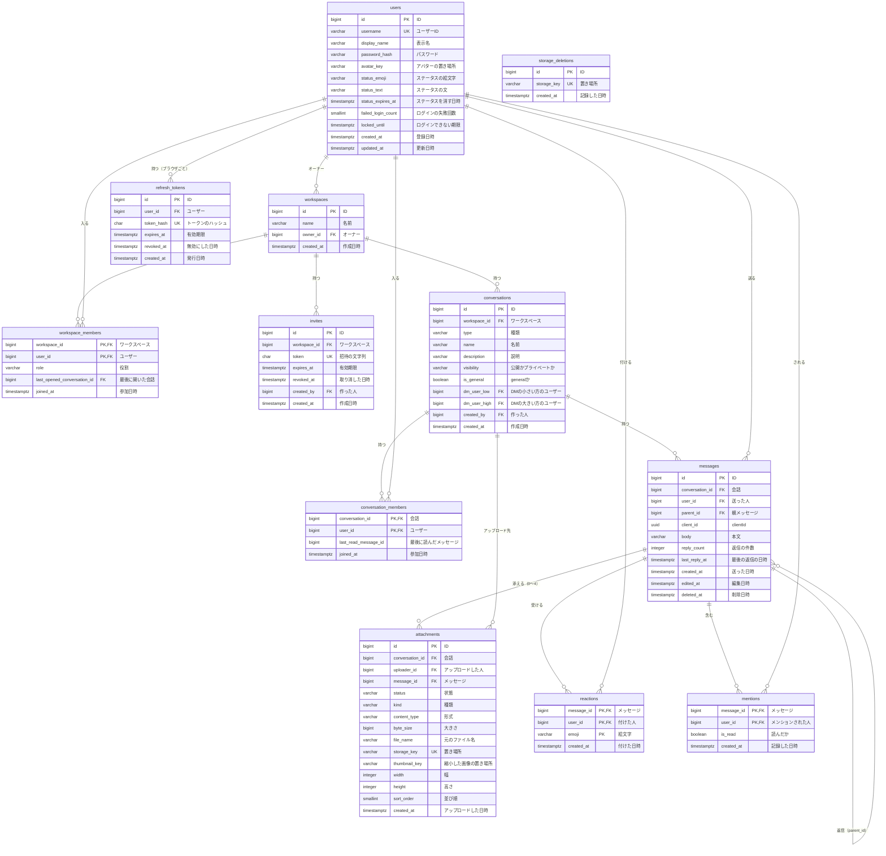

# データ設計書：チャットアプリ（RaiseChat）

| 項目 | 内容 |
| --- | --- |
| 文書番号 | RC-BD-DATA |
| 版数 | 0.1 |
| 作成日 | 2026-11-10 |
| 最終更新日 | 2026-11-10 |
| 作成者 | （氏名） |
| 上位文書 | [基本設計書](basic-design.md)（RC-BD） |
| 元にした文書 | [データ要件定義書](../requirements/data-requirements.md)（RC-REQ-DATA）版数 0.2、[機能定義書](../functions/function-definition.md)（RC-FD）版数 0.2、[技術スタック定義書](../tech-stack.md)（RC-TECH）版数 0.2 |
| 状態 | 承認待ち |

## 改訂履歴

| 版数 | 日付 | 内容 | 作成者 |
| --- | --- | --- | --- |
| 0.1 | 2026-11-10 | 初版。構成は BookLog のデータ設計書と同じにした | （氏名） |

本書は基本設計書の一部である。承認は[基本設計書](basic-design.md)で一括して行う。表記のルールは基本設計書 1.3 のとおり。

データベースは PostgreSQL（要件定義書 P-1）とし、型は PostgreSQL の型で書く。バージョンは[技術スタック定義書](../tech-stack.md)のとおり。テーブルは Flyway のマイグレーションで作る。データベースは LC_CTYPE を en_US.UTF-8 にして作る（pg_trgm が日本語を索引に入れるため。技術スタック定義書 3.3）。

---

## 1. 方針

| No | 方針 | 理由 |
| --- | --- | --- |
| 1 | 第 3 正規形を基本とする。未読の件数・メンションの件数・メンバーの人数・リアクションの件数は列に持たず、その都度数える。例外は、親メッセージの返信の件数と最後の返信の日時（reply_count・last_reply_at）と、オーナーを workspaces.owner_id と workspace_members.role の 2 か所で持つことだけとする | 同じデータを 2 か所に持たないことで、食い違いを防ぐ。返信の件数は、会話の一覧の 50 件ごとに数えると重いため、返信を足す・消すときに同じトランザクションで直す（FN-08 の 5 章の 3）。オーナーは変えないので（FN-03）、2 か所はワークスペースを作るときに 1 度だけ書き、食い違わない。owner_id は作れる数を数えるのに、role は権限の確かめに使う |
| 2 | 各データの ID は、データベースが自動で付ける連番（bigint）とする | メッセージの ID の大きさで並べ、「この ID より前・後」で読み込む（FN-07）。ID を推測されても、見られるかは毎回確かめる（BR-2）ので困らない |
| 3 | 削除は、データを実際に消す方式（物理削除）とする。ただし、返信のある親メッセージを消したときは、行を残して deleted_at を入れる | 「元に戻す」機能がないため。親メッセージはスレッドを残すために行が要る（FN-07 MS-11） |
| 4 | 日時はタイムゾーン付き（timestamptz）で保存し、画面では日本時間で出す | 海外のサーバーを使っても時刻がずれないようにするため |
| 5 | 添付・アバターのファイルは S3 に置き、データベースには置き場所（キー）だけを持つ | 要件定義書 P-2。データベースを小さく保つ |
| 6 | チャンネルと DM は、1 つの表（conversations）に種類（type）を持たせてまとめる | メッセージ・既読の位置・購読の宛先が「会話」でそろい、同じ処理で扱える（機能定義書 3.5 の ConversationSummary） |
| 7 | ワークスペースに結びつくデータは、外部キーの ON DELETE CASCADE で、ワークスペースを消すと一緒に消えるようにする。ユーザーは消さない（退会はない）ので、ユーザーへの外部キーは削除させない（RESTRICT） | ワークスペースの削除（W-6）・チャンネルの削除（CH-9）を 1 つの DELETE で漏れなく行うため |
| 8 | 「その人がその会話を見られるか」は、8.1 の 1 つの決まり（SQL）で求め、メッセージの一覧・購読・検索・メンション・未読のすべてで使う | 見られないデータが混ざらないようにするため（N-14、FN-13 の 5 章の 3） |

## 2. エンティティ一覧

| 論理名 | 物理名 | 内容 | 件数の目安 |
| --- | --- | --- | --- |
| ユーザー | users | 登録した人 | 1,000 件 |
| ワークスペース | workspaces | 仲間ごとの場 | 100 件 |
| ワークスペースのメンバー | workspace_members | 誰がどのワークスペースに入っているか | 5,000 件（測るワークスペースは 200 人） |
| 招待リンク | invites | ワークスペースに参加するためのリンク | 500 件 |
| 会話 | conversations | チャンネルと DM | 5,000 件（測るワークスペースはチャンネル 50） |
| 会話のメンバー | conversation_members | 誰がどの会話に入っているか、どこまで読んだか | 5 万件 |
| メッセージ | messages | 会話のメッセージとスレッドの返信 | 50 万件（うち返信 10 万件） |
| 添付ファイル | attachments | 画像・動画の置き場所 | 2 万件 |
| リアクション | reactions | 誰がどのメッセージにどの絵文字を付けたか | 20 万件 |
| メンション | mentions | 誰がどのメッセージでメンションされたか | 5 万件 |
| リフレッシュトークン | refresh_tokens | ログインしたままにするためのトークン（N-24） | ログインしているブラウザの数。2,000 件ほど |
| S3 から消せなかったファイル | storage_deletions | S3 から消すのに失敗したファイルの置き場所（BR-12） | ふだんは 0 件 |

件数の目安は、要件定義書 11.1 の性能を測る条件と同じにした（メンションは 10 通に 1 つとした）。

## 3. ER 図



線の記号の意味：`||` はちょうど 1、`o{` は 0 以上。messages は自分自身とつながる（返信の parent_id）。conversations は DM のとき users と 2 本の列（dm_user_low・dm_user_high）でつながる（図では省いた）。storage_deletions は、ほかの表とつながない。

## 4. テーブル定義

### 4.1 ユーザー（users）

| No | 論理名 | 物理名 | 型 | 必須 | キー | 初期値 | 説明 |
| --- | --- | --- | --- | --- | --- | --- | --- |
| 1 | ID | id | bigint | ○ | 主キー | 自動の連番 | 画面には出さない |
| 2 | ユーザー ID | username | varchar(15) | ○ | 一意（lower(username)） | | 登録したときの大文字・小文字のまま保存し、重複は小文字にして確かめる（A-2） |
| 3 | 表示名 | display_name | varchar(30) | ○ | | | |
| 4 | パスワード | password_hash | varchar(100) | ○ | | | BCrypt のハッシュ（N-18） |
| 5 | アバターの置き場所 | avatar_key | varchar(200) | | | なし | S3 のキー（avatars/{UUID}.png）。ないときはなし（PF-3） |
| 6 | ステータスの絵文字 | status_emoji | varchar(64) | | | なし | 絵文字 1 つ（FN-10 の 4 章）。ZWJ でつないだ絵文字も入る長さにする |
| 7 | ステータスの文 | status_text | varchar(100) | | | なし | |
| 8 | ステータスを消す日時 | status_expires_at | timestamptz | | | なし | 過ぎたら出さない（FN-02 の 5 章の 2） |
| 9 | ログインの失敗回数 | failed_login_count | smallint | ○ | | 0 | A-7 |
| 10 | ログインできない期限 | locked_until | timestamptz | | | なし | 5 回続けて失敗した時刻の 15 分後（A-7） |
| 11 | 登録日時 | created_at | timestamptz | ○ | | 登録した時刻 | |
| 12 | 更新日時 | updated_at | timestamptz | ○ | | 更新した時刻 | |

### 4.2 ワークスペース（workspaces）

| No | 論理名 | 物理名 | 型 | 必須 | キー | 初期値 | 説明 |
| --- | --- | --- | --- | --- | --- | --- | --- |
| 1 | ID | id | bigint | ○ | 主キー | 自動の連番 | URL（/w/{id}）に使う |
| 2 | 名前 | name | varchar(50) | ○ | | | ほかのワークスペースと同じでもよい |
| 3 | オーナー | owner_id | bigint | ○ | 外部キー（users） | | 変えない。作れる数（10 個）を数えるのに使う（BR-5） |
| 4 | 作成日時 | created_at | timestamptz | ○ | | 作った時刻 | |

### 4.3 ワークスペースのメンバー（workspace_members）

| No | 論理名 | 物理名 | 型 | 必須 | キー | 初期値 | 説明 |
| --- | --- | --- | --- | --- | --- | --- | --- |
| 1 | ワークスペース | workspace_id | bigint | ○ | 主キー、外部キー（workspaces） | | |
| 2 | ユーザー | user_id | bigint | ○ | 主キー、外部キー（users） | | |
| 3 | 役割 | role | varchar(10) | ○ | | | 'OWNER' か 'MEMBER'（CHECK 制約）。'OWNER' はワークスペースごとに 1 つ（部分一意の索引） |
| 4 | 最後に開いた会話 | last_opened_conversation_id | bigint | | 外部キー（conversations。消されたらなしにする） | なし | W-4 |
| 5 | 参加日時 | joined_at | timestamptz | ○ | | 参加した時刻 | また参加したときは新しい時刻 |

### 4.4 招待リンク（invites）

| No | 論理名 | 物理名 | 型 | 必須 | キー | 初期値 | 説明 |
| --- | --- | --- | --- | --- | --- | --- | --- |
| 1 | ID | id | bigint | ○ | 主キー | 自動の連番 | |
| 2 | ワークスペース | workspace_id | bigint | ○ | 外部キー（workspaces） | | |
| 3 | 招待の文字列 | token | char(43) | ○ | 一意 | | 32 バイトの乱数を URL で使える Base64 にしたもの（FN-04 の 5 章の 2） |
| 4 | 有効期限 | expires_at | timestamptz | ○ | | 作った時刻の 7 日後 | |
| 5 | 取り消した日時 | revoked_at | timestamptz | | | なし | |
| 6 | 作った人 | created_by | bigint | ○ | 外部キー（users） | | |
| 7 | 作成日時 | created_at | timestamptz | ○ | | 作った時刻 | |

### 4.5 会話（conversations）

| No | 論理名 | 物理名 | 型 | 必須 | キー | 初期値 | 説明 |
| --- | --- | --- | --- | --- | --- | --- | --- |
| 1 | ID | id | bigint | ○ | 主キー | 自動の連番 | URL（/w/{ws}/c/{id}・/w/{ws}/d/{id}）に使う |
| 2 | ワークスペース | workspace_id | bigint | ○ | 外部キー（workspaces） | | |
| 3 | 種類 | type | varchar(10) | ○ | | | 'CHANNEL' か 'DM'（CHECK 制約） |
| 4 | 名前 | name | varchar(80) | チャンネルは ○ | | | DM はなし。チャンネルは (workspace_id, lower(name)) で一意（部分一意の索引。type = 'CHANNEL'） |
| 5 | 説明 | description | varchar(250) | | | なし | チャンネルだけ |
| 6 | 公開かプライベートか | visibility | varchar(10) | チャンネルは ○ | | | 'PUBLIC' か 'PRIVATE'。DM はなし |
| 7 | general か | is_general | boolean | ○ | | false | true はワークスペースごとに 1 つ（部分一意の索引） |
| 8 | DM の小さい方のユーザー | dm_user_low | bigint | DM は ○ | 外部キー（users） | | DM の 2 人のうち ID の小さい方。(workspace_id, dm_user_low, dm_user_high) で一意（部分一意の索引。type = 'DM'） |
| 9 | DM の大きい方のユーザー | dm_user_high | bigint | DM は ○ | 外部キー（users） | | dm_user_low < dm_user_high（CHECK 制約） |
| 10 | 作った人 | created_by | bigint | ○ | 外部キー（users） | | DM を相手のサイドバーに出すかを決めるのにも使う（FN-12 の 5 章の 4） |
| 11 | 作成日時 | created_at | timestamptz | ○ | | 作った時刻 | |

種類ごとの列の決まり（CHECK 制約）：CHANNEL のときは name・visibility があり、dm_user_low・dm_user_high がない。DM のときはその逆で、is_general は false。

### 4.6 会話のメンバー（conversation_members）

| No | 論理名 | 物理名 | 型 | 必須 | キー | 初期値 | 説明 |
| --- | --- | --- | --- | --- | --- | --- | --- |
| 1 | 会話 | conversation_id | bigint | ○ | 主キー、外部キー（conversations） | | |
| 2 | ユーザー | user_id | bigint | ○ | 主キー、外部キー（users） | | |
| 3 | 最後に読んだメッセージ | last_read_message_id | bigint | ○ | | 参加した時点の最新のメッセージの ID（なければ 0） | 進めるだけで戻さない（FN-14 の 5 章の 3）。メッセージが消えても困らないよう、外部キーにはしない |
| 4 | 参加日時 | joined_at | timestamptz | ○ | | 参加した時刻 | |

DM の行は、ワークスペースを抜けても消さない（BR-9）。

### 4.7 メッセージ（messages）

| No | 論理名 | 物理名 | 型 | 必須 | キー | 初期値 | 説明 |
| --- | --- | --- | --- | --- | --- | --- | --- |
| 1 | ID | id | bigint | ○ | 主キー | 自動の連番 | 並び順に使う（FN-07 の 5 章の 1） |
| 2 | 会話 | conversation_id | bigint | ○ | 外部キー（conversations） | | |
| 3 | 送った人 | user_id | bigint | ○ | 外部キー（users） | | |
| 4 | 親メッセージ | parent_id | bigint | | 外部キー（messages） | なし | スレッドの返信のときだけ。親は返信でないこと（API で確かめる） |
| 5 | clientId | client_id | uuid | ○ | (user_id, client_id) で一意 | | 同じ送信を 2 回追加しない（FN-07 の 5 章の 8） |
| 6 | 本文 | body | varchar(4000) | ○ | | 空文字 | PostgreSQL の varchar の長さは文字（コードポイント）で数える。「削除されました」にしたときは空文字 |
| 7 | 返信の件数 | reply_count | integer | ○ | | 0 | 方針 1 の例外 |
| 8 | 最後の返信の日時 | last_reply_at | timestamptz | | | なし | 方針 1 の例外 |
| 9 | 送った日時 | created_at | timestamptz | ○ | | 送った時刻 | |
| 10 | 編集日時 | edited_at | timestamptz | | | なし | |
| 11 | 削除日時 | deleted_at | timestamptz | | | なし | 返信のある親メッセージを消したときだけ（方針 3） |

### 4.8 添付ファイル（attachments）

| No | 論理名 | 物理名 | 型 | 必須 | キー | 初期値 | 説明 |
| --- | --- | --- | --- | --- | --- | --- | --- |
| 1 | ID | id | bigint | ○ | 主キー | 自動の連番 | uploadId にも使う |
| 2 | 会話 | conversation_id | bigint | ○ | 外部キー（conversations） | | アップロードしたときの会話。送るメッセージと同じであること（FN-09 の 3.1） |
| 3 | アップロードした人 | uploader_id | bigint | ○ | 外部キー（users） | | |
| 4 | メッセージ | message_id | bigint | | 外部キー（messages） | なし | 送るまではなし |
| 5 | 状態 | status | varchar(10) | ○ | | 'UPLOADING' | 'UPLOADING'（PUT の URL を渡した）か 'READY'（complete で確かめた） |
| 6 | 種類 | kind | varchar(10) | ○ | | | 'IMAGE' か 'VIDEO' |
| 7 | 形式 | content_type | varchar(20) | ○ | | | image/jpeg・image/png・image/gif・image/webp・video/mp4・video/webm |
| 8 | 大きさ | byte_size | bigint | ○ | | | 画像は 10,485,760 以下、動画は 104,857,600 以下（CHECK 制約） |
| 9 | 元のファイル名 | file_name | varchar(255) | ○ | | | 表示とダウンロードの名前にだけ使う |
| 10 | 置き場所 | storage_key | varchar(200) | ○ | 一意 | | workspaces/{ws}/attachments/{UUID}（FN-09 の 5 章の 1） |
| 11 | 縮小した画像の置き場所 | thumbnail_key | varchar(200) | | | なし | 画像で、元が 800px より大きいときだけ |
| 12 | 幅・高さ | width・height | integer | | | なし | 取れたときだけ |
| 13 | 並び順 | sort_order | smallint | | | なし | 送ったときに 0〜3 を入れる。(message_id, sort_order) で一意 |
| 14 | アップロードした日時 | created_at | timestamptz | ○ | | 受け付けた時刻 | 送らなかったものを消すのに使う（BR-13） |

### 4.9 リアクション（reactions）

| No | 論理名 | 物理名 | 型 | 必須 | キー | 初期値 | 説明 |
| --- | --- | --- | --- | --- | --- | --- | --- |
| 1 | メッセージ | message_id | bigint | ○ | 主キー、外部キー（messages） | | |
| 2 | 付けた人 | user_id | bigint | ○ | 主キー、外部キー（users） | | |
| 3 | 絵文字 | emoji | varchar(64) | ○ | 主キー | | |
| 4 | 付けた日時 | created_at | timestamptz | ○ | | 付けた時刻 | 絵文字の並び順（最初に付けられた順）と、付けた人の並び順 |

### 4.10 メンション（mentions）

| No | 論理名 | 物理名 | 型 | 必須 | キー | 初期値 | 説明 |
| --- | --- | --- | --- | --- | --- | --- | --- |
| 1 | メッセージ | message_id | bigint | ○ | 主キー、外部キー（messages） | | |
| 2 | メンションされた人 | user_id | bigint | ○ | 主キー、外部キー（users） | | |
| 3 | 読んだか | is_read | boolean | ○ | | false | |
| 4 | 記録した日時 | created_at | timestamptz | ○ | | 記録した時刻 | |

### 4.11 リフレッシュトークン（refresh_tokens）

| No | 論理名 | 物理名 | 型 | 必須 | キー | 初期値 | 説明 |
| --- | --- | --- | --- | --- | --- | --- | --- |
| 1 | ID | id | bigint | ○ | 主キー | 自動の連番 | |
| 2 | ユーザー | user_id | bigint | ○ | 外部キー（users） | | |
| 3 | トークンのハッシュ | token_hash | char(64) | ○ | 一意 | | SHA-256 を 16 進で書いたもの（機能定義書 3.2） |
| 4 | 有効期限 | expires_at | timestamptz | ○ | | 発行した時刻の 14 日後 | |
| 5 | 無効にした日時 | revoked_at | timestamptz | | | なし | |
| 6 | 発行日時 | created_at | timestamptz | ○ | | 発行した時刻 | |

### 4.12 S3 から消せなかったファイル（storage_deletions）

| No | 論理名 | 物理名 | 型 | 必須 | キー | 初期値 | 説明 |
| --- | --- | --- | --- | --- | --- | --- | --- |
| 1 | ID | id | bigint | ○ | 主キー | 自動の連番 | |
| 2 | 置き場所 | storage_key | varchar(200) | ○ | 一意 | | |
| 3 | 記録した日時 | created_at | timestamptz | ○ | | 記録した時刻 | |

## 5. リレーションシップ定義

| 親 | 子 | 多重度 | 親を削除したときの子 | 説明 |
| --- | --- | --- | --- | --- |
| ワークスペース | ワークスペースのメンバー・招待リンク・会話 | 1 対 0 以上 | 一緒に削除 | W-6 |
| 会話 | 会話のメンバー・メッセージ・添付ファイル | 1 対 0 以上 | 一緒に削除 | CH-9 |
| 会話 | ワークスペースのメンバーの最後に開いた会話 | 1 対 0 以上 | なしにする（SET NULL） | W-4 |
| メッセージ | 返信（messages）・添付ファイル・リアクション・メンション | 1 対 0 以上 | 一緒に削除 | MS-11（返信のある親は行を残すので、返信は消えない） |
| ユーザー | ほかのすべての表 | 1 対 0 以上 | 削除させない（RESTRICT） | ユーザーは消さない（退会はない） |

「一緒に削除」は、外部キーの ON DELETE CASCADE で行う。S3 のファイルはデータベースでは消えないので、API が消す（BR-12）。

## 6. 索引

主キーと一意の制約には自動で索引ができる。それ以外に次の索引を作る。

| テーブル | 列 | 使う場面 |
| --- | --- | --- |
| users | lower(username) の一意の索引 | ログイン・重複の確認（A-2）、メンションの「@ユーザー ID」（FN-11） |
| workspace_members | (user_id) | 自分のワークスペースの一覧（W-1） |
| workspace_members | (last_opened_conversation_id) | 会話を削除したときになしにする（SET NULL）とき（全件を読まないため） |
| workspace_members | (workspace_id) WHERE role = 'OWNER' の一意の索引 | オーナーは 1 人 |
| workspaces | (owner_id) | 作れる数を数える（BR-5） |
| invites | (workspace_id, id DESC) | 招待リンクの一覧（I-1） |
| invites | (expires_at) | 30 日たったものをまとめて消す（BR-14） |
| conversations | (workspace_id, lower(name)) WHERE type = 'CHANNEL' の一意の索引 | 同じ名前のチャンネルを作らない（CH-2）、名前の順の一覧（CH-3） |
| conversations | (workspace_id) WHERE is_general の一意の索引 | general は 1 つ |
| conversations | (workspace_id, dm_user_low, dm_user_high) WHERE type = 'DM' の一意の索引 | 同じ 2 人の DM は 1 つ（FN-12）、自分が小さい方の DM を探す（8.1） |
| conversations | (workspace_id, dm_user_high) WHERE type = 'DM' | 自分が大きい方の DM を探す（8.1） |
| conversation_members | (user_id, conversation_id) | 自分が入っている会話（サイドバー・見られるか） |
| messages | (conversation_id, id) | 会話のメッセージの一覧（MS-1・MS-2）、未読の件数（8.2）、DM の最後のメッセージ、会話の削除で一緒に消すとき。返信を除く条件（parent_id IS NULL）は索引の外で絞る。部分索引にすると削除のときに使われないため、条件なしの索引にする |
| messages | (parent_id, id) WHERE parent_id IS NOT NULL | スレッドの返信の一覧（FN-08） |
| messages | body の GIN の索引（gin_trgm_ops） | 検索（8.3。技術スタック定義書 5.4） |
| attachments | (message_id, sort_order) の一意の索引 | メッセージの添付 |
| attachments | (conversation_id) | チャンネル・ワークスペースの削除で一緒に消すとき（全件を読まないため） |
| attachments | (created_at) WHERE message_id IS NULL | 送らなかったものをまとめて消す（BR-13） |
| reactions | (message_id, created_at) | メッセージのリアクション（RE-5） |
| mentions | (user_id, message_id DESC) | 読んでいないメンションの件数（8.2）、メンションの一覧（NT-5） |
| refresh_tokens | (user_id) | その人のリフレッシュトークンをすべて無効にする（BR-11） |
| refresh_tokens | (expires_at) | 有効期限を過ぎたものをまとめて消す（BR-11） |

## 7. データのルール

| ID | ルール | 関連要件 |
| --- | --- | --- |
| BR-1 | 文字列は前後の空白を取り除き、改行を LF にそろえてから保存する。パスワードは取り除かない | A-2、A-4、MS-4、CH-2 |
| BR-2 | 見られるかは 8.1 の決まりで求める。メッセージ・添付・リアクション・メンション・既読を扱う API と、WebSocket の購読は、毎回これを確かめ、見られなければ 404（購読は断る）にする | N-14、機能定義書 3.1 |
| BR-3 | オーナーだけの操作（招待リンク、キック、チャンネル・ワークスペースの削除、ほかの人のメッセージの削除）は、workspace_members の role が 'OWNER' かを確かめる。自分のものだけの操作（メッセージの編集、リアクションを外す、プロフィール）は、user_id が自分かを確かめる | N-16、N-17 |
| BR-4 | ワークスペースの作成では、1 つのトランザクションで workspaces・workspace_members（OWNER）・conversations（general）・conversation_members を作る | W-3 |
| BR-5 | 作れるワークスペースの数は、users の自分の行を SELECT … FOR UPDATE でロックしてから、owner_id が自分の workspaces を数えて確かめる（10 以上なら 409） | W-3、FN-03 の 5 章の 1 |
| BR-6 | 参加（招待リンク）では、workspace_members と general の conversation_members を INSERT … ON CONFLICT DO NOTHING で足し、DM の conversation_members は残っている行を使う。会話のメンバーを足すときは last_read_message_id にその会話の最新のメッセージの ID を入れる | I-5、MB-7、CH-4、CH-7 |
| BR-7 | メッセージの送信では、1 つのトランザクションで messages を足し、添付の message_id・sort_order を入れ（自分の・同じ会話の・READY の・まだ付いていないものだけ。違えば全体をやめる）、mentions を足す。返信なら親の reply_count を 1 増やし last_reply_at を入れる | MS-3、TH-3、AT-3、MN-4 |
| BR-8 | 返信の追加・削除と親の削除が同時に起きても件数が食い違わないよう、まず親の行を SELECT … FOR UPDATE でロックする。メッセージの削除では、返信のある親なら body を空にし deleted_at を入れ、attachments・reactions・mentions を消す。それ以外は行を消す。返信を消したら親の reply_count を 1 減らし、last_reply_at を残りの最後のものにする。親が deleted_at ありで reply_count が 0 になったら親も消す | MS-11、TH-7 |
| BR-9 | キック・退出では、workspace_members の行と、そのワークスペースのチャンネル（type = 'CHANNEL'）の conversation_members の行を消す。DM の conversation_members の行は消さない | MB-4、MB-5、FN-05 の 5 章の 3 |
| BR-10 | リアクションの種類の上限（50）は、messages の行を SELECT … FOR UPDATE でロックしてから、新しい絵文字のときだけ数えて確かめる | RE-7、FN-10 の 5 章の 2 |
| BR-11 | リフレッシュトークンは、登録・ログインのたびに 1 行追加する。取り直しでは、今の行の revoked_at を入れ、新しい行を追加する（1 つのトランザクション）。revoked_at が入っている行のトークンが使われたら、その user_id の有効な行をすべて無効にする。expires_at を過ぎた行は、1 日 1 回まとめて消す | A-8、N-24 |
| BR-12 | メッセージの削除・編集での添付の取り外し・チャンネルとワークスペースの削除・アバターの変更では、先にデータベースから消し、コミットの後で S3 のファイル（縮小した画像を含む）を消す。消すのに失敗したファイルは storage_deletions に記録しておき、1 日 1 回（4:30）まとめて消し直す | N-11、FN-09 の 5 章の 7 |
| BR-13 | message_id がなく、created_at から 24 時間を過ぎた attachments は、1 日 1 回（4:30）行を消し、S3 のファイルを消す（BR-12 と同じやり方） | AT-11 |
| BR-14 | 期限切れか取り消し済みで、created_at から 30 日を過ぎた invites は、1 日 1 回まとめて消す | FN-04 の 5 章の 4 |
| BR-15 | 既読の記録は last_read_message_id = GREATEST(last_read_message_id, :id) で進めるだけにする。あわせて、その会話の親メッセージ（parent_id IS NULL）のうち ID が :id 以下のものの自分あての mentions の is_read を true にする（読んだ位置より後のメンションは既読にしない）。スレッドを開いたとき（POST /api/messages/{親の ID}/thread-read）は、そのスレッドの返信（parent_id = 親の ID）の自分あての mentions の is_read を true にする | NT-4、FN-14 の 5 章の 3 |
| BR-16 | ログインに失敗したら failed_login_count を 1 増やし、5 になったら locked_until を 15 分後にし、failed_login_count を 0 に戻す。locked_until より前はパスワードを確かめずに M-7 を返す。成功したら 0 に戻す | A-7 |

## 8. 特別な SQL

### 8.1 見られる会話（BR-2）

```sql
-- :me はログインした人の ID、:ws はワークスペースの ID
SELECT c.id
FROM conversations c
WHERE c.workspace_id = :ws
  AND EXISTS (SELECT 1 FROM workspace_members wm
              WHERE wm.workspace_id = c.workspace_id AND wm.user_id = :me)
  AND (
        (c.type = 'CHANNEL' AND c.visibility = 'PUBLIC')
     OR (c.type = 'CHANNEL' AND c.visibility = 'PRIVATE'
         AND EXISTS (SELECT 1 FROM conversation_members cm
                     WHERE cm.conversation_id = c.id AND cm.user_id = :me))
     OR (c.type = 'DM' AND :me IN (c.dm_user_low, c.dm_user_high))
  );
```

1 つの会話を確かめるときは、c.id = :conversationId を足す。DM は「2 人のうちの 1 人で、いまワークスペースのメンバー」で見られる（データ要件定義書 5.2）。送れるか（canPost）は、チャンネルなら conversation_members に自分の行があること、DM なら相手も workspace_members にいることで決める。

### 8.2 サイドバーの未読・メンションの件数（NT-1・NT-2）

```sql
-- キック・退出した人の DM の行が残っているため（BR-9）、workspace_members でいまのメンバーかを確かめる（8.1 と同じ条件）
-- 自分が入っている会話ごとの未読の件数（100 件で数えるのをやめる）と、読んでいないメンションの件数
SELECT cm.conversation_id,
       (SELECT count(*) FROM (
            SELECT 1 FROM messages m
            WHERE m.conversation_id = cm.conversation_id
              AND m.parent_id IS NULL
              AND m.deleted_at IS NULL
              AND m.id > cm.last_read_message_id
              AND m.user_id <> :me
            LIMIT 100) u) AS unread_count,
       (SELECT count(*) FROM mentions mn
            JOIN messages m ON m.id = mn.message_id
            WHERE mn.user_id = :me AND NOT mn.is_read
              AND m.conversation_id = cm.conversation_id) AS mention_count
FROM conversation_members cm
JOIN conversations c ON c.id = cm.conversation_id
JOIN workspace_members wm ON wm.workspace_id = c.workspace_id AND wm.user_id = :me  -- いまのメンバーだけ（BR-2）
WHERE cm.user_id = :me AND c.workspace_id = :ws;
```

参加していない公開チャンネルの読んでいないメンション（FN-14 の 5 章の 4）は、別に mentions から 8.1 の見られる会話に絞って数え、ヘッダーの合計に足す。DM のうち、相手が作ってまだメッセージのないもの（FN-12 の 5 章の 4）は、サイドバーに出さない。

### 8.3 検索（FN-13）

```sql
-- :visible は 8.1 で求めた会話の ID の並び。:w1, :w2 … は空白で区切った言葉（% と _ はエスケープ済み）
SELECT m.*
FROM messages m
WHERE m.conversation_id = ANY(:visible)
  AND m.deleted_at IS NULL
  AND m.body ILIKE '%' || :w1 || '%'
  AND m.body ILIKE '%' || :w2 || '%'
  AND m.id < :cursor  -- 最初のページは bigint の最大値
ORDER BY m.id DESC
LIMIT 21;  -- 21 件目は「続きがあるか」を知るため
```

検索の対象には、スレッドの返信も含む（FN-13 SR-2。parent_id で絞らない）。言葉の中の % と _ と \ は、\ を前に付けてただの文字にしてから渡す（FN-13 の 5 章の 2）。3 文字以上の言葉は、body の GIN の索引（gin_trgm_ops）で探せる。1〜2 文字の言葉だけのときは索引が効かないため、性能テストで N-5 を確かめる（基本設計書 2.4）。日本語の言葉で索引が使われることは、API のテストで実行計画（EXPLAIN）を見て確かめる。

## 9. CRUD 表

C ＝ 作成、R ＝ 読み取り、U ＝ 更新、D ＝ 削除。表の名前は略す：ws（workspaces）、wm（workspace_members）、inv（invites）、conv（conversations）、cm（conversation_members）、msg（messages）、att（attachments）、rea（reactions）、men（mentions）、rt（refresh_tokens）、del（storage_deletions）。

| 機能 | 要件 | users | ws | wm | inv | conv | cm | msg | att | rea | men | rt | del | S3 |
| --- | --- | --- | --- | --- | --- | --- | --- | --- | --- | --- | --- | --- | --- | --- |
| ユーザー登録・ログイン・取り直し・ログアウト | A-1〜A-10 | C R U | | | | | | | | | | C R U | | |
| プロフィール | PF-1〜PF-9 | R U | | R | | | | | | | | | C | C R D |
| ワークスペースの作成・一覧 | W-1〜W-5 | R | C R | C R | | C | C R | R | | | R | | | |
| ワークスペースの削除 | W-6・W-7 | | R D | R D | D | D | D | D | R D | D | D | | C | D |
| 招待 | I-1〜I-9 | R | R | C R | C R U D | R | C R | R | | | | | | |
| メンバー管理（キック・退出） | MB-1〜MB-8 | R | R | R D | | R | D | | | | | | | |
| チャンネル | CH-1〜CH-13 | R | | R | | C R D | C R D | R D | R D | D | D | | C | D |
| メッセージ | MS-1〜MS-16 | R | | R | | R | R | C R U D | R U D | R D | C R D | | C | R D |
| スレッド | TH-1〜TH-8 | R | | R | | R | R | C R U D | R U D | R D | C R D | | C | R D |
| 添付 | AT-1〜AT-11 | | | R | | R | R | R | C R U D | | | | C | C R D |
| リアクション | RE-1〜RE-7 | R | | R | | R | R | R U | | C R D | | | | |
| メンション | MN-1〜MN-7 | R | | R | | R | R | R | | | C R D | | | |
| DM | DM-1〜DM-7 | R | | R | | C R | C R | R | | | | | | |
| 検索 | SR-1〜SR-8 | R | | R | | R | R | R | R | R | R | | | R |
| 通知 | NT-1〜NT-11 | | R | R U | | R | R U | R | | | R U | | | |

S3 の R は、署名付き URL を発行すること（添付の C は署名付きの PUT の URL を発行し、complete で読んで縮小した画像を置くこと）を表す。1 日 1 回の処理（4:30）で、有効期限を過ぎた refresh_tokens（BR-11）、30 日を過ぎた invites（BR-14）、送らなかった attachments（BR-13）を D し、storage_deletions のファイルを S3 から消し直して、消せた行を D する。

## 10. データ量の見積もり

日本語 1 文字を 3 バイトとして、2 章の件数で計算する。本文は、上限ではなく平均の長さ（50 文字）で計算した。

| 対象 | 計算 | 量 |
| --- | --- | --- |
| メッセージ | 50 万件 ×（本文 50 文字 × 3 ＋ その他 約 100） | 約 125MB |
| メッセージの検索の索引（pg_trgm） | 本文の量の 2〜3 倍 | 約 300MB |
| リアクション・メンション・会話のメンバー | 30 万件 × 約 60 | 約 18MB |
| 添付ファイルの行 | 2 万件 × 約 300 | 約 6MB |
| ユーザー・ワークスペース・会話・招待・リフレッシュトークンなど | 2 万件 × 約 200 | 約 4MB |
| そのほかの索引 | 表の量と同じくらい | 約 150MB |
| データベース全体 | | 約 600MB |
| S3 の添付（実際に使ったとき） | 数十人が使う場合、画像 1,000 枚 × 平均 2MB ＋ 動画 50 本 × 平均 30MB | 約 3.5GB |

RDS の容量は最小の 20GB で足りる。性能テストの添付 2 万件は、行だけを入れて、ファイルは同じ小さなファイルを指すようにする（S3 の費用を増やさないため）。S3 の費用はインフラ設計書 7 章。
