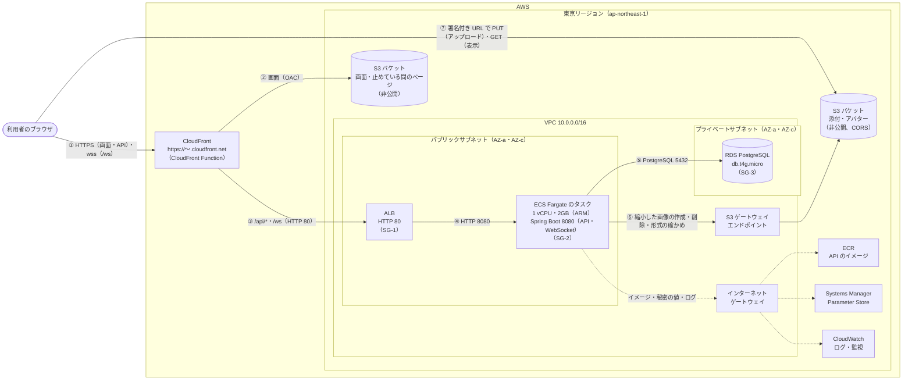
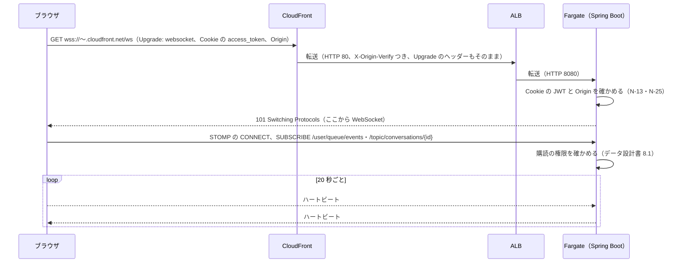
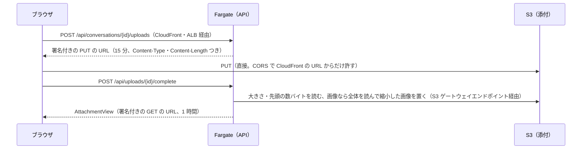

# インフラ設計書：チャットアプリ（RaiseChat）

| 項目 | 内容 |
| --- | --- |
| 文書番号 | RC-BD-INFRA |
| 版数 | 0.1 |
| 作成日 | 2026-11-10 |
| 最終更新日 | 2026-11-10 |
| 作成者 | （氏名） |
| 上位文書 | [基本設計書](basic-design.md)（RC-BD） |
| 元にした文書 | [要件定義書](../requirements/requirements.md)（RC-REQ）版数 0.6、[技術スタック定義書](../tech-stack.md)（RC-TECH）版数 0.1 |
| 状態 | 承認待ち |

## 改訂履歴

| 版数 | 日付 | 内容 | 作成者 |
| --- | --- | --- | --- |
| 0.1 | 2026-11-10 | 初版。BookLog のインフラ設計書を元にし、WebSocket の通り道、S3 への直接のアップロード、タスクの大きさと入れ替え方を変えた | （氏名） |

本書は基本設計書の一部である。承認は[基本設計書](basic-design.md)で一括して行う。表記のルールは基本設計書 1.3 のとおり。

公開は検収のときだけ環境を作って行い、使わない間は止め、検収が終わったら環境を消す（要件定義書 P-5）。本書は、公開するときの構成を決めておくものである。

---

## 1. 方針

| No | 方針 | 理由 |
| --- | --- | --- |
| 1 | CloudFront（入口）→ ALB（ロードバランサー）→ ECS Fargate（API のコンテナ）→ RDS（データベース）の構成にし、画面と添付は S3 に置く | 要件定義書 P-4。BookLog と同じ構成で、作り方と手順をそのまま使う |
| 2 | 画面（React をビルドしたファイル）は S3 に置き、CloudFront から配る。API・WebSocket と同じ CloudFront の URL にし、/api/*・/ws・/actuator/* だけを ALB に送る | 画面の配信に API のサーバーを使わない。同じ URL なので、JWT を入れる Cookie と CSRF 対策・WebSocket の Origin の確かめが開発中と同じに動く |
| 3 | WebSocket（/ws）も CloudFront と ALB を通す。CloudFront で wss（HTTPS の上の WebSocket）を受け、ALB からは ws（HTTP の上）で送る | CloudFront と ALB は WebSocket を中継できる（技術スタック定義書 3.5）。入口を 1 つにでき、N-12 の wss を CloudFront の証明書で満たせる |
| 4 | API は ECS Fargate で動かす。サーバー（EC2）は自分で持たない。タスクは 1 つだけにする | 要件定義書 P-4。WebSocket の通知の配信（Spring の simple broker）はタスクのメモリの中にあり、タスクが 2 つになると、片方につないだ人にはもう片方の通知が届かないため |
| 5 | Fargate の前に ALB を置く。HTTPS は CloudFront で受け、CloudFront → ALB は HTTP にする | タスクは作り直すたびに IP が変わるので、ALB で受け止めてヘルスチェックに通ったタスクにだけ送る。独自ドメインがないため ALB に証明書を付けられず、HTTPS は CloudFront の https://〜.cloudfront.net で受ける（N-12） |
| 6 | ALB は CloudFront からの通信だけを受け、さらに CloudFront が付ける秘密のヘッダー（X-Origin-Verify）がなければ 403 を返す | セキュリティグループだけでは、ほかの人の CloudFront を通した通信も届いてしまうため |
| 7 | Fargate のタスクはパブリックサブネットに置き、パブリック IP を付けるが、ALB からの通信しか受け付けない（SG-2） | タスクから ECR・Parameter Store・CloudWatch Logs に出る必要がある。プライベートサブネットに置くと NAT ゲートウェイ（月 7,000 円ほど）が要る。BookLog と同じ |
| 8 | RDS はプライベートサブネットに置き、Fargate のタスクからしか接続できないようにする。Multi-AZ にはしない | データベースは外から見えないのが基本。Multi-AZ は費用が 2 倍になり、学習用には要らない |
| 9 | 添付の S3 のバケットは非公開にし、アップロードは署名付きの PUT の URL で、表示は署名付きの GET の URL で、ブラウザが S3 と直接やり取りする | 要件定義書 N-20、機能定義書 FN-09。100MB の動画を API・ALB・CloudFront に通さないので、タスクの負荷と通信の費用を抑えられる |
| 10 | 新しいタスクに入れ替えるときは、古いタスクを止めてから新しいタスクを起動する（同時に 2 つ動かさない） | 方針 4。入れ替えの間（1〜2 分）は使えず、WebSocket も切れるが、画面がつなぎ直して取り直す（N-9、要件定義書 R-7）。公開は検収のときだけなので、この短い停止は受け入れる |
| 11 | 使わない間は、ECS のサービスと ALB を消し、RDS を止める。CloudFront は消さずに、止めている間は「止めています」のページを出す | 要件定義書 P-5。ALB は止められず、置いておくだけで月 約 3,500 円かかる（7 章）。CloudFront を消すと、作り直したときに URL が変わってしまう |

## 2. 構成図

| 番号 | 通信 | 内容 |
| --- | --- | --- |
| ① | ブラウザ → CloudFront | 画面（HTML・JS）・API（HTTPS）と WebSocket（wss）。HTTP（80）で来たら HTTPS（443）に移す。証明書は CloudFront のもの（*.cloudfront.net）を使う |
| ② | CloudFront → S3（画面） | /api/*・/ws・/actuator/* 以外。S3 は CloudFront からだけ読める（OAC）。画面の URL（/w/1/c/2 など）は CloudFront Function が index.html に書き換える（5.4） |
| ③ | CloudFront → ALB | /api/*・/ws・/actuator/*。HTTPS・wss を解いて、HTTP の 80 で ALB に送る。秘密のヘッダー X-Origin-Verify を付ける。WebSocket のつなぎ始め（Upgrade）に要るヘッダーもそのまま渡す |
| ④ | ALB → Fargate | HTTP の 8080。WebSocket もそのまま中継する。ALB はヘルスチェック（/actuator/health）に通ったタスクにだけ送る |
| ⑤ | Fargate → RDS | PostgreSQL の 5432。VPC の中だけで通る |
| ⑥ | Fargate → S3（添付） | アップロードの完了の確かめ（大きさ・先頭の数バイト）、縮小した画像・アバターの保存、削除。S3 ゲートウェイエンドポイントを通るので、インターネットに出ない |
| ⑦ | ブラウザ → S3（添付） | API が発行した署名付きの PUT の URL（15 分）でアップロードし、署名付きの GET の URL（1 時間）で表示・ダウンロードする。PUT はブラウザから別のサイト（S3）への送信になるため、バケットに CORS を設定する（3.2） |

タスクは、起動するときに ECR からイメージを、Parameter Store から秘密の値を取り、動いている間は CloudWatch Logs にログを送る。どれもパブリック IP を使ってインターネット経由で通る（方針 7）。

## 3. リソース一覧

Terraform（deploy/terraform/）で作る。名前の頭は「rc-」にする。

### 3.1 ネットワーク

| リソース | 名前 | 設定 |
| --- | --- | --- |
| VPC | rc-vpc | 10.0.0.0/16 |
| パブリックサブネット | rc-public-a / rc-public-c | 10.0.0.0/24（AZ-a）、10.0.1.0/24（AZ-c）。ALB は 2 つの AZ が必要。Fargate のタスクもここに置く |
| プライベートサブネット | rc-private-a / rc-private-c | 10.0.10.0/24（AZ-a）、10.0.11.0/24（AZ-c）。RDS のサブネットグループは 2 つの AZ が必要。インターネットには出ない |
| インターネットゲートウェイ | rc-igw | パブリックサブネットのルートに付ける |
| S3 ゲートウェイエンドポイント | rc-s3-endpoint | パブリック・プライベート両方のルートに付ける（無料） |

### 3.2 入口・API・データベース・ストレージ

| リソース | 名前 | 設定 |
| --- | --- | --- |
| CloudFront | raisechat | 価格クラスは PriceClass_200（日本を含む）。ビューワーは HTTPS に移す。既定は画面のバケット（OAC、CachingOptimized）。`/api/*`・`/ws`・`/actuator/*` は ALB の HTTP 80 へ、キャッシュしない（CachingDisabled）・すべてのメソッド・Cookie とクエリとヘッダーをすべて渡す（AllViewer。WebSocket のつなぎ始めのヘッダーも渡る）。止めている間は ALB へのビヘイビアをなくし、すべてのパスで止めている間のページを返す |
| CloudFront Function | rc-router | 動いている間は画面の URL を index.html に、止めている間はすべてを maintenance/index.html に書き換える（5.4） |
| ALB | rc-alb | インターネット向け、パブリックサブネット a・c、HTTP 80。X-Origin-Verify が合うときだけターゲットグループ rc-app（IP、8080、ヘルスチェック /actuator/health）に送り、ほかは 403。アイドルタイムアウトは 60 秒のまま（WebSocket は 20 秒ごとのハートビートで切れない。機能定義書 4.1）。止めている間は消す |
| ECR | rc-app | API のイメージ。タグはコミット ID で上書きさせない（IMMUTABLE）。push したときに脆弱性を検査する。新しいものから 10 個だけ残す |
| ECS クラスター | rc-cluster | Fargate。Container Insights は使わない（費用がかかるため） |
| ECS タスク定義 | rc-app | Fargate、ARM64（Graviton）、1 vCPU・メモリ 2GB（技術スタック定義書 3.5）。環境変数で DB の接続先・Cookie の Secure・画面の URL（WebSocket の Origin と S3 の CORS に使う）・バケット名を、Parameter Store から DB のパスワード・JWT の秘密の値を渡す。ログは CloudWatch Logs の /rc/app へ。止めている間は消す |
| ECS サービス | rc-app | タスクは 1 つ（方針 4）。入れ替えでは最小の健全な割合 0%・最大 100%（古いタスクを止めてから起動。方針 10）。パブリック IP あり。起動から 180 秒はヘルスチェックの失敗で止めない。新しいタスクが起動しなければ前のタスク定義に戻す（デプロイのサーキットブレーカー）。止めている間は消す |
| RDS | rc-db | PostgreSQL 17、db.t4g.micro、gp3 20GB、Single-AZ、パブリックアクセスなし、自動バックアップ 1 日（N-10。無料プランの上限。有料プランにしたら 7 日にする）、保存時の暗号化あり、削除保護あり、消すときは最後のスナップショットを取る。データベースの LC_CTYPE は en_US.UTF-8（データ設計書の冒頭） |
| S3 バケット（画面） | rc-web-{アカウント ID} | パブリックアクセスをすべてブロック、SSE-S3。画面のファイルと、止めている間のページ（maintenance/）を置く。CloudFront だけが読める（OAC） |
| S3 バケット（添付） | rc-files-{アカウント ID} | パブリックアクセスをすべてブロック、SSE-S3、バージョニングなし。添付を workspaces/{ws}/attachments/ の下に、アバターを avatars/ の下に置く。CORS：送り元は CloudFront の URL だけ、メソッドは PUT、ヘッダーは Content-Type、キャッシュは 1 時間。アップロードが終わらなかった分割アップロードを 1 日で消すライフサイクルの規則を付ける |

### 3.3 権限・秘密の値・監視

| リソース | 名前 | 設定 |
| --- | --- | --- |
| IAM ロール（タスクの実行） | rc-task-execution | ECS がタスクを起動するときに使う。AmazonECSTaskExecutionRolePolicy と、Parameter Store の /rc/db/password・/rc/jwt/secret の読み取り |
| IAM ロール（タスク） | rc-app | アプリ（AWS SDK）が使う。S3：rc-files-{アカウント ID} の workspaces/*・avatars/* への PutObject・GetObject・DeleteObject のみ。署名付き URL もこのロールで署名する（ロールの一時的な鍵の期限より URL の期限（最長 1 時間）が短いので困らない） |
| Parameter Store | /rc/db/password、/rc/jwt/secret | データベースのパスワード、JWT の署名に使う秘密の値（48 文字の乱数）。Terraform が作り、SecureString で置く |
| CloudWatch Logs | /rc/app | Spring Boot のログ（JSON。基本設計書 2.3）。30 日で消す |
| CloudWatch アラーム | rc-no-healthy-task、rc-api-5xx、rc-db-free-storage | ALB のヘルスチェックに通るタスクが 3 分続けてない、API の 5xx が 5 分で 10 回以上（この 2 つは動いている間だけ作る）、RDS の空き容量 2GB 未満で、SNS（rc-alerts）からメールを送る |
| AWS Budgets | rc-budget | 月の費用が予算（R-1。67 ドル ≒ 10,000 円）の 80% を超えたとき、月末の予測が予算を超えそうなときにメールを送る |

Terraform の状態ファイル（DB のパスワードなどの秘密の値も入る）は手元に置き、リポジトリには入れない。

## 4. セキュリティグループ（通信の許可）

| ID | 付ける先 | 受け付ける通信 | 送り元 | 外へ出る通信 | 理由 |
| --- | --- | --- | --- | --- | --- |
| SG-1 | ALB | TCP 80 | CloudFront のみ（AWS が管理するプレフィックスリスト com.amazonaws.global.cloudfront.origin-facing） | SG-2 の 8080 だけ | CloudFront を通らない通信を受けない。さらに秘密のヘッダーで確かめる（方針 6） |
| SG-2 | Fargate のタスク | TCP 8080 | SG-1 のみ | HTTPS の 443（ECR・Parameter Store・CloudWatch Logs・S3。宛先の IP が決まらないので宛先は絞らない）と、SG-3 への 5432 だけ | ALB を通らない通信を受けない（方針 7） |
| SG-3 | RDS | TCP 5432 | SG-2 のみ | なし | Fargate のタスクからしか接続させない |

## 5. 処理の流れ

### 5.1 WebSocket でつなぐ

### 5.2 添付のアップロード

### 5.3 公開の手順（概要）

1. API：手元で `mvnw package` で jar を作り、`docker buildx build --platform linux/arm64` でイメージを作って、コミット ID をタグにして ECR に push する
2. `terraform apply -var running=true` で、そのイメージを使う新しいタスク定義を作る。ECS が古いタスクを止めて新しいタスクを起動し、ALB のヘルスチェックに通ったら使えるようになる（方針 10。Flyway が起動時にテーブルを更新する）
3. 画面：frontend で `npm run build` して、できたファイルを画面のバケットに置き、index.html の CloudFront のキャッシュを消す
4. CloudFront の URL の /actuator/health が正常（200）になったこと、2 つのブラウザでメッセージがすぐ届くこと、画像を添付できることを確かめる

詳しい手順は運用設計（基本設計書 2.2）で決める。BookLog の deploy.sh・start.sh・stop.sh と同じ形のスクリプトにする。

### 5.4 画面の配り方

BookLog と同じにする。

| パス | 返すもの | Cache-Control | 理由 |
| --- | --- | --- | --- |
| /assets/… | Vite がビルドした JS・CSS、絵文字のデータ | max-age=31536000, public, immutable（1 年） | ファイル名に中身のハッシュが付き、中身が変われば URL も変わる |
| /w/1/c/2 などの画面の URL（最後の部分に拡張子がない） | index.html（CloudFront Function が書き換える） | no-cache | 直接開いたり読み直したりしても、画面（React Router）に任せる |
| /api/…・/ws | API・WebSocket（ないものは JSON の 404） | | ALB へ送るので index.html を返さない |
| /actuator/… | 稼働の確認 | | 同上 |
| 拡張子があってファイルがない | 403（S3 が返す） | | 同上 |

CloudFront のエラーページの設定（403・404 のときに index.html を返す）は使わない。API の 403・404 まで index.html になってしまうため。

## 6. 開発環境との対応

開発中は、添付の保存先のほかは AWS を使わず、手元の Docker Compose で同じ役割のものを動かす。ポートは CLAUDE.md の「サーバーのポート」のとおり。

| 役割 | 開発環境 | 自動のテスト | AWS |
| --- | --- | --- | --- |
| 入口 | なし（ブラウザから直接） | なし | CloudFront（443）→ ALB（80） |
| 画面 | Vite の開発サーバー（5173）。/api と /ws は 8080 に転送する（WebSocket の転送も有効にする） | Vitest（jsdom）。E2E は jar に入れた画面 | S3（rc-web-{アカウント ID}）のファイルを CloudFront が配る |
| API・WebSocket | Spring Boot（8080。mvnw spring-boot:run） | Spring Boot（テストの中、E2E は jar） | ECS Fargate のタスク（8080） |
| データベース | PostgreSQL のコンテナ（5432） | Testcontainers の PostgreSQL | RDS（5432） |
| 添付の保存先 | S3 の開発用のバケット（rc-files-dev-{アカウント ID}）。鍵は手元の ~/.aws/credentials。CORS の送り元は http://localhost:5173 | Testcontainers の MinIO（chainguard/minio）。E2E ではブラウザから MinIO に直接 PUT する | S3（rc-files-{アカウント ID}）。鍵はタスクロール |
| 秘密の値 | .env ファイル（リポジトリには入れない） | テストの中で決めた値 | Parameter Store |

アプリは接続先（データベースの URL、S3 のバケット名、テストのときだけ S3 のエンドポイント、画面の URL）を環境変数で受け取り、開発環境と AWS でコードを変えない（N-34）。WebSocket の Origin の確かめと S3 の CORS は、どちらも「画面の URL」の環境変数で決める。

## 7. 費用の目安

東京リージョンで、1 か月（730 時間）動かし続けた場合の概算である。1 ドル 150 円で計算した。単価は BookLog で 2026-11-07 に確かめたもの（BookLog の技術スタック定義書 6 章）を使った。構築の前に料金を確かめ直し、結果を技術スタック定義書 6 章に記録する。

| サービス | 内容 | 月額（概算） |
| --- | --- | --- |
| CloudFront | 少ない通信量（ずっと無料の枠：毎月 1TB・1,000 万リクエストまで）、CloudFront Function。添付は CloudFront を通らない | 0 円 |
| ALB | 時間あたりの料金（0.0243 ドル）＋ 少ない LCU。WebSocket の接続は数十本で、LCU はほとんど増えない | 約 3,500 円 |
| ECS Fargate | ARM・1 vCPU（0.04045 ドル／時）・2GB（0.00442 ドル／GB・時）を 1 つ | 約 5,400 円 |
| パブリック IPv4 | ALB の 2 つ ＋ タスクの 1 つ（1 つ 1 時間 0.005 ドル） | 約 1,600 円 |
| RDS | db.t4g.micro（0.025 ドル／時）＋ gp3 20GB ＋ バックアップ | 約 3,200 円 |
| S3（添付） | 3.5GB（データ設計書 10 章）＋ ブラウザへの読み出し（数十人で月 数十 GB）。S3 からインターネットへの転送は 1GB あたり約 0.114 ドル | 約 600 円 |
| S3（画面）・ECR | 画面のファイル、イメージ 10 個 | 約 200 円 |
| CloudWatch・Parameter Store | 少ない量 | 約 100 円 |
| 合計 | | 約 14,600 円 |

動かし続けると、R-1 の予算（月 10,000 円）を超える。そのため、公開は検収の期間だけにし、その間も使わない時間は止める（方針 11）。たとえば検収の 7 日間に 1 日 8 時間だけ動かすと、ALB・Fargate・パブリック IP・RDS の時間の分が 約 1,000 円になる。動画を多く見ると S3 からの転送の費用が増えるので、AWS Budgets のメールで気づけるようにする（R-1）。

止めている間の費用：ECS のサービスと ALB は消すので、かからない。RDS はストレージの分（約 500 円／月）だけかかる。S3・ECR は置いている量の分（約 300 円／月）かかる。RDS は止めても 7 日たつと自動で起動するため、長く止めるときは、スナップショットを取ってから消す。検収が終わったら、すべて消す（P-5）。

公開に使う AWS アカウントが無料プランのときは、費用はクレジットから引かれる。無料プランの上限のため、RDS の自動バックアップは 1 日分にする（3.2）。

## 8. 構築の方法

AWS のリソースは、手作業ではなく Terraform で作る。BookLog の deploy/terraform と同じ書き方・同じバージョンにする（Terraform 1.16.5、AWS プロバイダー 6.68.0、TFLint。[技術スタック定義書](../tech-stack.md) 3.5）。

| 項目 | 内容 |
| --- | --- |
| 置き場所 | deploy/terraform/（止めている間のページは deploy/maintenance/） |
| 起動・停止 | 変数 running で切り替える。running = false にすると、CloudFront をすべて止めている間のページにしてから、ECS のサービス・タスク定義・ALB・ALB のアラームを消す。running = true にすると作り直す。RDS の停止・起動はスクリプトで AWS CLI から行う |
| 手で作るもの | なし（BookLog の Google Books API の API キーにあたるものはない） |
| CI | GitHub Actions で terraform fmt -check・terraform validate・tflint を動かし、jar からイメージが作れることを確かめる。plan・apply は手元で行う |

## 9. 未決事項

| No | 内容 | 関係する要件 |
| --- | --- | --- |
| 1 | （決定）独自ドメインは取らず、CloudFront の URL で公開する（BookLog と同じ） | P-4、N-12 |
| 2 | （決定）API のタスクは 1 つで、入れ替えのときは短く止める（方針 4・10）。2026-11-10 に決めた | P-4、R-7 |
| 3 | タスクの大きさ（1 vCPU・2GB）で足りるか。性能テスト（基本設計書 2.4）で、画像の縮小と 50 人の WebSocket の接続を同時に行って確かめる | 技術スタック定義書 3.5、N-1〜N-7 |
