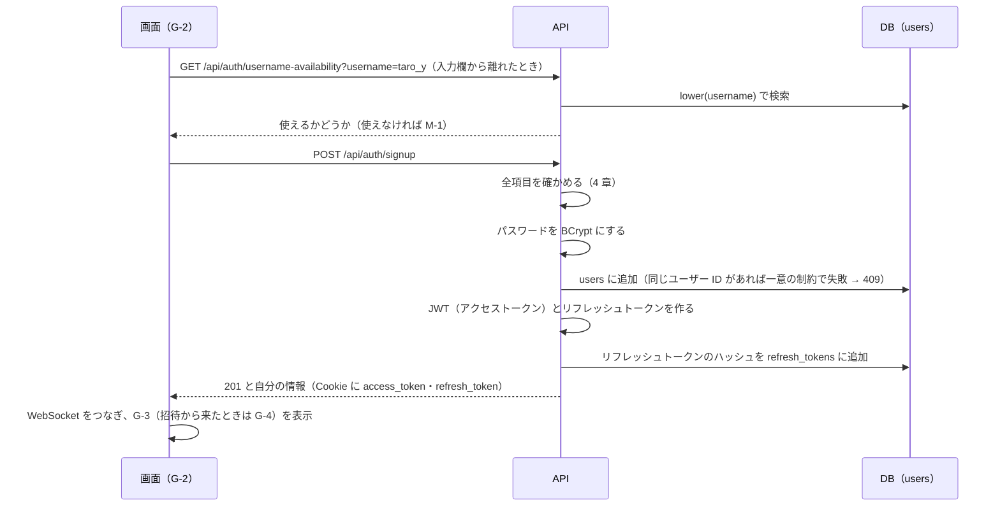
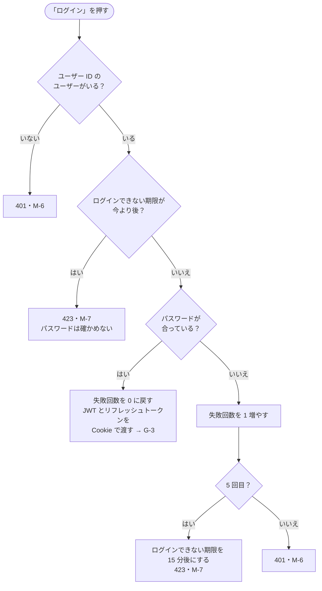
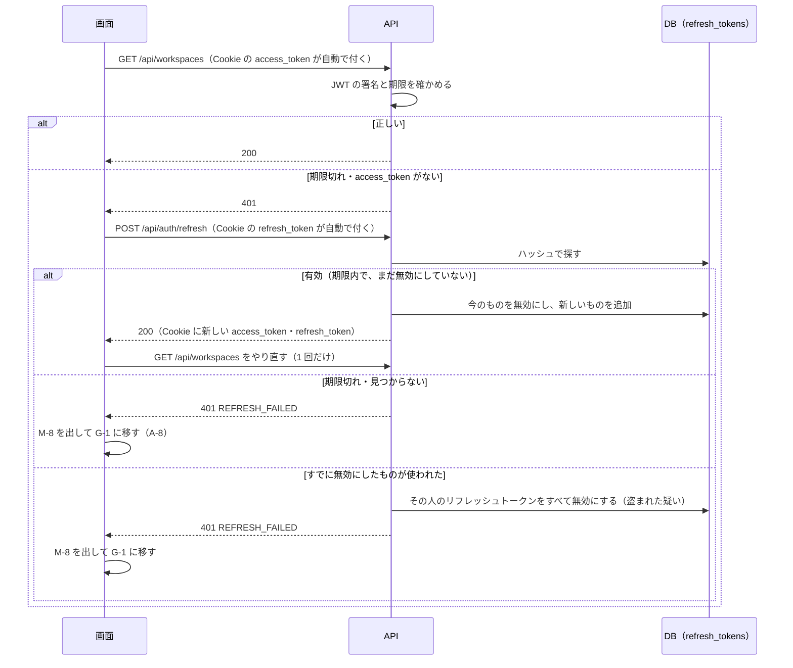
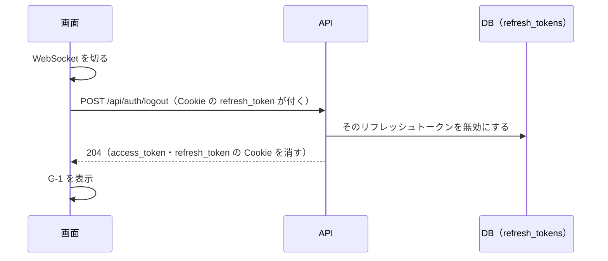

# 機能定義書 FN-01 ユーザー登録・ログイン：チャットアプリ（RaiseChat）

| 項目 | 内容 |
| --- | --- |
| 文書番号 | RC-FD-01 |
| 版数 | 0.1 |
| 作成日 | 2026-11-10 |
| 最終更新日 | 2026-11-10 |
| 作成者 | （氏名） |
| 上位文書 | [機能定義書](function-definition.md)（RC-FD） |
| 状態 | 承認待ち |

## 改訂履歴

| 版数 | 日付 | 内容 | 作成者 |
| --- | --- | --- | --- |
| 0.1 | 2026-11-10 | 初版 | （氏名） |

本書は機能定義書の一部である。承認は[機能定義書](function-definition.md)で一括して行う。API・リアルタイムの通知・メッセージの共通の決まりは機能定義書 3 章〜5 章のとおり。

---

## 1. 概要

| 項目 | 内容 |
| --- | --- |
| 目的 | 誰でもアカウントを作れるようにし、ログインした人だけがアプリを使えるようにする |
| 使う画面 | G-1 ログイン画面、G-2 ユーザー登録画面、全画面のヘッダー（ログアウト） |
| 関係する機能 | すべての機能（ログインしていないと使えない）。FN-04 招待（招待リンクから来た人は、ログイン・登録の後に G-4 に戻る） |
| 前提 | メールアドレスは使わない。パスワードを忘れた場合は作り直す。退会はない（要件定義書 2.2） |

## 2. 機能要件

| ID | 内容 |
| --- | --- |
| A-1 | ユーザー登録画面（G-2）でユーザー ID・表示名・パスワード・パスワード（確認）を入力して「登録する」を押すと、アカウントを作り、ログインした状態でワークスペースの一覧（G-3）を表示する |
| A-2 | ユーザー ID はトリムした後で 3〜15 文字の半角英数字と「_」とする。英字の大文字・小文字は区別せず、ほかのユーザーと同じものは使えない。条件に合わないときは M-2、使われているときは M-1 を表示する。登録した後は変えられない |
| A-3 | パスワードは 8〜64 文字の半角文字（英字・数字・記号・空白）で、英字と数字を両方含むものとする。条件に合わないときは M-3、パスワード（確認）と一致しないときは M-4 を表示する |
| A-4 | 表示名はトリムした後で 1〜30 文字とする。31 文字目以降は入力できない。0 文字のときは M-5 を表示する |
| A-5 | ログイン画面（G-1）でユーザー ID とパスワードを入力して「ログイン」を押すと、G-3 を表示する。ユーザー ID の英字の大文字・小文字は区別しない |
| A-6 | ユーザー ID がない・パスワードが違うときは、どちらの場合も M-6 を表示する。どちらが違うかは示さない（N-19） |
| A-7 | 同じユーザー ID で 5 回続けてログインに失敗したら、15 分間そのユーザー ID ではログインできないようにし、M-7 を表示する。ログインに成功したら失敗の回数を 0 に戻す |
| A-8 | 一度ログインすると、最後に操作してから 14 日間は、ブラウザを閉じて開き直してもログインしたままになる。14 日を過ぎて操作したときは M-8 を表示して G-1 に移す |
| A-9 | ヘッダーの「ログアウト」を押すと、確認なしでログアウトし、G-1 に戻る。そのブラウザの WebSocket も切る |
| A-10 | ログインしていない状態で G-3〜G-11 の URL を開いた場合は G-1 を表示し、ログイン（または G-2 での登録）の後に、開こうとした画面へ移す。招待リンク（G-4）から来た場合は G-4 に戻る（FN-04） |

## 3. 処理の流れ

### 3.1 ユーザー登録

### 3.2 ログイン

ユーザーがいないときも、いるときと同じくらいの時間をかけて返す（BCrypt の確認と同じ時間待つ）。返す時間の差で、ユーザー ID があるかどうかを調べられないようにするため（N-19）。

### 3.3 API を呼ぶときと、JWT の取り直し

同じ画面から同時に複数の API が 401 を返したときは、取り直しは 1 回だけ行い、そのあとで全部をやり直す。access_token の Cookie は JWT と同じ 15 分で消えるため、画面は、ログイン・登録・取り直し以外の API が 401 を返したら、TOKEN_EXPIRED でも UNAUTHENTICATED でも取り直しを試す。WebSocket も、JWT の期限で切れたら取り直してからつなぎ直す（機能定義書 4.1）。

### 3.4 ログアウト

## 4. 入力の確認

| 項目 | 型 | 必須 | 条件 | 守られないとき |
| --- | --- | --- | --- | --- |
| ユーザー ID | 文字列 | ○ | トリム後 3〜15 文字。半角英数字と「_」だけ。大文字・小文字を区別せずにほかと重ならない | M-2、重なれば M-1 |
| 表示名 | 文字列 | ○ | トリム後 1〜30 文字 | M-5 |
| パスワード | 文字列 | ○ | 8〜64 文字の半角文字（トリムしない）。英字と数字を 1 文字以上ずつ含む | M-3 |
| パスワード（確認） | 文字列 | ○ | パスワードと同じ | M-4。サーバーには送らず、画面だけで確かめる |

パスワードを半角文字に限るのは、パスワードの保存に使う BCrypt が先頭の 72 バイトまでしか使わないためである。

ログインのときは、ユーザー ID とパスワードが空でないことだけを確かめる（条件を教えないため）。

## 5. 業務ルール

| No | ルール |
| --- | --- |
| 1 | ユーザー ID は登録したときの大文字・小文字のまま表示し、比べるときは小文字にして比べる |
| 2 | ログインの失敗の回数は、存在するユーザー ID についてだけ数える |
| 3 | セッションは使わない（Spring Security を STATELESS にする）。ログインした人が誰かは、毎回 JWT の署名と期限で確かめる |
| 4 | JWT には、ユーザーの ID とユーザー ID 以外の情報（表示名・パスワードなど）を入れない。JWT の中身は暗号化されておらず、誰でも読めるため |
| 5 | リフレッシュトークンは使うたびに新しいものに替える。古いものが使われたら盗まれたとみなし、その人のリフレッシュトークンをすべて無効にする |
| 6 | 登録した直後は、どのワークスペースにも入っていない。G-3 に M-16 を出す（FN-03） |

## 6. API（案）

| メソッド | URL | 入力 | 出力（成功） | 主なエラー |
| --- | --- | --- | --- | --- |
| GET | /api/auth/username-availability?username= | ユーザー ID | 200 `{"available": true}` | 400 USERNAME_INVALID |
| POST | /api/auth/signup | `{"username","displayName","password"}` | 201 自分の情報 | 400、409 USERNAME_TAKEN |
| POST | /api/auth/login | `{"username","password"}` | 200 自分の情報。Cookie に access_token・refresh_token | 401 LOGIN_FAILED、423 LOGIN_LOCKED |
| POST | /api/auth/refresh | なし（Cookie の refresh_token） | 200 自分の情報。Cookie に新しい access_token・refresh_token | 401 REFRESH_FAILED |
| POST | /api/auth/logout | なし（Cookie の refresh_token） | 204。両方の Cookie を消す | |
| GET | /api/auth/me | なし | 200 自分の情報 | 401（ログインしていない） |

自分の情報：UserSummary（機能定義書 3.5）。画面は起動したときに GET /api/auth/me を呼ぶ。401 なら 3.3 のとおり取り直し、それでも 401 なら G-1 を出す（起動したときは M-8 を出さない）。

リアルタイムの通知：なし（ログアウトでは画面が自分で WebSocket を切る）。

## 7. 使うデータ

| テーブル | 操作 | 内容 |
| --- | --- | --- |
| users | C R U | 登録、ユーザー ID の確認、ログイン、失敗回数の更新 |
| refresh_tokens | C R U D | 登録・ログイン・取り直しのときに追加、取り直し・ログアウトのときに無効にする、有効期限を過ぎたものを 1 日 1 回消す |

## 8. 権限

| 操作 | ログインしていない人 | ログインしている人 |
| --- | --- | --- |
| ユーザー登録・ログイン | できる | G-1・G-2 を開くと G-3 に移す |
| ログアウト | — | できる |

## 9. エラーとメッセージ

| 場面 | HTTP | code | メッセージ |
| --- | --- | --- | --- |
| ユーザー ID が条件に合わない | 400 | USERNAME_INVALID | M-2 |
| ユーザー ID が使われている | 409 | USERNAME_TAKEN | M-1 |
| パスワードが条件に合わない | 400 | PASSWORD_INVALID | M-3 |
| 表示名が空 | 400 | DISPLAY_NAME_REQUIRED | M-5 |
| 画面を通さずに送られた、条件に合わない入力 | 400 | BAD_REQUEST | 入力が正しくありません。 |
| ユーザー ID がない・パスワードが違う | 401 | LOGIN_FAILED | M-6 |
| 失敗が続いてログインできない | 423 | LOGIN_LOCKED | M-7 |
| ログインしていない | 401 | UNAUTHENTICATED | 画面が取り直しを試し（3.3）、失敗したら G-1 を出す（操作の途中なら M-8） |
| アクセストークンの期限切れ | 401 | TOKEN_EXPIRED | 出さない（画面が取り直してやり直す） |
| リフレッシュトークンの期限切れ・無効 | 401 | REFRESH_FAILED | M-8 |

## 10. テストの観点

- TC-01-1：ユーザー ID：2 文字・3 文字・15 文字・16 文字、全角文字、「-」を含む、「Taro」と「taro」の重複
- TC-01-2：パスワード：7 文字・8 文字・64 文字・65 文字、英字だけ、数字だけ、全角文字を含む、前後に空白がある（取り除かずにそのまま使う）
- TC-01-3：4 回失敗 → 成功で回数が 0 に戻る。5 回失敗 → 正しいパスワードでも 15 分間は M-7、15 分後にログインできる
- TC-01-4：存在しないユーザー ID と、間違ったパスワードで、メッセージと HTTP ステータスが同じになる
- TC-01-5：ブラウザを閉じて開き直してもログインしたまま。ログアウトした後は G-3 の URL を開いても G-1 になる
- TC-01-6：ログインしていない状態で /w/1/c/2 を開く → G-1 → ログイン後に /w/1/c/2 に戻る。招待リンクを開く → G-1 → G-2 で登録 → G-4 に戻る
- TC-01-7：CSRF トークンなしの POST /api/auth/logout が 403 になる
- TC-01-8：access_token・refresh_token の Cookie に HttpOnly が付いていて、JavaScript（document.cookie）から読めない
- TC-01-9：JWT の中身を書き換えた Cookie・期限を過ぎた JWT・別の秘密の値で署名した JWT では、API が 401 になり、WebSocket もつながらない
- TC-01-10：15 分以上たってから操作すると、画面に何も出ずに操作が成功する。同時に複数の API が 401 になっても、取り直しは 1 回だけ。WebSocket は M-37 を出さずにつなぎ直す
- TC-01-11：取り直しで替わる前の古いリフレッシュトークンで POST /api/auth/refresh を送ると 401 になり、その人のほかのブラウザのログインも切れる
- TC-01-12：14 日と 1 分操作しなかった後に操作すると、M-8 が出て G-1 になる
