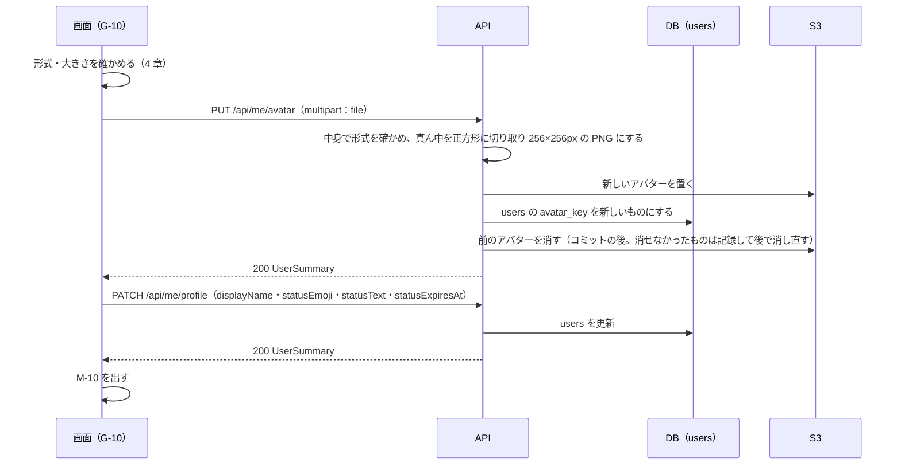
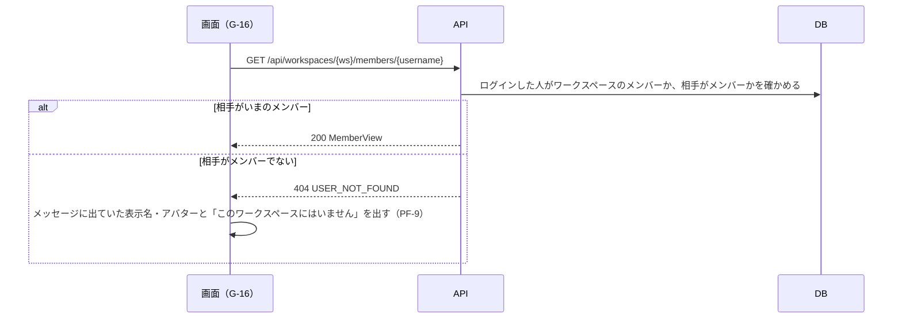

# 機能定義書 FN-02 プロフィール：チャットアプリ（RaiseChat）

| 項目 | 内容 |
| --- | --- |
| 文書番号 | RC-FD-02 |
| 版数 | 0.1 |
| 作成日 | 2026-11-10 |
| 最終更新日 | 2026-11-10 |
| 作成者 | （氏名） |
| 上位文書 | [機能定義書](function-definition.md)（RC-FD） |
| 状態 | 承認待ち |

## 改訂履歴

| 版数 | 日付 | 内容 | 作成者 |
| --- | --- | --- | --- |
| 0.1 | 2026-11-10 | 初版 | （氏名） |

本書は機能定義書の一部である。承認は[機能定義書](function-definition.md)で一括して行う。API・リアルタイムの通知・メッセージの共通の決まりは機能定義書 3 章〜5 章のとおり。

---

## 1. 概要

| 項目 | 内容 |
| --- | --- |
| 目的 | アバター・表示名・ステータスで、自分が誰で、いまどうしているかをほかのメンバーに伝えられるようにする |
| 使う画面 | G-10 プロフィールの設定画面、G-16 プロフィールのダイアログ |
| 関係する機能 | FN-12 DM（G-16 の「メッセージを送る」）、FN-14 通知（G-10 にブラウザの通知の設定を置く） |
| 前提 | プロフィールはすべてのワークスペースで共通（データ要件定義書 1 章）。ユーザー ID は変えられない（FN-01） |

## 2. 機能要件

| ID | 内容 |
| --- | --- |
| PF-1 | G-10 で、アバター・表示名・ステータスを変えて「保存する」を押すと保存し、M-10 を出す。何も変えていないときは「保存する」を押せない |
| PF-2 | アバターは「画像を選ぶ」で JPEG・PNG・WebP の 5MB までの画像を選ぶ。選ぶと、真ん中を正方形に切り取った見本を出す。保存すると、サーバーで真ん中を正方形に切り取り、256×256px に縮めて保存する。条件に合わない画像は M-9 を出す |
| PF-3 | 「アバターを外す」を押すと、アバターをなくし、表示名の頭文字を丸の中に出す |
| PF-4 | 表示名はトリムした後で 1〜30 文字とする。0 文字のときは M-5 を出す |
| PF-5 | ステータスは、絵文字 1 つ（絵文字の一覧から選ぶ）と文（0〜100 文字、改行なし）を入れる。どちらか片方だけでもよい。あわせて「消す時刻」を「消さない」「30 分後」「1 時間後」「今日の終わり（日本時間の 23:59）」「1 週間後」から選ぶ |
| PF-6 | 「ステータスを消す」を押すと、ステータスの絵文字と文と消す時刻をなくす。消す時刻を過ぎたステータスは、どの画面にも出さない |
| PF-7 | G-5・G-6・G-7・G-9 で人の名前かアバターを押すと、G-16 にアバター（大きく）・表示名・@ユーザー ID・ステータスを出す。自分以外の人には「メッセージを送る」（FN-12 の DM を開く）を出す |
| PF-8 | プロフィールを変えても、ほかの人の画面にはすぐには反映しない。ほかの人がメッセージ・メンバーの一覧などを次に読み込んだときに反映する |
| PF-9 | G-16 で見られるのは、そのワークスペースのいまのメンバーのプロフィールだけである。ワークスペースを抜けた人の名前を押したときは、メッセージに出ている表示名・アバターと「このワークスペースにはいません」だけを出し、「メッセージを送る」は出さない |

## 3. 処理の流れ

### 3.1 保存（アバターを変えるとき）

アバターは表示名・ステータスと別の API で送る。両方を変えたときは、画面はアバター → 表示名・ステータスの順に送り、どちらかに失敗したら M-49 を出して、成功した分はそのまま残す。

### 3.2 プロフィールのダイアログ

## 4. 入力の確認

| 項目 | 型 | 必須 | 条件 | 守られないとき |
| --- | --- | --- | --- | --- |
| アバター（file） | ファイル | | JPEG・PNG・WebP、5MB（5,242,880 バイト）まで。形式は拡張子ではなく中身で確かめる | M-9（API は 400 AVATAR_INVALID、5MB を超えれば 413 AVATAR_TOO_LARGE） |
| 表示名（displayName） | 文字列 | ○ | トリム後 1〜30 文字 | M-5 |
| ステータスの絵文字（statusEmoji） | 文字列 | | 絵文字 1 つ（FN-10 の 4 章と同じ条件） | 画面では一覧から選ぶだけ。API は 400 BAD_REQUEST |
| ステータスの文（statusText） | 文字列 | | トリム後 0〜100 文字。改行を含まない | 101 文字目以降は入力できない。API は 400 BAD_REQUEST |
| 消す時刻（statusExpiresAt） | 日時 | | 今より後の日時か null（消さない）。画面が選んだものを日時に直して送る | 400 BAD_REQUEST |

## 5. 業務ルール

| No | ルール |
| --- | --- |
| 1 | アバターは切り取って縮めたものだけを S3 に置き、元の画像は保存しない |
| 2 | 消す時刻を過ぎたステータスは、出力（UserSummary）では null にして返す。データベースの値は、次に保存したときに上書きする（消すための定期の処理はしない） |
| 3 | ステータスの絵文字も文も空なら、消す時刻も null にする |
| 4 | アバターの URL は署名付き URL（有効期限 1 時間。N-20）。画面は期限が切れる前に、一覧を読み直したときの新しい URL に替える |
| 5 | プロフィールの変更はリアルタイムで送らない（PF-8） |

## 6. API（案）

| メソッド | URL | 入力 | 出力（成功） | 主なエラー |
| --- | --- | --- | --- | --- |
| GET | /api/me/profile | なし | 200 MyProfile | |
| PATCH | /api/me/profile | `{"displayName","statusEmoji","statusText","statusExpiresAt"}` | 200 UserSummary | 400 |
| PUT | /api/me/avatar | multipart：file | 200 UserSummary | 400 AVATAR_INVALID、413 AVATAR_TOO_LARGE、500 |
| DELETE | /api/me/avatar | なし | 200 UserSummary | |
| GET | /api/workspaces/{ws}/members/{username} | なし | 200 MemberView | 404 WORKSPACE_NOT_FOUND、404 USER_NOT_FOUND |

- MyProfile：UserSummary に statusExpiresAt を足したもの
- MemberView：UserSummary に role（OWNER・MEMBER）と joinedAt を足したもの（FN-05 と同じ）

リアルタイムの通知：なし（5 章の 5）。

## 7. 使うデータ

| テーブル | 操作 | 内容 |
| --- | --- | --- |
| users | R U | 表示名・アバターの置き場所・ステータスの読み書き |
| workspace_members | R | G-16 で、ログインした人と相手がメンバーかを確かめる |
| S3 | C D | アバターのファイルを置く・前のものを消す |

## 8. 権限

| 操作 | 本人 | 同じワークスペースのメンバー | それ以外 |
| --- | --- | --- | --- |
| プロフィールを変える | できる | できない | できない |
| プロフィールを見る（G-16） | できる | できる | できない（404） |

## 9. エラーとメッセージ

| 場面 | HTTP | code | メッセージ |
| --- | --- | --- | --- |
| アバターの形式が違う | 400 | AVATAR_INVALID | M-9 |
| アバターが 5MB を超える | 413 | AVATAR_TOO_LARGE | M-9 |
| 表示名が空 | 400 | DISPLAY_NAME_REQUIRED | M-5 |
| 画面を通さずに送られた、条件に合わない入力 | 400 | BAD_REQUEST | 入力が正しくありません。 |
| 相手がワークスペースのメンバーでない | 404 | USER_NOT_FOUND | 出さない（PF-9 の表示にする） |
| 保存に失敗 | 500 | INTERNAL_ERROR | M-49 |

## 10. テストの観点

- TC-02-1：アバター：5MB ちょうど・5MB＋1 バイト、GIF・SVG、拡張子を .png に変えたテキストファイルは M-9
- TC-02-2：横長・縦長の画像が、真ん中を正方形に切り取った 256×256px で保存され、前のアバターのファイルが S3 から消える
- TC-02-3：アバターを外すと頭文字の丸になり、S3 のファイルも消える
- TC-02-4：表示名：空白だけ・1 文字・30 文字。31 文字目は入力できない
- TC-02-5：ステータス：絵文字だけ・文だけ・両方。文 100 文字。「30 分後」を選ぶと、30 分後に読み込み直すとどの画面にも出ない
- TC-02-6：ステータスの文に `` を入れても文字のまま出る
- TC-02-7：G-16 に、ほかの人には「メッセージを送る」が出て、自分には出ない
- TC-02-8：ほかのワークスペースの人のユーザー ID で GET /api/workspaces/{ws}/members/{username} を送ると 404。抜けた人の名前を押すと「このワークスペースにはいません」が出る
- TC-02-9：表示名を変えた後、ほかの人が会話を開き直すと新しい表示名で出る
