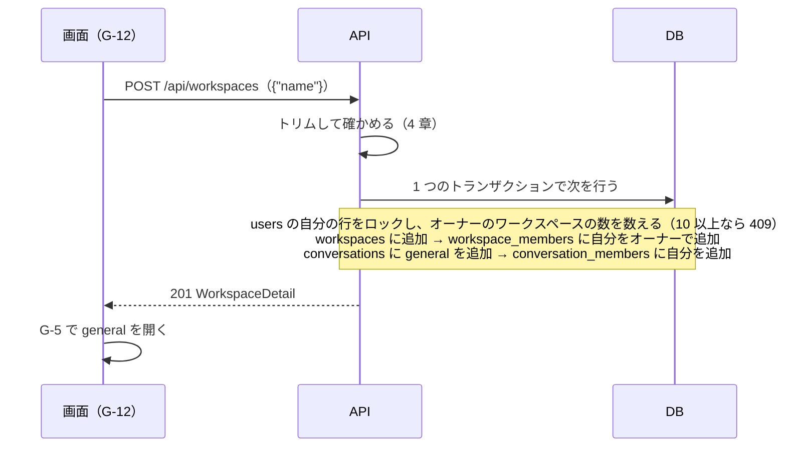
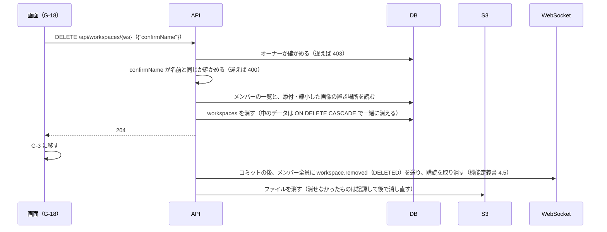

# 機能定義書 FN-03 ワークスペース：チャットアプリ（RaiseChat）

| 項目 | 内容 |
| --- | --- |
| 文書番号 | RC-FD-03 |
| 版数 | 0.2 |
| 作成日 | 2026-11-10 |
| 最終更新日 | 2026-11-13 |
| 作成者 | （氏名） |
| 上位文書 | [機能定義書](function-definition.md)（RC-FD） |
| 状態 | 承認待ち |

## 改訂履歴

| 版数 | 日付 | 内容 | 作成者 |
| --- | --- | --- | --- |
| 0.1 | 2026-11-10 | 初版 | （氏名） |
| 0.2 | 2026-11-13 | ワークスペースの削除を作るとき（開発計画書 1-8）に決めたことを 6 章に足した：確認の名前の比べ方、削除の前に行をロックすること | （氏名） |

本書は機能定義書の一部である。承認は[機能定義書](function-definition.md)で一括して行う。API・リアルタイムの通知・メッセージの共通の決まりは機能定義書 3 章〜5 章のとおり。

---

## 1. 概要

| 項目 | 内容 |
| --- | --- |
| 目的 | 仲間ごとの場（ワークスペース）を作り、入っているワークスペースを切り替えて使えるようにする。オーナーは、要らなくなったワークスペースを削除できる |
| 使う画面 | G-3 ワークスペースの一覧画面、G-12 ワークスペースの作成ダイアログ、G-5 チャット画面（サイドバーのワークスペース名）、G-9 メンバー一覧画面（「ワークスペースを削除」）、G-18 確認ダイアログ |
| 関係する機能 | FN-04 招待（ほかの人はリンクから参加する）、FN-05 メンバー管理、FN-06 チャンネル（作ると general ができる）、FN-09 添付（削除で S3 のファイルも消す）、FN-14 通知（G-3 の未読・メンションの印） |
| 前提 | ワークスペースを作った人がオーナーになり、変えられない。1 人が作れるのは 10 個まで（データ要件定義書 2 章）。名前は変えられない |

## 2. 機能要件

| ID | 内容 |
| --- | --- |
| W-1 | G-3 に、自分が入っているワークスペースを名前の順に出す。自分がオーナーのものには「オーナー」の印、未読があるものには太字、メンションされたものには件数を出す（FN-14） |
| W-2 | 入っているワークスペースが 1 つもないときは、G-3 に M-16 と「ワークスペースを作る」を出す |
| W-3 | G-3 の「ワークスペースを作る」を押すと G-12 を出す。名前（トリム後 1〜50 文字）を入れて「作る」を押すと、ワークスペースを作って自分をオーナーにし、公開チャンネル general を作って自分を入れ、G-5 で general を開く。名前が空のときは M-11、すでに 10 個作っているときは M-12 を出す |
| W-4 | G-3 でワークスペースを選ぶと、G-5 でそのワークスペースで最後に開いた会話を開く。初めて開くとき、または最後に開いた会話が見られなくなっていたときは general を開く |
| W-5 | G-5 のヘッダーの自分のアバターを押すと出るメニューの「ワークスペースの一覧」から G-3 に戻り、ほかのワークスペースに切り替えられる |
| W-6 | オーナーには、G-9 の下に「ワークスペースを削除」を出す。押すと G-18 に M-14 と名前の入力欄を出し、ワークスペースの名前と同じ文字を入れたときだけ「削除」を押せる。「削除」でワークスペースと、その中のチャンネル・DM・メッセージ・添付（S3 のファイルを含む）・リアクション・メンション・招待リンク・メンバーをすべて消し、G-3 に移す。「キャンセル」では何もしない |
| W-7 | ワークスペースが削除されたとき、そのワークスペースを開いていたほかのメンバーの画面には M-15 を出して G-3 に移す。G-3 を開いていたメンバーの一覧からは、そのワークスペースを消す |
| W-8 | 入っていない・存在しないワークスペースの URL（/w/{ws}/…）を開いたときは、M-13 を出して G-3 に移す |
| W-9 | G-5 のサイドバーの上と、ヘッダーにワークスペースの名前を出す |

## 3. 処理の流れ

### 3.1 作成

### 3.2 削除

## 4. 入力の確認

| 項目 | 型 | 必須 | 条件 | 守られないとき |
| --- | --- | --- | --- | --- |
| 名前（name） | 文字列 | ○ | トリム後 1〜50 文字。改行を含まない。ほかのワークスペースと同じでもよい | 0 文字は M-11（API は 400 WORKSPACE_NAME_REQUIRED）。51 文字目以降は入力できない（API は 400 BAD_REQUEST） |
| 削除の確認の名前（confirmName） | 文字列 | ○ | ワークスペースの名前と完全に同じ（トリムした後で比べる） | 同じになるまで「削除」を押せない。API は 400 CONFIRM_NAME_MISMATCH |

## 5. 業務ルール

| No | ルール |
| --- | --- |
| 1 | 作れる数（10 個）は、自分がオーナーで、いまあるワークスペースの数で数える。削除したものは数えない。同時に作ったときに 11 個にならないよう、数えるときに自分の users の行をロックする |
| 2 | ワークスペースの作成と、general・オーナーのメンバーの追加は、1 つのトランザクションで行う |
| 3 | general は、ワークスペースごとにちょうど 1 つ。退出・削除できない（FN-06） |
| 4 | 最後に開いた会話は、会話を開いたときに記録する（FN-14 の既読の記録と同じ API で行う） |
| 5 | ワークスペースの削除では、データベースのデータは外部キーの ON DELETE CASCADE で消す。S3 のファイルはコミットの後に消し、消せなかったものは記録して 1 日 1 回消し直す（要件定義書 N-11） |
| 6 | 削除した後に、そのワークスペースのメッセージ・添付・招待リンクを、API・WebSocket・署名付き URL のどれからも取れないようにする。署名付き URL は期限まで使えてしまうため、S3 のファイルを消すことで取れなくする |
| 7 | G-3 の並び順は名前の順（同じ名前は作った順） |

## 6. API（案）

| メソッド | URL | 入力 | 出力（成功） | 主なエラー |
| --- | --- | --- | --- | --- |
| GET | /api/workspaces | なし | 200 WorkspaceSummary の並び（ページングしない） | |
| POST | /api/workspaces | `{"name"}` | 201 WorkspaceDetail | 400、409 WORKSPACE_LIMIT |
| GET | /api/workspaces/{ws} | なし | 200 WorkspaceDetail | 404 WORKSPACE_NOT_FOUND |
| DELETE | /api/workspaces/{ws} | `{"confirmName"}` | 204 | 400 CONFIRM_NAME_MISMATCH、403 NOT_OWNER、404 |

- 削除の confirmName は、ワークスペースの名前とまったく同じ文字のときだけ通す（前後の空白も取り除かない）
- 削除は、ワークスペースの行をロックしてからメンバーを読む（同時に招待リンクで参加した人にも workspace.removed を送るため）
- WorkspaceSummary：`{"id","name","role","hasUnread","mentionCount"}`（role は OWNER・MEMBER）
- WorkspaceDetail：WorkspaceSummary に owner（UserSummary）・memberCount・generalConversationId・lastOpenedConversationId（なければ null）を足したもの

リアルタイムの通知：

| API | 通知 | 送る相手 |
| --- | --- | --- |
| DELETE /api/workspaces/{ws} | workspace.removed（reason は DELETED） | 削除したときのメンバー全員（オーナーを含む） |

## 7. 使うデータ

| テーブル | 操作 | 内容 |
| --- | --- | --- |
| workspaces | C R D | 作成・一覧・削除 |
| workspace_members | C R D | オーナーの追加、一覧、削除で一緒に消える |
| conversations・conversation_members | C D | general と自分の追加、削除で一緒に消える |
| messages・attachments・reactions・mentions・invites | D | 削除で一緒に消える |
| users | R | 作れる数を数えるときのロック |
| S3 | D | 削除で添付・縮小した画像のファイルを消す |

## 8. 権限

| 操作 | オーナー | メンバー | メンバーでない人 |
| --- | --- | --- | --- |
| ワークスペースを作る | — | — | 誰でもできる（10 個まで） |
| 一覧・詳細を見る | できる | できる | できない（404） |
| 削除する | できる | できない（403） | できない（404） |

## 9. エラーとメッセージ

| 場面 | HTTP | code | メッセージ |
| --- | --- | --- | --- |
| 名前が空 | 400 | WORKSPACE_NAME_REQUIRED | M-11 |
| 画面を通さずに送られた、条件に合わない入力 | 400 | BAD_REQUEST | 入力が正しくありません。 |
| すでに 10 個作っている | 409 | WORKSPACE_LIMIT | M-12 |
| 入っていない・存在しない | 404 | WORKSPACE_NOT_FOUND | M-13。G-3 に移す |
| オーナーでない人が削除しようとした | 403 | NOT_OWNER | M-49 |
| 確認の名前が違う | 400 | CONFIRM_NAME_MISMATCH | 出さない（画面では押せない） |
| 開いていたワークスペースが削除された | — | — | M-15（workspace.removed を受け取ったとき） |
| 作成・削除に失敗 | 500 | INTERNAL_ERROR | M-49 |

## 10. テストの観点

- TC-03-1：名前：空白だけ・1 文字・50 文字。51 文字目は入力できない。ほかと同じ名前でも作れる
- TC-03-2：作ると自分がオーナーになり、general に自分だけが入っていて、G-5 で general が開く
- TC-03-3：10 個作った後の 11 個目は M-12。1 つ削除するとまた作れる。11 個目を 2 つのタブから同時に送っても 10 個を超えない
- TC-03-4：G-3 の一覧が名前の順で、オーナーの印・未読・メンションの印が出る。ワークスペースがないと M-16
- TC-03-5：最後に開いた会話が次に選んだときに開く。その会話が削除されていたら general が開く
- TC-03-6：入っていないワークスペースの URL を開くと M-13 で G-3。API（GET /api/workspaces/{ws}）も 404
- TC-03-7：削除の確認で名前が 1 文字でも違うと「削除」を押せない。API に違う名前を送ると 400
- TC-03-8：オーナーでない人が DELETE /api/workspaces/{ws} を送ると 403
- TC-03-9：削除すると、チャンネル・DM・メッセージ・添付（S3 のファイルも）・リアクション・メンション・招待リンクがすべて消え、その招待リンクを開くと M-18
- TC-03-10：削除したとき、別のブラウザでそのワークスペースの G-5 を開いていたメンバーに M-15 が出て G-3 に移り、その後そのワークスペースのメッセージの通知が届かない
