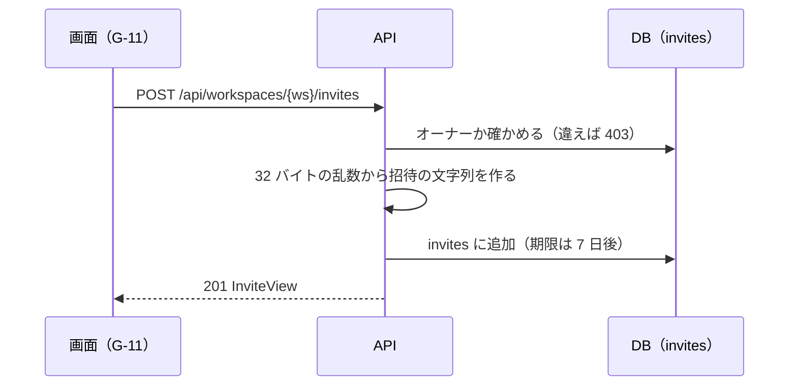
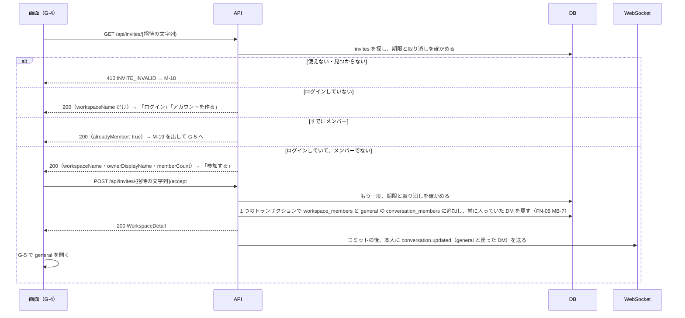

# 機能定義書 FN-04 招待：チャットアプリ（RaiseChat）

| 項目 | 内容 |
| --- | --- |
| 文書番号 | RC-FD-04 |
| 版数 | 0.2 |
| 作成日 | 2026-11-10 |
| 最終更新日 | 2026-11-13 |
| 作成者 | （氏名） |
| 上位文書 | [機能定義書](function-definition.md)（RC-FD） |
| 状態 | 承認待ち |

## 改訂履歴

| 版数 | 日付 | 内容 | 作成者 |
| --- | --- | --- | --- |
| 0.1 | 2026-11-10 | 初版 | （氏名） |
| 0.2 | 2026-11-13 | 招待リンクを作るとき（開発計画書 1-7）に決めたことを足した：中身を見る API はログインしていればその人として扱い、JWT の期限切れは 401、ログインしていないときの InvitePreview の項目は null、一覧のカーソル、取り消しをもう一度送ったときは 204、URL は画面の URL（WEB_ORIGIN）から作る、参加したときの DM の通知 | （氏名） |

本書は機能定義書の一部である。承認は[機能定義書](function-definition.md)で一括して行う。API・リアルタイムの通知・メッセージの共通の決まりは機能定義書 3 章〜5 章のとおり。

---

## 1. 概要

| 項目 | 内容 |
| --- | --- |
| 目的 | オーナーが招待リンクを作って友人に渡し、友人がそのリンクからワークスペースに参加できるようにする。リンクには期限があり、オーナーが取り消せる |
| 使う画面 | G-11 招待リンクの管理画面、G-4 招待の参加画面、G-18 確認ダイアログ、G-1・G-2（ログインしていない人） |
| 関係する機能 | FN-01（ログインしていない人はログイン・登録の後に G-4 に戻る）、FN-05 メンバー管理（キック・退出した人の再参加）、FN-06 チャンネル（参加すると general に入る） |
| 前提 | 招待リンクを作れるのはオーナーだけ（要件定義書 3.1）。期限は作ってから 7 日で、期限までなら何人でも使える（データ要件定義書 4 章）。メールでの招待はしない |

## 2. 機能要件

| ID | 内容 |
| --- | --- |
| I-1 | オーナーには、G-5 のサイドバーのワークスペース名を押すと出るメニューに「招待リンクの管理」を出す。押すと G-11 を開き、招待リンクを作った新しい順に、URL・作った日時・期限・状態（有効・期限切れ・取り消し済み）を出す |
| I-2 | G-11 の「招待リンクを作る」を押すと、期限 7 日の招待リンク（https://〜/invite/{招待の文字列}）を作って一覧の先頭に出す。「コピー」を押すと URL をクリップボードに入れて M-20 を出す |
| I-3 | 有効な招待リンクの「取り消す」を押すと G-18 に M-17 を出し、「取り消す」でそのリンクを取り消す。取り消したリンクでは参加できない。「キャンセル」では何もしない |
| I-4 | ログインしていない人が招待リンクを開くと、G-4 にワークスペースの名前と「ログイン」「アカウントを作る」を出す。どちらかでログイン・登録すると G-4 に戻る（FN-01 A-10） |
| I-5 | ログインしている人が有効な招待リンクを開くと、G-4 にワークスペースの名前・オーナーの表示名・メンバーの人数と「参加する」を出す。押すとワークスペースのメンバーになり、general に入り、G-5 で general を開く |
| I-6 | 期限切れ・取り消し済み・存在しない招待リンクを開いたときは、G-4 に M-18 を出す。ワークスペースの名前は出さない |
| I-7 | すでにそのワークスペースのメンバーである人が招待リンクを開いたときは、M-19 を出して G-5 でそのワークスペースを開く |
| I-8 | キック・退出した人も、有効な招待リンクから I-5 のとおり参加できる（要件定義書 U-3。参加したときの会話の扱いは FN-05 MB-7） |
| I-9 | オーナーでない人には「招待リンクの管理」を出さない。G-11 の URL を開いたときは、G-5 でそのワークスペースを開く |

## 3. 処理の流れ

### 3.1 招待リンクを作る

### 3.2 招待リンクから参加する

## 4. 入力の確認

| 項目 | 型 | 必須 | 条件 | 守られないとき |
| --- | --- | --- | --- | --- |
| 招待の文字列（URL の一部） | 文字列 | ○ | 43 文字の英数字・「-」・「_」（32 バイトの乱数を URL で使える Base64 にしたもの） | 形が違うときも、見つからないときと同じく 410 INVITE_INVALID |

ほかに入力はない（期限は 7 日に決まっていて、選べない）。

## 5. 業務ルール

| No | ルール |
| --- | --- |
| 1 | 招待リンクが使えるのは、期限が今より後で、取り消していないときだけ。参加の API でもう一度確かめる（G-4 を開いた後に期限が切れたときのため） |
| 2 | 招待の文字列は、推測できない 32 バイトの乱数から作る（要件定義書 N-22）。G-11 で何度でもコピーできるよう、データベースにはそのまま保存する |
| 3 | ログインしていない人に返すのはワークスペースの名前だけ（要件定義書 3.1、N-13）。オーナーの表示名・人数は、ログインしている人にだけ返す |
| 4 | 期限切れ・取り消し済みのリンクは、作ってから 30 日たったら 1 日 1 回まとめて消す。消したリンクは、存在しないリンクと同じ扱い（M-18） |
| 5 | 参加の API は、2 回送られてもメンバーを 2 回足さない（workspace_members の一意の制約。すでにメンバーなら何もせず 200 を返す） |
| 6 | 参加しても、ほかのメンバーにリアルタイムの通知は送らない（メンバーの一覧は開いたときに読む） |
| 7 | G-11 の一覧には、まだ消していないリンク（5 章の 4）をすべて出す。状態は、取り消した日時があれば「取り消し済み」、期限を過ぎていれば「期限切れ」、それ以外は「有効」 |

## 6. API（案）

| メソッド | URL | 入力 | 出力（成功） | 主なエラー |
| --- | --- | --- | --- | --- |
| GET | /api/workspaces/{ws}/invites?cursor= | なし | 200 InviteView の一覧（50 件ずつ） | 403 NOT_OWNER、404 WORKSPACE_NOT_FOUND |
| POST | /api/workspaces/{ws}/invites | なし | 201 InviteView | 403、404 |
| DELETE | /api/workspaces/{ws}/invites/{id} | なし | 204（取り消し済みにする。行は消さない） | 403、404 INVITE_NOT_FOUND |
| GET | /api/invites/{招待の文字列} | なし（ログインしていなくてもよい） | 200 InvitePreview | 401 TOKEN_EXPIRED、410 INVITE_INVALID |
| POST | /api/invites/{招待の文字列}/accept | なし | 200 WorkspaceDetail（FN-03） | 401、410 INVITE_INVALID |

- InviteView：`{"id","url","createdAt","expiresAt","revokedAt","status"}`（status は ACTIVE・EXPIRED・REVOKED）。url は画面の URL（環境変数 WEB_ORIGIN。インフラ設計書）に /invite/{招待の文字列} を付けたもの
- InvitePreview：`{"workspaceName","workspaceId","ownerDisplayName","memberCount","alreadyMember"}`。ログインしていないときは workspaceName のほかは null
- 一覧のカーソルは、前のページの最後のリンクの ID（機能定義書 3.4）。数でなければ 400 BAD_REQUEST
- 取り消し済み・期限切れのリンクをもう一度取り消したときは、何もせずに 204（最初に取り消した日時を残す）
- GET /api/invites/{招待の文字列} は、ログインがいらない API だが、access_token の Cookie があればその人として扱う（オーナー・人数・alreadyMember を返すため）。JWT の期限が切れていれば 401 TOKEN_EXPIRED を返し、画面が取り直してやり直す（機能定義書 3.2）。期限切れ以外で読めない JWT（秘密の値を替えた後の古い Cookie など）は、ログインしていない人として扱う

リアルタイムの通知：

| API | 通知 | 送る相手 |
| --- | --- | --- |
| POST /api/invites/{招待の文字列}/accept | conversation.updated（general と、戻った DM ごと。この順に送る） | 参加した本人。すでにメンバーだったときは送らない |

## 7. 使うデータ

| テーブル | 操作 | 内容 |
| --- | --- | --- |
| invites | C R U D | 作成、一覧、取り消し（revoked_at を記録）、30 日たったものを消す |
| workspaces | R | 名前、オーナー |
| workspace_members | C R | 参加、メンバーか・人数 |
| conversations・conversation_members | R C | general に入る、前の DM を戻す（FN-05 MB-7） |

## 8. 権限

| 操作 | オーナー | メンバー | ログインしている人（メンバーでない） | ログインしていない人 |
| --- | --- | --- | --- | --- |
| 招待リンクを作る・一覧・取り消す | できる | できない（403） | できない（404） | できない（401） |
| 招待リンクの中身を見る（G-4） | できる | できる | できる | ワークスペースの名前だけ |
| 招待リンクから参加する | — | —（M-19） | できる | ログインの後にできる |

## 9. エラーとメッセージ

| 場面 | HTTP | code | メッセージ |
| --- | --- | --- | --- |
| 期限切れ・取り消し済み・存在しない招待リンク | 410 | INVITE_INVALID | M-18 |
| すでにメンバー | 200 | — | M-19（alreadyMember が true のとき） |
| オーナーでない人が作る・取り消す | 403 | NOT_OWNER | M-49 |
| 取り消そうとしたリンクがない | 404 | INVITE_NOT_FOUND | M-49。一覧を読み直す |
| 作成・取り消し・参加に失敗 | 500 | INTERNAL_ERROR | M-49 |

## 10. テストの観点

- TC-04-1：オーナーが作ったリンクの期限が 7 日後になり、コピーで M-20。オーナーでない人の POST /api/workspaces/{ws}/invites は 403
- TC-04-2：ログインしていない人がリンクを開くと、ワークスペースの名前だけが出る（API の応答にもオーナー・人数がない）。登録・ログインすると G-4 に戻り、参加できる
- TC-04-3：参加すると general に入り、G-5 で general が開く。general のほかのチャンネルには入っていない
- TC-04-4：期限の 1 分前のリンクで参加できる。期限を過ぎたリンク・取り消したリンク・文字を 1 つ変えたリンクは M-18 で、ワークスペースの名前が出ない
- TC-04-5：G-4 を開いた後にオーナーがリンクを取り消すと、「参加する」で M-18
- TC-04-6：すでにメンバーの人がリンクを開くと M-19 で G-5 に移る。参加の API を 2 回送ってもメンバーは 1 人
- TC-04-7：1 つのリンクで 3 人が参加できる
- TC-04-8：キックされた人・退出した人が、有効なリンクからまた参加できる
- TC-04-9：オーナーでない人には「招待リンクの管理」が出ず、/w/{ws}/invites を開くと G-5 に移る
- TC-04-10：作ってから 30 日たった期限切れのリンクが消え、開くと M-18
