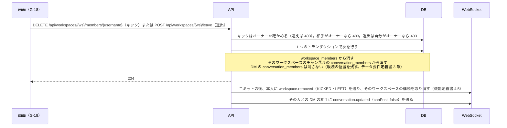

# 機能定義書 FN-05 メンバー管理：チャットアプリ（RaiseChat）

| 項目 | 内容 |
| --- | --- |
| 文書番号 | RC-FD-05 |
| 版数 | 0.1 |
| 作成日 | 2026-11-10 |
| 最終更新日 | 2026-11-10 |
| 作成者 | （氏名） |
| 上位文書 | [機能定義書](function-definition.md)（RC-FD） |
| 状態 | 承認待ち |

## 改訂履歴

| 版数 | 日付 | 内容 | 作成者 |
| --- | --- | --- | --- |
| 0.1 | 2026-11-10 | 初版 | （氏名） |

本書は機能定義書の一部である。承認は[機能定義書](function-definition.md)で一括して行う。API・リアルタイムの通知・メッセージの共通の決まりは機能定義書 3 章〜5 章のとおり。

---

## 1. 概要

| 項目 | 内容 |
| --- | --- |
| 目的 | ワークスペースに誰がいるかを見られるようにする。オーナーはメンバーをキックでき、オーナー以外のメンバーは自分で退出できるようにする |
| 使う画面 | G-9 メンバー一覧画面、G-16 プロフィールのダイアログ、G-18 確認ダイアログ、G-3（キック・退出の後） |
| 関係する機能 | FN-04 招待（キック・退出した人の再参加）、FN-06 チャンネル（会話のメンバーから外す）、FN-12 DM（抜けた人との DM は送れなくなる）、FN-02（G-16） |
| 前提 | オーナーは退出できず、キックもされない（要件定義書 2.2）。キック・退出した人が送ったメッセージ・添付・リアクションは残す（データ要件定義書 3 章） |

## 2. 機能要件

| ID | 内容 |
| --- | --- |
| MB-1 | G-5 のサイドバーのワークスペース名を押すと出るメニューの「メンバー」から G-9 を開く。メンバーの人数と、オーナーを先頭に、表示名の順でアバター・表示名・@ユーザー ID・ステータス・「オーナー」の印を出す。上の欄に文字を入れると、表示名かユーザー ID にその文字を含む人だけに絞る。いないときは M-47 を出す |
| MB-2 | G-9 で名前を押すと G-16 を出す（FN-02 PF-7） |
| MB-3 | オーナーには、自分以外のメンバーの行に「キック」を出す。押すと G-18 に M-21 を出し、「キック」でその人をワークスペースから外す。「キャンセル」では何もしない |
| MB-4 | キックされた人は、ワークスペースのメンバーと、そのワークスペースのすべてのチャンネルのメンバーから外れる。その人がそのワークスペースを開いていたときは、M-22 を出して G-3 に移す。その時点から、そのワークスペースのリアルタイムの通知は届かない（N-15） |
| MB-5 | オーナー以外のメンバーには、G-9 の下に「ワークスペースから退出」を出す。押すと G-18 に M-23 を出し、「退出」で MB-4 と同じくメンバーとすべてのチャンネルから外れて G-3 に移る |
| MB-6 | キック・退出した人のメッセージは、表示名・アバターとともにそのまま残る。名前を押したときは FN-02 PF-9 のとおり。その人との DM は、相手には読めるが送れず、入力欄の代わりに M-36 を出す（FN-12） |
| MB-7 | キック・退出した人が招待リンクからまた参加したとき（FN-04 I-8）は、チャンネルは general にだけ入り直し、前に入っていたほかのチャンネルには入り直さない。DM は前のものに戻り、それまでのメッセージを読めて、また送れる |
| MB-8 | キック・退出・再参加は、ほかのメンバーの G-9 にはすぐには反映しない（開き直したときに反映する）。DM の相手のサイドバーと開いている DM の入力欄だけは、すぐに反映する（MB-6） |

## 3. 処理の流れ

### 3.1 キック・退出

退出は「キックする人」と「される人」が同じ人であるだけで、処理は同じである。

### 3.2 また参加したとき

FN-04 の 3.2 のとおり。DM は、その人の conversation_members の行が残っているので、ワークスペースのメンバーに戻れば読めるようになる（5 章の 3）。

## 4. 入力の確認

| 項目 | 型 | 必須 | 条件 | 守られないとき |
| --- | --- | --- | --- | --- |
| 絞り込みの文字（q） | 文字列 | | トリム後 0〜30 文字。大文字・小文字を区別しない部分一致 | 31 文字目以降は入力できない。API は 400 BAD_REQUEST |

## 5. 業務ルール

| No | ルール |
| --- | --- |
| 1 | オーナーはキックできない・退出できない。API でも 403 にする |
| 2 | キック・退出は、本人が開いているブラウザがいくつあっても、すべての画面で M-22（キック）を出して G-3 に移す（退出した本人には M-22 を出さない） |
| 3 | DM を見られるかは「2 人のうち、いまワークスペースのメンバーである人」で決める（データ要件定義書 5.2）。そのため DM の conversation_members の行は、キック・退出でも消さない |
| 4 | キック・退出した人へのメンションのうち、通知していないものは、その人が見られる会話のものでなくなるので、メンションの一覧と件数に出さない（FN-14） |
| 5 | キックされた人に「キックした人」は知らせない |
| 6 | メンバーの一覧は 50 件ずつ読む。並びはオーナーが先頭、あとは表示名の順（同じ表示名はユーザー ID の順） |

## 6. API（案）

| メソッド | URL | 入力 | 出力（成功） | 主なエラー |
| --- | --- | --- | --- | --- |
| GET | /api/workspaces/{ws}/members?q=&cursor= | 絞り込みの文字 | 200 MemberView の一覧（50 件ずつ）。memberCount も返す | 404 WORKSPACE_NOT_FOUND |
| GET | /api/workspaces/{ws}/members/{username} | なし | 200 MemberView（FN-02） | 404 |
| DELETE | /api/workspaces/{ws}/members/{username} | なし | 204 | 403 NOT_OWNER・CANNOT_KICK_OWNER、404 USER_NOT_FOUND |
| POST | /api/workspaces/{ws}/leave | なし | 204 | 403 OWNER_CANNOT_LEAVE、404 |

MemberView：UserSummary に role（OWNER・MEMBER）と joinedAt を足したもの。

リアルタイムの通知：

| API | 通知 | 送る相手 |
| --- | --- | --- |
| DELETE /api/workspaces/{ws}/members/{username} | workspace.removed（KICKED） | キックされた人 |
| POST /api/workspaces/{ws}/leave | workspace.removed（LEFT） | 退出した本人（ほかのタブのため） |
| 上の 2 つ | conversation.updated（canPost: false） | その人との DM の相手 |

## 7. 使うデータ

| テーブル | 操作 | 内容 |
| --- | --- | --- |
| workspace_members | R D | 一覧、キック・退出 |
| conversation_members | D | そのワークスペースのチャンネルから外す（DM の行は残す） |
| conversations | R | その人との DM を探す |
| users | R | 表示名・アバター・ステータス |

## 8. 権限

| 操作 | オーナー | メンバー | メンバーでない人 |
| --- | --- | --- | --- |
| メンバーの一覧を見る | できる | できる | できない（404） |
| キックする | できる（オーナー自身は除く） | できない（403） | できない（404） |
| 退出する | できない（403） | できる | — |

## 9. エラーとメッセージ

| 場面 | HTTP | code | メッセージ |
| --- | --- | --- | --- |
| 絞り込んで 0 人 | 200 | — | M-47 |
| オーナーでない人がキックしようとした | 403 | NOT_OWNER | M-49 |
| オーナーをキックしようとした | 403 | CANNOT_KICK_OWNER | M-49 |
| オーナーが退出しようとした | 403 | OWNER_CANNOT_LEAVE | M-49 |
| キックしようとした人がもういない | 404 | USER_NOT_FOUND | M-49。一覧を読み直す |
| キックされた（本人の画面） | — | — | M-22（workspace.removed を受け取ったとき） |
| キック・退出に失敗 | 500 | INTERNAL_ERROR | M-49 |

## 10. テストの観点

- TC-05-1：一覧がオーナー先頭・表示名の順。「たろ」「TARO」で絞ると、表示名・ユーザー ID のどちらかに含む人が出る。いなければ M-47
- TC-05-2：オーナーにだけ「キック」が出て、自分の行には出ない。メンバーが DELETE /api/workspaces/{ws}/members/{username} を送ると 403、オーナーを指定すると 403
- TC-05-3：キックすると、キックされた人が別のブラウザで開いていた G-5 に M-22 が出て G-3 に移り、その後そのワークスペースの general・プライベートチャンネル・DM のメッセージの通知が届かない。API でそのワークスペースの会話を読むと 404
- TC-05-4：キックされた人の送ったメッセージは残り、名前を押すと「このワークスペースにはいません」
- TC-05-5：キックされた人との DM の相手の画面で、すぐに入力欄が M-36 に替わる。API で送ると 403
- TC-05-6：メンバーが退出すると G-3 に移り、ワークスペースの一覧から消える。オーナーには「ワークスペースから退出」が出ず、API で送ると 403
- TC-05-7：退出した人が招待リンクからまた参加すると、general にだけ入っていて、前に入っていたプライベートチャンネルには入っていない（中身も見られない）。前の DM は読めて送れ、抜ける前に読んでいたところより後だけが未読になる
- TC-05-8：キックされた人あての、通知していなかったメンションが、また参加した後のメンションの一覧に出ない（入っていないチャンネルのもの）
