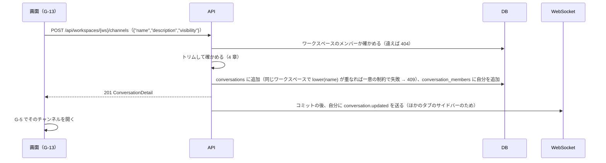
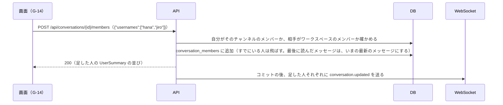
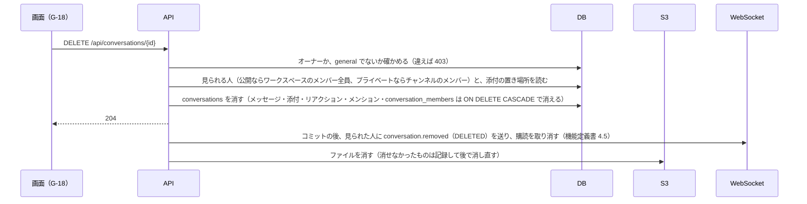

# 機能定義書 FN-06 チャンネル：チャットアプリ（RaiseChat）

| 項目 | 内容 |
| --- | --- |
| 文書番号 | RC-FD-06 |
| 版数 | 0.2 |
| 作成日 | 2026-11-10 |
| 最終更新日 | 2026-11-13 |
| 作成者 | （氏名） |
| 上位文書 | [機能定義書](function-definition.md)（RC-FD） |
| 状態 | 承認待ち |

## 改訂履歴

| 版数 | 日付 | 内容 | 作成者 |
| --- | --- | --- | --- |
| 0.1 | 2026-11-10 | 初版 | （氏名） |
| 0.2 | 2026-11-13 | チャンネルを作るとき（開発計画書 1-6）に決めたことを足した：招待の候補を返す API（GET /api/conversations/{id}/candidates。ワークスペースのメンバーの一覧（FN-05）は 1-8 で作るため）、参加・退出をもう一度送ったときは何もしない、DM にチャンネルの操作を送ったときは 403 FORBIDDEN、一覧のカーソルの中身 | （氏名） |

本書は機能定義書の一部である。承認は[機能定義書](function-definition.md)で一括して行う。API・リアルタイムの通知・メッセージの共通の決まりは機能定義書 3 章〜5 章のとおり。

---

## 1. 概要

| 項目 | 内容 |
| --- | --- |
| 目的 | ワークスペースの中を話題ごとのチャンネルに分けられるようにする。公開チャンネルは誰でも見て参加でき、プライベートチャンネルはメンバーに招待された人だけが見られる |
| 使う画面 | G-5 チャット画面（サイドバー・会話の見出し・入力欄）、G-8 チャンネル一覧画面、G-13 チャンネルの作成ダイアログ、G-14 チャンネルの詳細ダイアログ、G-18 確認ダイアログ |
| 関係する機能 | FN-03（ワークスペースを作ると general ができる）、FN-05（キック・退出でチャンネルから外れる）、FN-07 メッセージ（チャンネルの中のやり取り）、FN-14 通知（サイドバーの未読・メンション） |
| 前提 | チャンネルはワークスペースのメンバーなら誰でも作れる。削除できるのはオーナーだけ（要件定義書 3.1）。名前・種類（公開・プライベート）は変えられない（要件定義書 2.2） |

## 2. 機能要件

| ID | 内容 |
| --- | --- |
| CH-1 | G-5 のサイドバーに、自分が入っているチャンネルを、general を先頭に、あとは名前の順で出す。プライベートチャンネルには 🔒 を付ける。見出し「チャンネル」の「＋」を押すと G-13 を出す |
| CH-2 | G-13 で名前・説明・種類（公開・プライベート。初めは公開）を入れて「作る」を押すと、チャンネルを作って自分をメンバーにし、G-5 でそのチャンネルを開く。名前が条件に合わないときは M-24、同じ名前のチャンネルがワークスペースにあるときは M-25 を出す |
| CH-3 | サイドバーの「チャンネルを探す」で G-8 を開く。ワークスペースの公開チャンネルと、自分が入っているプライベートチャンネルを名前の順に、名前・説明・メンバーの人数・「参加中」の印とともに出す。上の欄に文字を入れると、名前にその文字を含むものだけに絞る |
| CH-4 | G-8 で参加していない公開チャンネルの「参加する」を押すと、そのチャンネルのメンバーになり、G-5 で開く。チャンネルの名前を押したときは、参加せずに G-5 で開く |
| CH-5 | 参加していない公開チャンネルを G-5 で開いたときは、メッセージ・スレッド・リアクションを見られるが、入力欄の代わりに M-30 と「参加する」を出す。リアクション・スレッドの返信もできない。「参加する」を押すとメンバーになり、入力欄を出してサイドバーにも足す |
| CH-6 | G-5 の会話の見出しに、チャンネルの名前（プライベートは 🔒 つき）・説明・メンバーの人数を出す。押すと G-14 に名前・説明・種類・作った人と日時・メンバーの一覧（表示名の順。名前で絞り込める）を出す |
| CH-7 | プライベートチャンネルのメンバーには、G-14 に「メンバーを招待」を出す。押すと、そのチャンネルにいないワークスペースのメンバーを名前で探して選べる（いないときは M-47）。選んで「招待する」を押すと、その人たちをメンバーにする。招待された人のサイドバーには、すぐにそのチャンネルが出る |
| CH-8 | general 以外のチャンネルのメンバーには、G-14 に「チャンネルから退出」を出す。公開チャンネルは確認なしで退出し、プライベートチャンネルは G-18 に M-29 を出して「退出」で退出する。退出したチャンネルはサイドバーから消え、G-5 は general に移る |
| CH-9 | オーナーには、general 以外のチャンネルの G-14 に「チャンネルを削除」を出す。押すと G-18 に M-26 を出し、「削除」でチャンネルと、その中のメッセージ・スレッドの返信・添付（S3 のファイルを含む）・リアクション・メンションをすべて消す。「キャンセル」では何もしない |
| CH-10 | チャンネルが削除されたとき、そのチャンネルを開いていた人の画面には M-28 を出して general に移す。サイドバーからはすぐに消す |
| CH-11 | 見られないチャンネル（入っていないプライベートチャンネル、削除されたチャンネル、ほかのワークスペースのチャンネル）の URL を開いたときは、M-27 を出して general を開く。入っていないプライベートチャンネルは、G-8・検索・メンションの候補など、どこにも名前を出さない |
| CH-12 | 公開チャンネルを作っても、ほかのメンバーには知らせない（G-8 で見つけて参加する） |
| CH-13 | general は、ワークスペースのメンバー全員が入っていて、退出・削除できない。ワークスペースに参加した人は自動で入る（FN-04） |

## 3. 処理の流れ

### 3.1 作成

### 3.2 プライベートチャンネルへの招待

### 3.3 削除

## 4. 入力の確認

| 項目 | 型 | 必須 | 条件 | 守られないとき |
| --- | --- | --- | --- | --- |
| 名前（name） | 文字列 | ○ | トリム後 1〜80 文字。空白（半角・全角）・タブ・改行を含まない。同じワークスペースの中で、大文字・小文字を区別せずにほかのチャンネルと重ならない | 0 文字・空白を含むときは M-24（API は 400 CHANNEL_NAME_INVALID）。重なれば M-25（API は 409 CHANNEL_NAME_TAKEN）。81 文字目以降は入力できない |
| 説明（description） | 文字列 | | トリム後 0〜250 文字。改行を含まない | 251 文字目以降は入力できない。API は 400 BAD_REQUEST |
| 種類（visibility） | 文字列 | ○ | PUBLIC か PRIVATE | 400 BAD_REQUEST |
| 招待する人（usernames） | 文字列の並び | ○ | 1〜50 人。ワークスペースのメンバー | 400 BAD_REQUEST。メンバーでない人が含まれていたら 404 USER_NOT_FOUND（誰も足さない） |
| 絞り込みの文字（q） | 文字列 | | トリム後 0〜80 文字 | 400 BAD_REQUEST |

## 5. 業務ルール

| No | ルール |
| --- | --- |
| 1 | チャンネルの名前の重なりは、削除したチャンネルとは比べない（削除した名前はまた使える） |
| 2 | 参加・招待で会話のメンバーになったときは、最後に読んだメッセージをその時点の最新のメッセージにする（参加前のメッセージは未読にしない。データ要件定義書 5.3） |
| 3 | 公開チャンネルは、ワークスペースのメンバーなら参加していなくても読める（要件定義書 3.1）。ただし、送信・リアクション・スレッドの返信は参加した人だけができる（API は 403 NOT_CHANNEL_MEMBER） |
| 4 | プライベートチャンネルは、そのチャンネルのメンバーでなければ、オーナーでも見られない。API は、あるかどうかを教えないため 404 を返す |
| 5 | プライベートチャンネルのメンバーが全員退出しても、チャンネルは消さない（オーナーも見られないが、データは残る）。削除はオーナーがメンバーとして入っているときだけできる |
| 6 | 公開チャンネルから退出しても、見ることはできる（参加していない公開チャンネルと同じ扱い）。プライベートチャンネルから退出すると、その時点から見られなくなる（機能定義書 4.5） |
| 7 | チャンネルの一覧（G-8）と会話のメンバーの一覧は 50 件ずつ読む。サイドバーの一覧はページングしない |

## 6. API（案）

| メソッド | URL | 入力 | 出力（成功） | 主なエラー |
| --- | --- | --- | --- | --- |
| GET | /api/workspaces/{ws}/conversations | なし | 200 ConversationSummary の並び（自分が入っているチャンネルと DM。ページングしない） | 404 WORKSPACE_NOT_FOUND |
| GET | /api/workspaces/{ws}/channels?q=&cursor= | 絞り込みの文字 | 200 ChannelListItem の一覧（50 件ずつ） | 404 |
| POST | /api/workspaces/{ws}/channels | `{"name","description","visibility"}` | 201 ConversationDetail | 400、404、409 CHANNEL_NAME_TAKEN |
| GET | /api/conversations/{id} | なし | 200 ConversationDetail | 404 CONVERSATION_NOT_FOUND |
| GET | /api/conversations/{id}/members?q=&cursor= | 絞り込みの文字 | 200 UserSummary の一覧（50 件ずつ） | 404 |
| POST | /api/conversations/{id}/join | なし | 200 ConversationDetail | 403 PRIVATE_CHANNEL（プライベート・DM）、404 |
| POST | /api/conversations/{id}/leave | なし | 204 | 403 CANNOT_LEAVE_GENERAL、404 |
| GET | /api/conversations/{id}/candidates?q= | 絞り込みの文字 | 200 UserSummary の並び（そのチャンネルにいないワークスペースのメンバーを表示名の順に 50 人まで。ページングしない） | 403 NOT_PRIVATE_CHANNEL、404 |
| POST | /api/conversations/{id}/members | `{"usernames":[…]}` | 200 UserSummary の並び | 400、403 NOT_PRIVATE_CHANNEL、404 |
| DELETE | /api/conversations/{id} | なし | 204 | 403 NOT_OWNER・CANNOT_DELETE_GENERAL、404 |

- ChannelListItem：`{"id","name","description","visibility","memberCount","joined"}`
- チャンネルの一覧・会話のメンバーの一覧のカーソルは「最後に出した行の ID:名前（表示名）」（機能定義書 3.4）。名前・表示名・ユーザー ID の絞り込みは、大文字・小文字を区別せずに、その文字を含むもの（%・_ も文字として探す）
- 参加（join）をもう入っているチャンネルに、退出（leave）を入っていないチャンネルに送ったときは、何もせずに成功を返す
- DM に参加・退出・招待・削除を送ったときは 403 FORBIDDEN（DM の操作は FN-12）
- ConversationDetail：ConversationSummary（機能定義書 3.5）に description・memberCount・createdBy（UserSummary）・createdAt を足したもの

リアルタイムの通知：

| API | 通知 | 送る相手 |
| --- | --- | --- |
| POST /api/workspaces/{ws}/channels | conversation.updated | 作った本人 |
| POST /api/conversations/{id}/join | conversation.updated | 参加した本人 |
| POST /api/conversations/{id}/members | conversation.updated | 招待された人それぞれ |
| POST /api/conversations/{id}/leave | conversation.removed（LEFT） | 退出した本人 |
| DELETE /api/conversations/{id} | conversation.removed（DELETED） | 削除したときに見られた人 |

## 7. 使うデータ

| テーブル | 操作 | 内容 |
| --- | --- | --- |
| conversations | C R D | チャンネルの作成・一覧・詳細・削除 |
| conversation_members | C R D | 作成・参加・招待・退出、メンバーの一覧と人数 |
| workspace_members | R | ワークスペースのメンバーか、オーナーか |
| messages・attachments・reactions・mentions | D | チャンネルの削除で一緒に消える |
| S3 | D | チャンネルの削除で添付・縮小した画像のファイルを消す |

## 8. 権限

| 操作 | オーナー | チャンネルのメンバー | ワークスペースのメンバー（チャンネルのメンバーでない） |
| --- | --- | --- | --- |
| チャンネルを作る | できる | できる | できる |
| 公開チャンネルを見る | できる | できる | できる |
| 公開チャンネルに参加する | できる | — | できる |
| プライベートチャンネルを見る | メンバーならできる | できる | できない（404） |
| プライベートチャンネルに招待する | メンバーならできる | できる | できない（404） |
| 退出する（general 以外） | メンバーならできる | できる | — |
| 削除する（general 以外） | できる（プライベートはメンバーのとき） | できない（403） | できない |

## 9. エラーとメッセージ

| 場面 | HTTP | code | メッセージ |
| --- | --- | --- | --- |
| 名前が空・空白を含む | 400 | CHANNEL_NAME_INVALID | M-24 |
| 同じ名前のチャンネルがある | 409 | CHANNEL_NAME_TAKEN | M-25 |
| 画面を通さずに送られた、条件に合わない入力 | 400 | BAD_REQUEST | 入力が正しくありません。 |
| 見られない・存在しないチャンネル | 404 | CONVERSATION_NOT_FOUND | M-27。general を開く |
| 招待しようとした人がワークスペースにいない | 404 | USER_NOT_FOUND | M-49。候補を読み直す |
| プライベートチャンネル・DM に参加 API を送った | 403 | PRIVATE_CHANNEL | M-49 |
| general から退出・general を削除しようとした | 403 | CANNOT_LEAVE_GENERAL・CANNOT_DELETE_GENERAL | M-49 |
| オーナーでない人が削除しようとした | 403 | NOT_OWNER | M-49 |
| 開いていたチャンネルが削除された | — | — | M-28（conversation.removed を受け取ったとき）。general に移る |
| 作成・参加・退出・招待・削除に失敗 | 500 | INTERNAL_ERROR | M-49 |

## 10. テストの観点

- TC-06-1：名前：1 文字・80 文字・日本語、半角・全角の空白を含むと M-24。「Travel」があるときに「travel」は M-25。削除したチャンネルの名前はまた使える
- TC-06-2：作ると自分だけがメンバーで、サイドバーに出て G-5 で開く。ほかのメンバーには通知されず、G-8 に出る（公開）・出ない（プライベート）
- TC-06-3：参加していない公開チャンネルを開くと、メッセージは読めて、入力欄の代わりに M-30。API で送信・リアクション・スレッドの返信を送ると 403。「参加する」で入力欄が出てサイドバーに足される
- TC-06-4：参加・招待された人には、それより前のメッセージが未読にならない
- TC-06-5：プライベートチャンネルに招待すると、招待された人の別のブラウザのサイドバーにすぐ出る。メンバーでない人（オーナーを含む）は G-8 に出ず、URL を開くと M-27、API は 404
- TC-06-6：プライベートチャンネルから退出すると、その時点から、そのチャンネルのメッセージの通知が届かず、URL を開くと M-27
- TC-06-7：general には「チャンネルから退出」「チャンネルを削除」が出ず、API で送ると 403
- TC-06-8：オーナーが削除すると、開いていた人に M-28 が出て general に移り、サイドバーからも消える。メッセージ・添付（S3 のファイルも）・リアクション・メンションが消える。メンバーが DELETE を送ると 403
- TC-06-9：チャンネル名・説明に `` を入れても文字のまま出る
