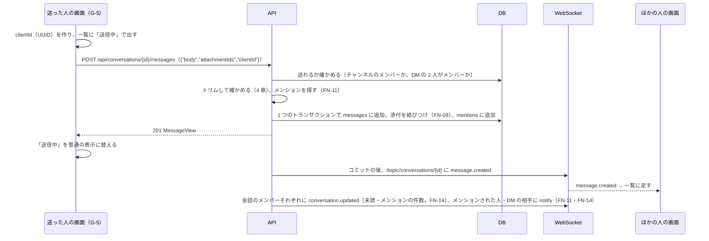
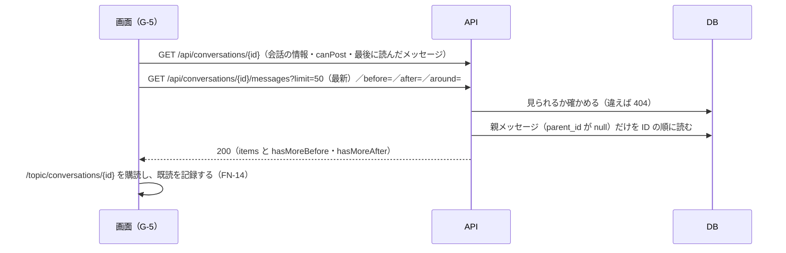
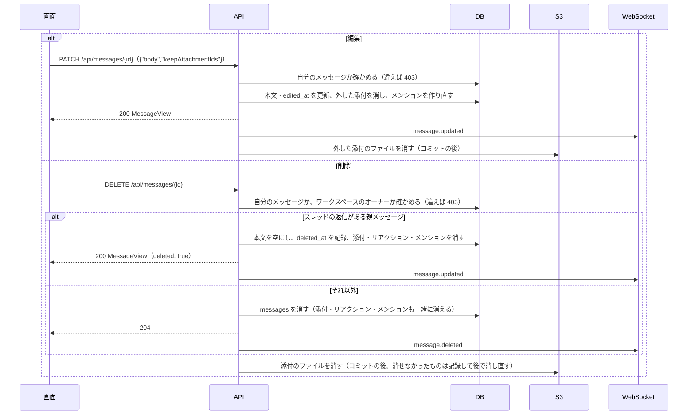

# 機能定義書 FN-07 メッセージ：チャットアプリ（RaiseChat）

| 項目 | 内容 |
| --- | --- |
| 文書番号 | RC-FD-07 |
| 版数 | 0.3 |
| 作成日 | 2026-11-10 |
| 最終更新日 | 2026-11-14 |
| 作成者 | （氏名） |
| 上位文書 | [機能定義書](function-definition.md)（RC-FD） |
| 状態 | 承認待ち |

## 改訂履歴

| 版数 | 日付 | 内容 | 作成者 |
| --- | --- | --- | --- |
| 0.1 | 2026-11-10 | 初版 | （氏名） |
| 0.2 | 2026-11-12 | 5 章の 7：通知には clientId がないため、API の応答より先に届いた自分のメッセージの通知は、本文で「送信中」と見分けることにした（開発計画書 1-5） | （氏名） |
| 0.3 | 2026-11-14 | 添付を作るとき（開発計画書 1-11）に決めたことを足した：編集の keepAttachmentIds を送らなければ添付をすべて残すこと、GET /api/messages/{id}（添付の URL の期限切れで読み直す。FN-09） | （氏名） |

本書は機能定義書の一部である。承認は[機能定義書](function-definition.md)で一括して行う。API・リアルタイムの通知・メッセージの共通の決まりは機能定義書 3 章〜5 章のとおり。

---

## 1. 概要

| 項目 | 内容 |
| --- | --- |
| 目的 | 会話（チャンネル・DM）にメッセージを送り、編集・削除できるようにする。送ったメッセージ・編集・削除は、同じ会話を開いているほかの人の画面にすぐ出す |
| 使う画面 | G-5 チャット画面（メッセージの一覧・入力欄）、G-18 確認ダイアログ |
| 関係する機能 | FN-08 スレッド（返信も同じ仕組みで送る）、FN-09 添付、FN-10 リアクション、FN-11 メンション、FN-12 DM、FN-14 通知（未読） |
| 前提 | 本文は 4,000 文字まで、Markdown 記法で書ける（データ要件定義書 6 章）。編集の履歴は残さない。送れるのは、チャンネルのメンバーと、相手がワークスペースにいる DM だけ（ConversationSummary の canPost） |

## 2. 機能要件

| ID | 内容 |
| --- | --- |
| MS-1 | G-5 で会話を開くと、最新の 50 件を古いものが上になるように出し、いちばん下を表示する。未読があるときは、最初の未読のメッセージの上に「新着」の線を出し、その線が見える位置を表示する |
| MS-2 | いちばん上まで戻ると、その前の 50 件を読み込んで上に足す。それより前がなければ、会話の始まり（チャンネル名と「ここから始まります」）を出す |
| MS-3 | 入力欄に本文を入れて Enter（または「送信」）を押すと送る。Shift＋Enter は改行する（要件定義書 N-31）。本文も添付もないときは送れない。送ったメッセージはすぐに一覧のいちばん下に「送信中」の薄い表示で出し、送れたら普通の表示にする |
| MS-4 | 本文が 3,800 文字を超えたら、残りの文字数を入力欄の下に出す。4,000 文字を超えたら M-35 を出して送れないようにする |
| MS-5 | ほかの人が送ったメッセージは、同じ会話を開いている人の画面に、開き直さずに出す（要件定義書 N-3）。いちばん下を見ているときは自動で下まで送り、上の方を見ているときは送らずに「新しいメッセージ」のボタンを出す |
| MS-6 | 本文は次の Markdown 記法を飾りにして出す：`**太字**`、`*斜体*` と `_斜体_`、`~~取り消し線~~`、`` `コード` ``、「```」で囲んだコードブロック、行頭の `> ` の引用、行頭の `- `・`* ` の箇条書き、行頭の `1. ` の番号付きの箇条書き。それ以外（見出し・画像・表・HTML のタグなど）は、書いたままの文字で出す。改行はそのまま出す |
| MS-7 | 本文の中の http:// と https:// で始まる URL はリンクにし、押すと新しいタブで開く。それ以外（javascript: など）はリンクにしない（要件定義書 N-21） |
| MS-8 | 入力欄の「B」「I」「S」「</>」を押すと、選んだ文字の前後に太字・斜体・取り消し線・コードの記号を入れる |
| MS-9 | 自分のメッセージに重ねて「編集」を押すと、その場で本文を編集できる。Enter で保存、Esc でやめる。保存すると、メッセージの時刻の後ろに「（編集済み）」と出し、同じ会話を開いているほかの人の画面にもすぐ反映する |
| MS-10 | 自分のメッセージに重ねて「削除」を押すと、G-18 に M-31 を出し、「削除」で消す。オーナーには、ほかの人のメッセージにも「削除」を出し、G-18 に M-32 を出して消せる（要件定義書 U-2）。ほかの人のメッセージは、オーナーでも編集できない |
| MS-11 | スレッドの返信があるメッセージ（親メッセージ）を消したときは、本文・添付・リアクションを消して M-33 を出し、スレッドは残す。返信のないメッセージを消したときは、一覧から消す。消したことは、同じ会話を開いているほかの人の画面にもすぐ反映する |
| MS-12 | 同じ人が 5 分以内に続けて送ったメッセージは、アバターと表示名を省いて詰めて出す。日付が変わるところに、日付の区切りの線を出す |
| MS-13 | 送信に失敗したときは、そのメッセージを一覧に残して M-34 と「もう一度送る」「取り消す」を出す。入力した文は消さない。「取り消す」を押すと、一覧から消して本文を入力欄に戻す |
| MS-14 | 検索・メンションの一覧（FN-13・FN-14）・ブラウザの通知から、あるメッセージの位置を開いたときは、そのメッセージの前後 25 件ずつを読み込み、そのメッセージを数秒だけ目立たせて出す。上下にスクロールすると、さらに前後を読み込む |
| MS-15 | 送らずにほかの会話に移ったときは、入力欄の文を会話ごとに覚えておき、戻ったときに入力欄に戻す（画面を開いている間だけ） |
| MS-16 | 送れない会話（canPost が false）では、入力欄の代わりに、参加していない公開チャンネルなら M-30（FN-06）、相手がワークスペースにいない DM なら M-36（FN-12）を出す |

## 3. 処理の流れ

### 3.1 送信



同じ clientId で 2 回送られたとき（応答が届く前に通信が切れて、もう一度送ったときなど）は、2 つ目は追加せず、1 つ目の MessageView を返す。

### 3.2 読み込み



### 3.3 編集・削除



## 4. 入力の確認

| 項目 | 型 | 必須 | 条件 | 守られないとき |
| --- | --- | --- | --- | --- |
| 本文（body） | 文字列 | 添付がないときは ○ | トリム後、改行を LF にそろえて 0〜4,000 文字。添付がないときは 1 文字以上 | 0 文字で添付もないときは送れない（API は 400 MESSAGE_EMPTY）。4,001 文字以上は M-35（API は 400 MESSAGE_TOO_LONG） |
| 添付（attachmentIds） | 数値の並び | | 0〜4 個。FN-09 の 4 章 | FN-09 の 9 章 |
| clientId | 文字列 | ○ | UUID の形 | 400 BAD_REQUEST |
| 残す添付（keepAttachmentIds） | 数値の並び | | 編集のときだけ。そのメッセージの添付の ID。送らなければ（null）すべて残す | 400 BAD_REQUEST。編集で添付を足すことはできない |

## 5. 業務ルール

| No | ルール |
| --- | --- |
| 1 | メッセージの並びは ID の順（ID は新しいほど大きい）。送った日時は表示だけに使う |
| 2 | 本文は Markdown 記法のまま保存し、飾りにするのは画面で行う。画面は HTML として解釈させない方法（本文を部品に分けて組み立てる。HTML の文字列を差し込まない）で出す（要件定義書 N-21） |
| 3 | 会話のメッセージの一覧に出すのは親メッセージ（スレッドの返信でないもの）だけ。返信は FN-08 で出す |
| 4 | 削除したメッセージ（データごと消したもの）は元に戻せない。「削除されました」の親メッセージは、残った返信がすべて消えたら、データごと消して message.deleted を送る（FN-08） |
| 5 | 送った人がワークスペースを抜けても、メッセージは残す。編集・削除できるのは、送った本人（ワークスペースのメンバーのとき）とオーナーだけ |
| 6 | 送信・編集・削除のリアルタイムの通知は、コミットの後に送る（ロールバックしたものを送らないため） |
| 7 | 自分の画面には、API の応答と message.created の両方が届く。画面は ID で同じメッセージかを見分け、1 つだけ出す。通知には clientId を入れないので、API の応答より先に自分のメッセージの通知が届いたときは、同じ本文（前後の空白を除き、改行を LF にそろえたもの）の「送信中」を 1 つ、届いた通知に置き換える |
| 8 | 同じ clientId を同じ人が送ったときは、2 つ目を追加しない（messages の一意の制約（user_id, client_id）） |

## 6. API（案）

| メソッド | URL | 入力 | 出力（成功） | 主なエラー |
| --- | --- | --- | --- | --- |
| GET | /api/conversations/{id}/messages?before=&after=&around=&limit= | before・after・around のどれか 1 つか、なし（最新）。limit は 1〜50（初めは 50） | 200 `{"items": MessageView の並び（古い順）, "hasMoreBefore", "hasMoreAfter"}` | 404 CONVERSATION_NOT_FOUND |
| POST | /api/conversations/{id}/messages | `{"body","attachmentIds","clientId"}` | 201 MessageView | 400、403 NOT_CHANNEL_MEMBER・DM_PARTNER_LEFT、404 |
| PATCH | /api/messages/{id} | `{"body","keepAttachmentIds"}` | 200 MessageView | 400、403 NOT_AUTHOR、404 MESSAGE_NOT_FOUND |
| DELETE | /api/messages/{id} | なし | 204（データごと消したとき）、200 MessageView（「削除されました」にしたとき） | 403 FORBIDDEN、404 |
| GET | /api/messages/{id} | なし | 200 MessageView（添付の新しい署名付き URL。FN-09 AT-10） | 404 MESSAGE_NOT_FOUND |

- メッセージの一覧は、機能定義書 3.4 の例外である。before（その ID より前）、after（その ID より後）、around（その ID の前後 25 件ずつと、その ID のもの）で指定する
- around で指定したメッセージがスレッドの返信のときは、その親メッセージの前後を返し、画面はスレッドのパネルも開く（FN-08）

リアルタイムの通知：

| API | 通知 | 送る相手 |
| --- | --- | --- |
| POST /api/conversations/{id}/messages | message.created | /topic/conversations/{id} |
| 〃 | conversation.updated・workspace.updated（未読・メンション。FN-14）、notify（FN-11・FN-14） | 会話のメンバー（送った人を除く）。メンションされた人 |
| PATCH /api/messages/{id} | message.updated | /topic/conversations/{id} |
| DELETE /api/messages/{id} | message.updated（「削除されました」にしたとき）または message.deleted | /topic/conversations/{id} |
| 〃 | conversation.updated（未読・メンションの件数が減ったとき） | 未読・メンションの件数が変わった人 |

## 7. 使うデータ

| テーブル | 操作 | 内容 |
| --- | --- | --- |
| messages | C R U D | 送信・一覧・編集・削除 |
| attachments | U R D | 送信で結びつける、一覧、編集・削除で消す（FN-09） |
| mentions | C D | 送信・編集で作り直す、削除で消す（FN-11） |
| reactions | R D | 一覧、削除で消す（FN-10） |
| conversations・conversation_members・workspace_members | R | 見られるか・送れるか、未読の計算（FN-14） |
| S3 | D | 編集で外した添付・削除したメッセージの添付のファイルを消す |

## 8. 権限

| 操作 | 送った本人 | オーナー | 会話を見られる人 | 見られない人 |
| --- | --- | --- | --- | --- |
| メッセージを読む | できる | 見られる会話ならできる | できる | できない（404） |
| 送る | — | canPost のときできる | canPost のときできる（403 NOT_CHANNEL_MEMBER・DM_PARTNER_LEFT） | できない（404） |
| 編集する | できる | ほかの人のものはできない（403） | できない（403） | できない（404） |
| 削除する | できる | できる（要件定義書 U-2） | できない（403） | できない（404） |

## 9. エラーとメッセージ

| 場面 | HTTP | code | メッセージ |
| --- | --- | --- | --- |
| 本文も添付もない | 400 | MESSAGE_EMPTY | 出さない（画面では送れない） |
| 本文が 4,000 文字を超える | 400 | MESSAGE_TOO_LONG | M-35 |
| 画面を通さずに送られた、条件に合わない入力 | 400 | BAD_REQUEST | 入力が正しくありません。 |
| 参加していない公開チャンネルに送った | 403 | NOT_CHANNEL_MEMBER | M-30 |
| 相手がワークスペースにいない DM に送った | 403 | DM_PARTNER_LEFT | M-36 |
| ほかの人のメッセージを編集しようとした | 403 | NOT_AUTHOR | M-49 |
| ほかの人のメッセージを削除しようとした（オーナーでない） | 403 | FORBIDDEN | M-49 |
| 見られない会話・存在しない会話 | 404 | CONVERSATION_NOT_FOUND | M-27 |
| 編集・削除しようとしたメッセージがもうない | 404 | MESSAGE_NOT_FOUND | M-49。一覧から消す |
| 送信に失敗 | 500 | INTERNAL_ERROR | M-34（MS-13） |
| 読み込みに失敗 | 500 | INTERNAL_ERROR | M-48 |
| 編集・削除に失敗 | 500 | INTERNAL_ERROR | M-49 |

## 10. テストの観点

- TC-07-1：本文：空白・改行だけで添付なしは送れない。1 文字・4,000 文字は送れる。4,001 文字は M-35、API でも 400。CRLF は LF にそろえてから数える
- TC-07-2：Enter で送信、Shift＋Enter で改行。日本語の入力の変換を確定する Enter では送らない
- TC-07-3：2 つのブラウザ（別の人）で同じ会話を開き、送信・編集・削除が開き直さずに 1 秒以内に相手の画面に出る
- TC-07-4：上の方を見ているときに新しいメッセージが来ると、自動で下に送らず「新しいメッセージ」が出る
- TC-07-5：MS-6 の記法がそれぞれ飾りになり、`# 見出し`・`<b>太字</b>`・`` は書いたままの文字で出る
- TC-07-6：`<script>alert(1)</script>`・`` が文字のまま出る。`javascript:alert(1)` はリンクにならない。https の URL は新しいタブで開く
- TC-07-7：60 件ある会話で、最新 50 件が出て、上に戻ると残り 10 件と会話の始まりが出る
- TC-07-8：「新着」の線が、最初の未読のメッセージの上に出る
- TC-07-9：編集すると「（編集済み）」が付き、相手の画面にも反映する。ほかの人のメッセージの PATCH は、オーナーでも 403
- TC-07-10：自分のメッセージは M-31 で削除できる。オーナーはほかの人のメッセージを M-32 で削除できる。オーナーでない人がほかの人のメッセージの DELETE を送ると 403
- TC-07-11：返信のある親メッセージを削除すると M-33 になり、スレッドは残る。返信のないものは一覧から消える
- TC-07-12：通信を切って送ると M-34 が出て、本文が残る。「もう一度送る」で 1 つだけ送られる（同じ clientId を 2 回送っても 1 つ）
- TC-07-13：検索の結果から開くと、そのメッセージの前後が出て目立って表示される
- TC-07-14：入力の途中でほかの会話に移って戻ると、入力した文が残っている
- TC-07-15：入っていないプライベートチャンネル・ほかの人の DM・ほかのワークスペースの会話のメッセージを API で読むと 404。/topic/conversations/{id} を購読しようとすると断られる
