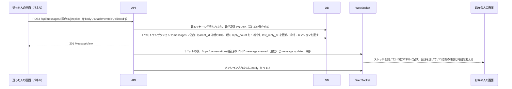

# 機能定義書 FN-08 スレッド：チャットアプリ（RaiseChat）

| 項目 | 内容 |
| --- | --- |
| 文書番号 | RC-FD-08 |
| 版数 | 0.1 |
| 作成日 | 2026-11-10 |
| 最終更新日 | 2026-11-10 |
| 作成者 | （氏名） |
| 上位文書 | [機能定義書](function-definition.md)（RC-FD） |
| 状態 | 承認待ち |

## 改訂履歴

| 版数 | 日付 | 内容 | 作成者 |
| --- | --- | --- | --- |
| 0.1 | 2026-11-10 | 初版 | （氏名） |

本書は機能定義書の一部である。承認は[機能定義書](function-definition.md)で一括して行う。API・リアルタイムの通知・メッセージの共通の決まりは機能定義書 3 章〜5 章のとおり。

---

## 1. 概要

| 項目 | 内容 |
| --- | --- |
| 目的 | あるメッセージへの返信を、会話の流れに混ぜずにスレッドとしてまとめられるようにする |
| 使う画面 | G-5 チャット画面（スレッドのパネル、親メッセージの返信の件数）、G-18 確認ダイアログ |
| 関係する機能 | FN-07 メッセージ（返信もメッセージの 1 つ。送信・編集・削除・表示の決まりは FN-07 と同じ）、FN-09〜FN-11（返信にも添付・リアクション・メンションができる） |
| 前提 | 返信への返信はできない（データ要件定義書 6 章）。返信は会話のメッセージの一覧に出さず、チャンネルの未読にも数えない（データ要件定義書 5.3） |

## 2. 機能要件

| ID | 内容 |
| --- | --- |
| TH-1 | 会話の一覧のメッセージに重ねて「スレッドで返信」を押すと、G-5 の右にスレッドのパネルを開き、親メッセージ・返信の一覧（古いものが上）・返信の入力欄を出す |
| TH-2 | 返信のある親メッセージの下には「（件数）件の返信」と最後の返信の時刻を出す。押すとスレッドのパネルを開く |
| TH-3 | パネルの入力欄で返信を送る。送り方・Markdown 記法・添付・メンション・失敗したときの扱いは FN-07 の MS-3〜MS-8・MS-13 と同じ。送った返信は、そのスレッドを開いている人のパネルにすぐ出し、その会話を開いている人の画面の親メッセージの件数と時刻もすぐ変える |
| TH-4 | 返信の編集・削除は FN-07 の MS-9・MS-10 と同じ（オーナーはほかの人の返信も削除できる） |
| TH-5 | パネルの中の返信には「スレッドで返信」を出さない（返信への返信はできない） |
| TH-6 | パネルは「✕」で閉じる。開いているスレッドは URL（?thread={親メッセージの ID}）に入れ、読み込み直しても開いたままにする。横幅が狭い画面では、パネルを画面いっぱいに出し、戻るボタンで会話に戻る |
| TH-7 | 「削除されました」の親メッセージ（FN-07 MS-11）のスレッドも開ける。残った返信がすべて消えたら、親メッセージも一覧から消し、開いていたパネルは閉じる |
| TH-8 | 参加していない公開チャンネルでは、スレッドを読めるが、返信の入力欄の代わりに M-30 を出す |

## 3. 処理の流れ

### 3.1 返信を送る

### 3.2 返信を消す

FN-07 の 3.3 と同じ。返信を消したときは、親の reply_count を 1 減らし、last_reply_at を残った返信の最後のものにして、親の message.updated も送る。親が「削除されました」で、残った返信が 0 になったときは、親もデータごと消して message.deleted を送る。

## 4. 入力の確認

FN-07 の 4 章と同じ。ほかに入力はない。

## 5. 業務ルール

| No | ルール |
| --- | --- |
| 1 | 返信は、親と同じ会話のメッセージとして保存し、parent_id に親の ID を入れる。親が返信（parent_id がある）のときは 400 にする |
| 2 | 返信は会話の未読に数えない。ただし返信の中のメンションは、メンションの件数と通知に数える（FN-11・FN-14） |
| 3 | 親の返信の件数（reply_count）と最後の返信の日時（last_reply_at）は、返信を足す・消すときに同じトランザクションで直す |
| 4 | スレッドのパネルを開いているときも、購読するのはその会話の /topic/conversations/{id} だけ（返信の通知は同じ宛先に届く。機能定義書 4.2） |
| 5 | 返信の一覧は 50 件ずつ。開いたときは最新の 50 件を出し、上に戻るとその前を読む |
| 6 | 検索・メンションから返信を開いたとき（FN-07 MS-14）は、会話の一覧で親メッセージの位置を開き、パネルでその返信の位置を開く |

## 6. API（案）

| メソッド | URL | 入力 | 出力（成功） | 主なエラー |
| --- | --- | --- | --- | --- |
| GET | /api/messages/{親の ID}/replies?before=&after=&around=&limit= | FN-07 の一覧と同じ | 200 `{"parent": MessageView, "items": MessageView の並び（古い順）, "hasMoreBefore", "hasMoreAfter"}` | 404 MESSAGE_NOT_FOUND |
| POST | /api/messages/{親の ID}/replies | `{"body","attachmentIds","clientId"}` | 201 MessageView | 400 CANNOT_REPLY_TO_REPLY ほか FN-07 と同じ、403、404 |

返信の編集・削除は FN-07 の PATCH・DELETE /api/messages/{id} を使う。

リアルタイムの通知：

| API | 通知 | 送る相手 |
| --- | --- | --- |
| POST /api/messages/{親の ID}/replies | message.created（返信）、message.updated（親） | /topic/conversations/{会話の ID} |
| 〃 | notify（メンションされた人だけ。FN-11）、conversation.updated（メンションの件数。FN-14） | メンションされた人 |
| 返信の DELETE | message.deleted（返信）、message.updated または message.deleted（親） | /topic/conversations/{会話の ID} |

## 7. 使うデータ

| テーブル | 操作 | 内容 |
| --- | --- | --- |
| messages | C R U D | 返信の追加・一覧・編集・削除、親の件数と日時の更新 |
| attachments・reactions・mentions | C R D | FN-07 と同じ |
| conversation_members・workspace_members | R | 見られるか・送れるか |

## 8. 権限

FN-07 の 8 章と同じ。

## 9. エラーとメッセージ

| 場面 | HTTP | code | メッセージ |
| --- | --- | --- | --- |
| 返信に返信しようとした（画面を通さずに送られた） | 400 | CANNOT_REPLY_TO_REPLY | 入力が正しくありません。 |
| 親メッセージがもうない | 404 | MESSAGE_NOT_FOUND | M-49。パネルを閉じる |
| そのほか | — | — | FN-07 の 9 章と同じ |

## 10. テストの観点

- TC-08-1：「スレッドで返信」でパネルが開き、返信を送ると、別のブラウザでスレッドを開いている人のパネルと、会話を開いている人の親の件数・時刻が開き直さずに変わる
- TC-08-2：返信は会話の一覧に出ず、チャンネルの未読にも数えない。返信の中のメンションは通知される
- TC-08-3：パネルの返信には「スレッドで返信」が出ない。API で返信に返信を送ると 400
- TC-08-4：返信の編集・削除で親の件数と最後の返信の時刻が直る
- TC-08-5：「削除されました」の親のスレッドで、最後の返信を消すと親も消え、パネルが閉じる
- TC-08-6：?thread= を付けた URL を読み込み直すとパネルが開いたまま。375px の幅では、パネルが画面いっぱいに出て、戻るで会話に戻る
- TC-08-7：参加していない公開チャンネルでスレッドを読めて、入力欄の代わりに M-30 が出る
- TC-08-8：51 件の返信があるスレッドで、最新 50 件が出て、上に戻ると残りが出る
