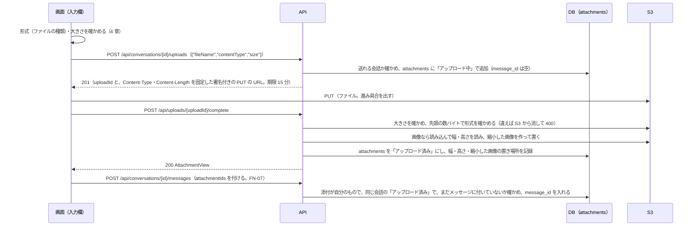
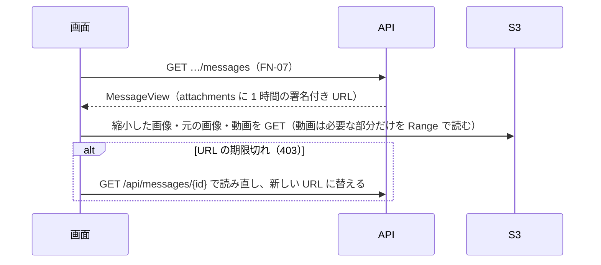

# 機能定義書 FN-09 画像・動画の添付：チャットアプリ（RaiseChat）

| 項目 | 内容 |
| --- | --- |
| 文書番号 | RC-FD-09 |
| 版数 | 0.2 |
| 作成日 | 2026-11-10 |
| 最終更新日 | 2026-11-14 |
| 作成者 | （氏名） |
| 上位文書 | [機能定義書](function-definition.md)（RC-FD） |
| 状態 | 承認待ち |

## 改訂履歴

| 版数 | 日付 | 内容 | 作成者 |
| --- | --- | --- | --- |
| 0.1 | 2026-11-10 | 初版 | （氏名） |
| 0.2 | 2026-11-14 | 添付を作るとき（開発計画書 1-11）に決めたことを足した：形式の確かめ方（動画の先頭のバイト、読めない画像）、縮小した画像の置き場所、complete を 2 回送ったとき、送る前に外せるもの、画面を離れたときと「もう一度」のときの外し方、AttachmentView の downloadUrl と thumbnailUrl、エラーの code（UPLOAD_NOT_FOUND） | （氏名） |

本書は機能定義書の一部である。承認は[機能定義書](function-definition.md)で一括して行う。API・リアルタイムの通知・メッセージの共通の決まりは機能定義書 3 章〜5 章のとおり。

---

## 1. 概要

| 項目 | 内容 |
| --- | --- |
| 目的 | メッセージに画像・動画を添付して送り、画像は縮小して並べて拡大でき、動画はその場で再生できるようにする |
| 使う画面 | G-5 チャット画面（入力欄・メッセージ・スレッドのパネル）、G-17 画像の拡大ダイアログ |
| 関係する機能 | FN-07 メッセージ・FN-08 スレッド（添付はメッセージと一緒に送る）、FN-03・FN-06（削除で S3 のファイルも消す） |
| 前提 | 1 通に 4 個まで。画像は JPEG・PNG・GIF・WebP の 10MB まで、動画は MP4・WebM の 100MB まで（データ要件定義書 6.1）。動画の変換・サムネイルは作らない（要件定義書 2.2）。ファイルは S3 に置き、外部から直接は読めない（要件定義書 N-20） |

## 2. 機能要件

| ID | 内容 |
| --- | --- |
| AT-1 | 入力欄の「📎」でファイルを選ぶ、入力欄にファイルをドラッグ＆ドロップする、画像を貼り付ける、のどれでも添付できる。添付したファイルは入力欄の上に、画像は小さな見本、動画はファイル名で並べ、「×」で外せる |
| AT-2 | 1 通に 5 個以上添付しようとしたときは M-38 を出し、5 個目以降は添付しない。形式・大きさが条件に合わないファイルは M-39 を出して添付しない |
| AT-3 | 添付したファイルはすぐにアップロードを始め、それぞれに進み具合を出す。すべてのアップロードが終わるまで「送信」を押せない（本文だけを先に送ることはしない） |
| AT-4 | アップロードに失敗したファイルには M-40 と「もう一度」を出す。外すか、もう一度アップロードして成功するまで送れない |
| AT-5 | 送ったメッセージの画像は、縮小した画像（長い辺 800px まで）を並べて出す。画像を押すと G-17 に元の画像を大きく出し、同じメッセージのほかの画像に左右で移れる。G-17 には「ダウンロード」を出す |
| AT-6 | アニメーションする GIF・WebP は、縮小した画像では最初のコマだけを出し、G-17 では動かして出す |
| AT-7 | 動画は、再生ボタンつきの枠をメッセージの中に出す。自動では再生しない。再生ボタンを押すと、全部を読み込むのを待たずに再生を始める（要件定義書 N-7）。ブラウザが再生できない動画は、M-41 と「ダウンロード」を出す |
| AT-8 | 画像・動画の幅と高さが分かっているときは、読み込む前からその大きさの場所を取り、読み込んだときに一覧がずれないようにする |
| AT-9 | メッセージの編集（FN-07 MS-9）では、添付を外せる（足すことはできない）。外した添付は S3 からも消す。本文が空で、添付をすべて外すことはできない |
| AT-10 | 添付の URL は署名付き URL（有効期限 1 時間）で渡す。期限が切れて表示できなかったときは、画面がそのメッセージを読み直して新しい URL に替える |
| AT-11 | アップロードしたが送らなかったファイル（外した、送らずに画面を閉じたなど）は、アップロードしてから 24 時間たったら、1 日 1 回まとめて消す |

## 3. 処理の流れ

### 3.1 アップロードと送信

ファイルは API サーバーを通さず、画面から S3 に直接送る（100MB の動画で API サーバーを長く使わないため）。

### 3.2 表示

## 4. 入力の確認

| 項目 | 型 | 必須 | 条件 | 守られないとき |
| --- | --- | --- | --- | --- |
| ファイルの数 | 数値 | | 1 通に 0〜4 個 | M-38（API は 400 TOO_MANY_ATTACHMENTS） |
| 形式（contentType） | 文字列 | ○ | image/jpeg・image/png・image/gif・image/webp・video/mp4・video/webm。complete のときに、ファイルの先頭の 16 バイトでも確かめる（拡張子だけでは決めない）。画像はアバターと同じ見分け方（FN-02）、MP4 は 5〜8 バイト目が「ftyp」、WebM は先頭が EBML の印（1A 45 DF A3）。先頭は画像の形でも、読めない画像（壊れている・4,000 万画素を超える）は添付できない | M-39（API は 400 ATTACHMENT_TYPE_INVALID） |
| 大きさ（size） | 数値 | ○ | 画像は 1〜10,485,760 バイト、動画は 1〜104,857,600 バイト | M-39（API は 413 ATTACHMENT_TOO_LARGE） |
| ファイル名（fileName） | 文字列 | ○ | 1〜255 文字。表示にだけ使い、S3 の置き場所には使わない | 長いときは画面で 255 文字に切って送る。API は 400 BAD_REQUEST |

## 5. 業務ルール

| No | ルール |
| --- | --- |
| 1 | S3 の置き場所は、ワークスペースの ID と推測できない乱数で作る（例：workspaces/3/attachments/{UUID}）。元のファイル名は使わない |
| 2 | 署名付きの PUT の URL は、Content-Type と Content-Length を署名に含め、申告と違うファイルを置けないようにする。期限は 15 分 |
| 3 | complete で形式が申告と違ったとき（画像の拡張子にした HTML・SVG など）は、S3 のファイルを消して 400 にする。S3 に置くファイルの Content-Type は記録した形式に固定し、表示用の署名付き URL でも同じ Content-Type を指定する（データ要件定義書 6.1、要件定義書 N-21） |
| 4 | 縮小した画像は、長い辺を 800px までにした JPEG（透過のある PNG・WebP・GIF は PNG）にする。元の画像が 800px 以下なら作らず、元の画像を使う。アニメーションする画像は最初のコマから作る |
| 5 | 動画は変換しない。幅・高さは、取れるときだけ記録する（取れなくても送れる） |
| 6 | 「ダウンロード」の署名付き URL には、元のファイル名で保存されるように Content-Disposition（attachment）を指定する |
| 7 | 添付を消すとき（メッセージの削除、編集で外す、チャンネル・ワークスペースの削除、送らなかったもの）は、データベースの行をコミットした後に S3 のファイル（縮小した画像を含む）を消す。消せなかったものは記録して 1 日 1 回消し直す（要件定義書 N-11） |
| 8 | 送らなかった添付（message_id が空のまま 24 時間たったもの）は、1 日 1 回まとめて消す（AT-11） |
| 9 | S3 のバケットは、本アプリの画面の URL からの PUT だけを受け付けるよう CORS を設定する（やり方はインフラ設計書で決める） |
| 10 | 縮小した画像は、元のファイルの置き場所に「-thumb.jpg」（透過のある画像は「-thumb.png」）を付けたところに置く。同じ添付の complete が同時に来ても同じところに置くので、片方を消す必要がない。complete は、済んだものに 2 回送っても同じ AttachmentView を返す |
| 11 | complete では、S3 に置かれたファイルの大きさが受け付けたときの大きさと違うときも、形式が違うときと同じく S3 のファイルと記録を消して 400 にする。S3 の読み書き（10MB までの画像の読み込みと縮小）はトランザクションの外で行い、最後に行をロックして「アップロード済み」にする |
| 12 | 送る前に外せる（DELETE）・complete できるのは、アップロードした本人の、まだメッセージに付いていないものだけ。会話を見られなくなったもの（キック・退出・削除）も complete できない（404） |
| 13 | 画面は、「もう一度」のときは受け付けからやり直し、前に受け付けてもらったものは DELETE で外す。送らずに会話を移った・画面を閉じたときも、送っていないものを DELETE で外す（届かなかったものは AT-11 で消える）。送れなかったメッセージを「取り消す」と、本文と一緒に添付も入力欄に戻す |

## 6. API（案）

| メソッド | URL | 入力 | 出力（成功） | 主なエラー |
| --- | --- | --- | --- | --- |
| POST | /api/conversations/{id}/uploads | `{"fileName","contentType","size"}` | 201 `{"uploadId","putUrl","headers","expiresAt"}` | 400 ATTACHMENT_TYPE_INVALID、403（送れない会話）、404、413 ATTACHMENT_TOO_LARGE |
| POST | /api/uploads/{uploadId}/complete | なし | 200 AttachmentView | 400 ATTACHMENT_TYPE_INVALID・UPLOAD_NOT_FOUND_IN_STORAGE、404 UPLOAD_NOT_FOUND |
| DELETE | /api/uploads/{uploadId} | なし（送る前に外したとき） | 204 | 404 UPLOAD_NOT_FOUND |
| GET | /api/messages/{id} | なし | 200 MessageView（新しい署名付き URL） | 404 MESSAGE_NOT_FOUND |

AttachmentView：MessageView の attachments の 1 つと同じ形（機能定義書 3.5）。url は表示用（Content-Type を記録した形式に固定）、thumbnailUrl は縮小した画像（作らなかった画像は url と同じ。動画は null）、downloadUrl は元のファイル名で保存させるもの（5 章の 6）。添付をメッセージに付けるのは FN-07 の POST …/messages（attachmentIds）で行う。

リアルタイムの通知：なし（添付はメッセージの通知（FN-07）に含めて送る）。

## 7. 使うデータ

| テーブル | 操作 | 内容 |
| --- | --- | --- |
| attachments | C R U D | アップロードの記録、完了、メッセージへの結びつけ、表示、削除 |
| messages | R | 添付を付けるメッセージ |
| conversation_members・workspace_members | R | 送れる会話か、見られるか |
| S3 | C R D | ファイルと縮小した画像を置く・読む・消す |

## 8. 権限

| 操作 | アップロードした本人 | 会話を見られる人 | 見られない人 |
| --- | --- | --- | --- |
| アップロードする | 送れる会話（canPost）のときだけ | — | できない（404） |
| 送る前に外す・完了させる | できる | できない（404） | できない（404） |
| 送った添付を見る・ダウンロードする | できる | できる | できない（URL を受け取れない） |
| 送った添付を消す | メッセージの編集・削除で（FN-07） | オーナーはメッセージの削除で | できない |

## 9. エラーとメッセージ

| 場面 | HTTP | code | メッセージ |
| --- | --- | --- | --- |
| 5 個以上添付した | 400 | TOO_MANY_ATTACHMENTS | M-38 |
| 形式が違う（中身が申告と違うときも） | 400 | ATTACHMENT_TYPE_INVALID | M-39 |
| 大きすぎる | 413 | ATTACHMENT_TOO_LARGE | M-39 |
| S3 にファイルがない（PUT が終わっていない） | 400 | UPLOAD_NOT_FOUND_IN_STORAGE | M-40 |
| 自分のものでない・ほかの会話の・送り済みの・complete していない添付を付けようとした。同じ添付を 2 回並べた | 400 | BAD_REQUEST | 入力が正しくありません。 |
| ほかの人の・送り済みの・ないアップロードを complete・DELETE した | 404 | UPLOAD_NOT_FOUND | M-40 |
| アップロード（S3 への PUT を含む）に失敗 | 500 など | — | M-40 |
| 動画を再生できない | — | — | M-41 |

## 10. テストの観点

- TC-09-1：画像：10MB ちょうど・10MB＋1 バイト。動画：100MB ちょうど・100MB＋1 バイト。PDF・SVG・HEIC は M-39
- TC-09-2：拡張子を .png に変えた HTML ファイル・申告と違う Content-Type で PUT したファイルは complete で 400 になり、S3 から消える
- TC-09-3：5 個目を添付すると M-38。4 個は送れる。API に 5 個の attachmentIds を送ると 400
- TC-09-4：アップロードの途中は「送信」を押せない。通信を切ると M-40、「もう一度」で送れる
- TC-09-5：ドラッグ＆ドロップ・貼り付けでも添付できる
- TC-09-6：送った画像が縮小した画像（長い辺 800px 以下）で並び、押すと G-17 に元の画像が出て、左右で移れる。アニメーション GIF は G-17 で動く
- TC-09-7：100MB の動画を送ってから、相手の画面に再生ボタンが出るまでの時間（要件定義書 N-7）。再生ボタンを押して 5 秒以内に始まる
- TC-09-8：Safari で再生できない WebM は M-41 と「ダウンロード」が出る
- TC-09-9：ほかの人の uploadId で complete・DELETE を送ると 404。ほかの人の添付の ID を付けて送ると 400
- TC-09-10：入っていないプライベートチャンネルのメッセージの添付の URL は、API から受け取れない。署名付き URL は 1 時間で開けなくなり、画面は読み直して表示を続ける
- TC-09-11：編集で添付を外すと、表示から消えて S3 のファイル（縮小した画像も）も消える
- TC-09-12：送らずに外した添付は S3 から消え、送らずに閉じた添付は 24 時間後の片付けで消える
