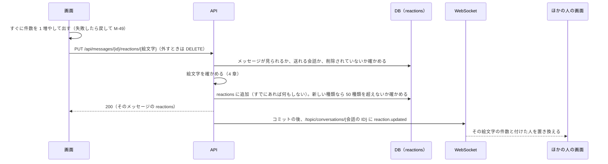

# 機能定義書 FN-10 絵文字リアクション：チャットアプリ（RaiseChat）

| 項目 | 内容 |
| --- | --- |
| 文書番号 | RC-FD-10 |
| 版数 | 0.3 |
| 作成日 | 2026-11-10 |
| 最終更新日 | 2026-11-15 |
| 作成者 | （氏名） |
| 上位文書 | [機能定義書](function-definition.md)（RC-FD） |
| 状態 | 承認待ち |

## 改訂履歴

| 版数 | 日付 | 内容 | 作成者 |
| --- | --- | --- | --- |
| 0.1 | 2026-11-10 | 初版 | （氏名） |
| 0.2 | 2026-11-14 | 絵文字の条件（4 章）に、component（肌の色・髪型の部品 9 個）と、異体字セレクタ（U+FE0F）の有無の違いの扱いを足した（ステータスの絵文字を作るとき（開発計画書 1-10）に、画面の絵文字の一覧と食い違うと分かったため） | （氏名） |
| 0.3 | 2026-11-15 | リアクションを作るとき（開発計画書 1-13）に決めたことを入れた。reactions.users を username だけから username と表示名の組にした（RE-4 で表示名を出すため）。21 人目より後に付けた自分の reactedByMe の直し方（5 章の 4）、変わらなかったときも通知を送ること（5 章の 3）、外すときも送れるか・「削除されました」かを確かめること（5 章の 7・6 章）、メッセージの行は付けるときも外すときもロックすること（5 章の 2）、長押しで出したときは付け外ししないこと（RE-4）を書いた | （氏名） |

本書は機能定義書の一部である。承認は[機能定義書](function-definition.md)で一括して行う。API・リアルタイムの通知・メッセージの共通の決まりは機能定義書 3 章〜5 章のとおり。

---

## 1. 概要

| 項目 | 内容 |
| --- | --- |
| 目的 | メッセージに絵文字で手軽に反応できるようにする |
| 使う画面 | G-5 チャット画面（メッセージ・スレッドのパネル） |
| 関係する機能 | FN-07 メッセージ・FN-08 スレッド（親メッセージにも返信にも付けられる）、FN-02（ステータスの絵文字も同じ一覧から選ぶ） |
| 前提 | 使えるのは Unicode の絵文字だけ（カスタム絵文字はない。要件定義書 2.2）。1 人が 1 つのメッセージに、違う絵文字をいくつでも付けられる。1 つのメッセージの絵文字の種類は 50 まで（データ要件定義書 6.2） |

## 2. 機能要件

| ID | 内容 |
| --- | --- |
| RE-1 | メッセージに重ねて「リアクション」を押すと、絵文字の一覧（種類ごとの分類・名前での検索・最近使ったもの）を出す。選ぶと、そのメッセージに自分のリアクションとして付ける |
| RE-2 | メッセージの下に、付いた絵文字ごとに絵文字と件数を並べる。自分が付けた絵文字は枠の色を変え、「（件数）、自分も付けた」と読み上げる（色だけで区別しない。要件定義書 N-30） |
| RE-3 | 並んでいる絵文字を押すと、自分がまだ付けていなければ付け、付けていれば外す。並びの最後の「＋」で RE-1 の一覧を出す |
| RE-4 | 並んでいる絵文字に重ねる（スマートフォンでは長押し）と、付けた人の表示名を付けた順に 20 人まで出す（「たろう、はなこ、ほか 3 人」）。長押しで出したときは、指を離しても付ける・外すにしない。リアクションを付けられない人（RE-7）も見られる |
| RE-5 | 絵文字は、その絵文字が最初に付けられた順に並べる。全員が外して 0 件になった絵文字は消す |
| RE-6 | 付けた・外したことは、同じ会話を開いているほかの人の画面にすぐ出す（要件定義書 N-3） |
| RE-7 | 50 種類の絵文字が付いたメッセージに、まだ付いていない絵文字を付けようとしたときは M-42 を出す。参加していない公開チャンネルと「削除されました」のメッセージには、リアクションのボタンを出さない |

## 3. 処理の流れ

## 4. 入力の確認

| 項目 | 型 | 必須 | 条件 | 守られないとき |
| --- | --- | --- | --- | --- |
| 絵文字（URL の一部。URL エンコードする） | 文字列 | ○ | Unicode の絵文字 1 つ。Unicode が定める絵文字の一覧（emoji-test.txt の fully-qualified のもの。肌の色や ZWJ でつないだものを含む）にあるもの。一覧の版は技術スタック定義書で決め、画面の絵文字の一覧と同じ版にする | 画面では一覧から選ぶだけ。API は 400 EMOJI_INVALID |

ステータスの絵文字（FN-02）も、この条件で確かめる。

- 画面の絵文字の一覧（emoji-picker-element-data）には、emoji-test.txt で component に分類される肌の色・髪型の部品（🏻〜🏿・🦰・🦱・🦳・🦲 の 9 個）も単独で出るので、これも使えるものとする。これで一覧の絵文字（3,953 個）と API が使えるとするものが同じになる
- 画面の一覧は「👍️」のように、emoji-test.txt にない異体字セレクタ（U+FE0F）を付けることがある。U+FE0F の有無だけが違うものは同じ絵文字とみなし、emoji-test.txt の形（👍）に直して保存する（U+FE0F を除くと同じになる絵文字は一覧にないことを、読み込むときに確かめる）

## 5. 業務ルール

| No | ルール |
| --- | --- |
| 1 | リアクションは（message_id, user_id, emoji）の一意の制約で 1 人 1 絵文字 1 つに保つ。付ける・外すは何度送っても同じ結果になる（PUT・DELETE） |
| 2 | 絵文字の種類の上限（50）は、新しい種類を足すときだけ確かめる。同時に足して 51 種類にならないよう、メッセージの行をロックしてから数える。付ける・外すはどちらもメッセージの行をロックしてから確かめる（同時に「削除されました」にされたメッセージに付けないため。削除も同じ行をロックする。BR-8） |
| 3 | reaction.updated には、変わった絵文字だけでなく、そのメッセージの reactions 全体を入れる（届く順が入れ替わっても最後の状態が正しくなるように）。すでに付けていた・付けていなかったなど、何も変わらなかったときも送る（ほかの人の画面を最後の状態に合わせる） |
| 4 | reactedByMe は受け取った人ごとに違うため、通知では false で送る。画面が users に自分の username があるかで決める。users は 20 人までなので、21 人目より後に付けた自分は users にいない。そのときは、いま出している reactedByMe を残す（ほかの人の操作では変わらないため） |
| 5 | メッセージを削除したら、そのリアクションも消える（ON DELETE CASCADE。「削除されました」にしたときも消す。FN-07） |
| 6 | 最近使った絵文字は、ブラウザに覚える（サーバーには保存しない。emoji-picker-element が IndexedDB に覚える） |
| 7 | 外すときも、付けるときと同じく、送れる会話か・「削除されました」でないかを確かめる（8 章のとおり、見られるが送れない人は自分のものも外せない） |

## 6. API（案）

| メソッド | URL | 入力 | 出力（成功） | 主なエラー |
| --- | --- | --- | --- | --- |
| PUT | /api/messages/{id}/reactions/{絵文字} | なし | 200 `{"reactions": […]}`（MessageView の reactions と同じ形） | 400 EMOJI_INVALID、403 NOT_CHANNEL_MEMBER・DM_PARTNER_LEFT・MESSAGE_DELETED、404、409 REACTION_LIMIT |
| DELETE | /api/messages/{id}/reactions/{絵文字} | なし | 200 `{"reactions": […]}` | 400 EMOJI_INVALID、403 NOT_CHANNEL_MEMBER・DM_PARTNER_LEFT・MESSAGE_DELETED、404 |

リアルタイムの通知：

| API | 通知 | 送る相手 |
| --- | --- | --- |
| PUT・DELETE | reaction.updated | /topic/conversations/{会話の ID} |

## 7. 使うデータ

| テーブル | 操作 | 内容 |
| --- | --- | --- |
| reactions | C R D | 付ける・一覧・外す |
| messages | R U | 見られるか・削除されていないか、上限を数えるときのロック |
| users | R | 付けた人の表示名 |
| conversation_members・workspace_members | R | 見られるか・送れるか |

## 8. 権限

| 操作 | 送れる人（canPost） | 見られるが送れない人 | 見られない人 |
| --- | --- | --- | --- |
| リアクションを見る | できる | できる | できない（404） |
| 付ける・自分のものを外す | できる | できない（403） | できない（404） |
| ほかの人のリアクションを外す | できない（オーナーも） | できない | できない |

## 9. エラーとメッセージ

| 場面 | HTTP | code | メッセージ |
| --- | --- | --- | --- |
| 絵文字でない文字 | 400 | EMOJI_INVALID | 入力が正しくありません。 |
| 50 種類を超える | 409 | REACTION_LIMIT | M-42 |
| 参加していない公開チャンネル・相手がいない DM | 403 | NOT_CHANNEL_MEMBER・DM_PARTNER_LEFT | M-49 |
| 「削除されました」のメッセージ | 403 | MESSAGE_DELETED | M-49 |
| メッセージがもうない | 404 | MESSAGE_NOT_FOUND | M-49 |
| 付ける・外すに失敗 | 500 | INTERNAL_ERROR | M-49。表示を戻す |

## 10. テストの観点

- TC-10-1：付けると件数が増えて自分の枠の色が変わり、もう一度押すと外れる。0 件になった絵文字は消える
- TC-10-2：1 人が同じメッセージに 3 種類の絵文字を付けられる。同じ絵文字を 2 回 PUT しても 1 つ
- TC-10-3：別のブラウザで同じ会話を開いている人の画面に、1 秒以内に反映する
- TC-10-4：重ねると付けた人の表示名が付けた順に出る。21 人以上は「ほか N 人」
- TC-10-5：肌の色を変えた絵文字・家族の絵文字（ZWJ）を付けられる。「a」や 2 つの絵文字を並べたものを API に送ると 400
- TC-10-6：50 種類付いたメッセージに 51 種類目は M-42。すでにある絵文字にはまだ付けられる
- TC-10-7：スレッドの返信にも付けられる。参加していない公開チャンネルではボタンが出ず、API は 403
