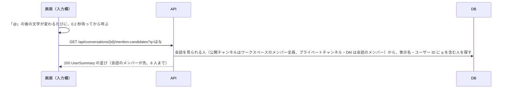

# 機能定義書 FN-11 メンション：チャットアプリ（RaiseChat）

| 項目 | 内容 |
| --- | --- |
| 文書番号 | RC-FD-11 |
| 版数 | 0.1 |
| 作成日 | 2026-11-10 |
| 最終更新日 | 2026-11-10 |
| 作成者 | （氏名） |
| 上位文書 | [機能定義書](function-definition.md)（RC-FD） |
| 状態 | 承認待ち |

## 改訂履歴

| 版数 | 日付 | 内容 | 作成者 |
| --- | --- | --- | --- |
| 0.1 | 2026-11-10 | 初版 | （氏名） |

本書は機能定義書の一部である。承認は[機能定義書](function-definition.md)で一括して行う。API・リアルタイムの通知・メッセージの共通の決まりは機能定義書 3 章〜5 章のとおり。

---

## 1. 概要

| 項目 | 内容 |
| --- | --- |
| 目的 | メッセージの中で「@ユーザー ID」と書いて特定の人に呼びかけ、その人に知らせられるようにする |
| 使う画面 | G-5 チャット画面（入力欄の候補、メッセージの中のメンションの表示） |
| 関係する機能 | FN-07 メッセージ・FN-08 スレッド（本文からメンションを探す）、FN-14 通知（メンションの件数・一覧・ブラウザの通知） |
| 前提 | メンションできるのは 1 人ずつ（@channel・@here はない。要件定義書 2.2）。記録・通知するのは、送ったときにその会話を見られる人へのメンションだけ（データ要件定義書 6.3） |

## 2. 機能要件

| ID | 内容 |
| --- | --- |
| MN-1 | 入力欄で「@」に続けて文字を入れると、その会話を見られるメンバーのうち、表示名かユーザー ID にその文字を含む人を、会話のメンバーを先にして 8 人まで候補に出す。上下の矢印で選び、Enter か Tab（またはクリック）で「@ユーザー ID 」を入れる。Esc で候補を閉じる |
| MN-2 | 候補を使わずに「@ユーザー ID」を手で書いてもメンションになる（5 章の 1 の書き方に合うとき） |
| MN-3 | 送ったメッセージの中のメンション（記録したもの）は、「@ユーザー ID」を目立つ色の文字で出す。自分へのメンションは、さらに背景の色を変えて出す。記録しなかった「@〜」（いない人・見られない人など）は普通の文字で出す |
| MN-4 | 自分へのメンション、同じ人への 2 つ目以降のメンション、その会話を見られない人へのメンションは記録しない |
| MN-5 | メンションされた人には、サイドバーのメンションの件数（FN-14 NT-2）、メンションの一覧（G-7。FN-14 NT-5）、ブラウザの通知（設定がオンのとき。FN-14 NT-7）で知らせる |
| MN-6 | メッセージを編集してメンションを足したときは、足した人にだけ MN-5 のとおり知らせる。メンションを消したときは、その人のメンションの件数・一覧からも消す |
| MN-7 | 名前を押すと G-16 を出す（メンションの「@ユーザー ID」を押したときも同じ。FN-02 PF-7） |

## 3. 処理の流れ

### 3.1 候補を出す



### 3.2 送ったときに記録する

FN-07 の 3.1 の「メンションを探す」で次を行う。

```mermaid
flowchart TD
    s([本文]) --> code[コード・コードブロックの中を除く]
    code --> find[「@ユーザー ID」の書き方に合う所を探す]
    find --> user{そのユーザー ID の人がいる？}
    user -- いない --> skip[記録しない]
    user -- いる --> self{自分？}
    self -- はい --> skip
    self -- いいえ --> see{送ったときに<br>その会話を見られる？}
    see -- いいえ --> skip
    see -- はい --> rec[mentions に記録（同じ人は 1 つ）<br>コミットの後に notify と conversation.updated を送る]
```

## 4. 入力の確認

| 項目 | 型 | 必須 | 条件 | 守られないとき |
| --- | --- | --- | --- | --- |
| 候補の文字（q） | 文字列 | | 0〜30 文字。空なら会話のメンバーを表示名の順に 8 人 | 400 BAD_REQUEST |

本文のメンションは FN-07 の本文として確かめる。メンションの数に上限はない。

## 5. 業務ルール

| No | ルール |
| --- | --- |
| 1 | メンションの書き方は「@」に続く 3〜15 文字の半角英数字と「_」。「@」の前は、本文の始まりか、英数字・「_」以外の文字とする（メールアドレスの「a@b」をメンションにしない）。大文字・小文字は区別しない。コード（`` ` `` で囲んだ所）とコードブロックの中は探さない |
| 2 | 「見られる人」は、公開チャンネルではワークスペースのいまのメンバー全員（チャンネルに参加していなくてもよい）、プライベートチャンネルではそのチャンネルのメンバー、DM では 2 人のうちワークスペースのいまのメンバーである人（要件定義書 3.1、データ要件定義書 6.3） |
| 3 | 送った後に会話のメンバーに加わった人に、加わる前のメンションは知らせない（データ要件定義書 6.3） |
| 4 | 編集したときは、本文からメンションを探し直し、増えた人を足し、減った人を消す。残った人のメンションの「読んだか」は変えない（もう一度は知らせない） |
| 5 | 本文に残っている「@ユーザー ID」の文字は、記録したかどうかにかかわらず消さない。画面は MessageView の mentions にある人だけを目立たせる |

## 6. API（案）

| メソッド | URL | 入力 | 出力（成功） | 主なエラー |
| --- | --- | --- | --- | --- |
| GET | /api/conversations/{id}/mention-candidates?q= | 候補の文字 | 200 UserSummary の並び（8 人まで） | 404 CONVERSATION_NOT_FOUND |

メンションの記録は FN-07 の送信・編集の API の中で行う。メンションの一覧は FN-14 の API で読む。

リアルタイムの通知（FN-07・FN-08 の送信・編集の中で送る）：

| 場面 | 通知 | 送る相手 |
| --- | --- | --- |
| メンションを記録した | notify（kind は MENTION）、conversation.updated・workspace.updated（メンションの件数） | メンションされた人 |
| 編集でメンションを消した | conversation.updated・workspace.updated（件数が減ったとき） | メンションを消された人 |

## 7. 使うデータ

| テーブル | 操作 | 内容 |
| --- | --- | --- |
| mentions | C D | 送信・編集で記録、編集・削除で消す |
| users | R | ユーザー ID から人を探す、候補 |
| workspace_members・conversation_members | R | 会話を見られる人か |

## 8. 権限

| 操作 | 送れる人（canPost） | それ以外 |
| --- | --- | --- |
| 候補を出す | できる | 見られる会話ならできる（使い道はない）。見られなければ 404 |
| メンションする | できる | できない（送れないため） |

## 9. エラーとメッセージ

| 場面 | HTTP | code | メッセージ |
| --- | --- | --- | --- |
| 候補に一致する人がいない | 200 | — | 候補を出さない（メッセージも出さない） |
| 候補の読み込みに失敗 | 500 | INTERNAL_ERROR | 候補を出さない |

## 10. テストの観点

- TC-11-1：「@はな」で表示名・ユーザー ID に含む人が 8 人まで、会話のメンバーが先に出る。矢印と Enter・Tab で選べる
- TC-11-2：プライベートチャンネル・DM では、会話のメンバーでない人が候補に出ず、手で「@その人」と書いても記録されず通知されない
- TC-11-3：公開チャンネルで、チャンネルに参加していないワークスペースのメンバーをメンションすると、その人に通知される
- TC-11-4：「@taro_y」「@TARO_Y」がどちらもメンションになる。「a@taro_y」「`@taro_y`」、コードブロックの中はならない
- TC-11-5：自分へのメンション・いないユーザー ID は記録されず、普通の文字で出る。同じ人を 2 回書いても通知は 1 回
- TC-11-6：自分へのメンションは背景の色が変わって出る
- TC-11-7：編集でメンションを足すと、足した人にだけ通知される。消すと、その人のメンションの件数と一覧から消える
- TC-11-8：スレッドの返信の中のメンションも通知される
- TC-11-9：後でプライベートチャンネルに招待された人に、招待の前のメンションは出ない
