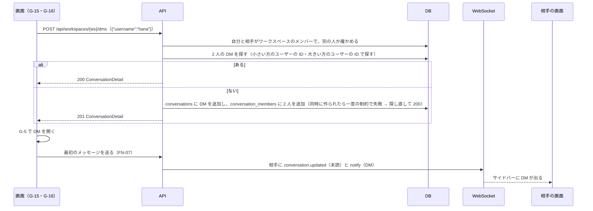

# 機能定義書 FN-12 ダイレクトメッセージ：チャットアプリ（RaiseChat）

| 項目 | 内容 |
| --- | --- |
| 文書番号 | RC-FD-12 |
| 版数 | 0.1 |
| 作成日 | 2026-11-10 |
| 最終更新日 | 2026-11-10 |
| 作成者 | （氏名） |
| 上位文書 | [機能定義書](function-definition.md)（RC-FD） |
| 状態 | 承認待ち |

## 改訂履歴

| 版数 | 日付 | 内容 | 作成者 |
| --- | --- | --- | --- |
| 0.1 | 2026-11-10 | 初版 | （氏名） |

本書は機能定義書の一部である。承認は[機能定義書](function-definition.md)で一括して行う。API・リアルタイムの通知・メッセージの共通の決まりは機能定義書 3 章〜5 章のとおり。

---

## 1. 概要

| 項目 | 内容 |
| --- | --- |
| 目的 | 同じワークスペースのメンバーと 2 人だけでやり取りできるようにする |
| 使う画面 | G-5 チャット画面（サイドバーの DM の一覧・会話の見出し）、G-15 DM の相手の選択ダイアログ、G-16 プロフィールのダイアログ（「メッセージを送る」） |
| 関係する機能 | FN-07〜FN-11（DM の中の動きはチャンネルと同じ）、FN-05（相手が抜けたときは送れない）、FN-14 通知（DM の未読の件数・ブラウザの通知） |
| 前提 | DM は同じワークスペースの 2 人の間だけ（3 人以上・自分あてはない。要件定義書 2.2）。同じワークスペースで同じ 2 人の DM は 1 つ（データ要件定義書 5.2）。DM を見られるのは 2 人のうちワークスペースのいまのメンバーである人だけで、オーナーも見られない |

## 2. 機能要件

| ID | 内容 |
| --- | --- |
| DM-1 | G-5 のサイドバーの「ダイレクトメッセージ」に、自分の DM を、最後のメッセージが新しい順に、相手のアバター・表示名・ステータスの絵文字とともに出す。未読があるものは太字にし、未読の件数を出す（FN-14） |
| DM-2 | 見出し「ダイレクトメッセージ」の「＋」を押すと G-15 を出す。自分以外のワークスペースのメンバーを名前で探して（いないときは M-47）選ぶと、その人との DM を G-5 で開く。まだ DM がなければ作る |
| DM-3 | G-16 の「メッセージを送る」を押したときも、DM-2 と同じくその人との DM を開く（なければ作る） |
| DM-4 | 作ったばかりで、まだメッセージのない DM は、作った人のサイドバーにだけ出す。最初のメッセージが送られたら、相手のサイドバーにもすぐ出す |
| DM-5 | DM の会話の見出しに、相手のアバター・表示名・@ユーザー ID・ステータスを出す。押すと G-16 を出す。DM の中のメッセージ・スレッド・添付・リアクション・メンションは、チャンネルと同じ（FN-07〜FN-11） |
| DM-6 | 相手がワークスペースを抜けた（キック・退出）DM は、読めるが送れない。入力欄の代わりに M-36 を出し、リアクション・スレッドの返信もできない。相手がまた参加したら、また送れる（FN-05 MB-6・MB-7） |
| DM-7 | ほかの人の DM の URL を開いたときは、M-27 を出して general を開く。ほかの人の DM は、検索・メンションの一覧など、どこにも出さない（要件定義書 N-14） |

## 3. 処理の流れ

## 4. 入力の確認

| 項目 | 型 | 必須 | 条件 | 守られないとき |
| --- | --- | --- | --- | --- |
| 相手（username） | 文字列 | ○ | ワークスペースのいまのメンバーで、自分でない | 自分なら 400 CANNOT_DM_SELF、メンバーでなければ 404 USER_NOT_FOUND |

G-15 の名前での検索は、FN-05 のメンバーの一覧の API（絞り込みの文字）を使う。

## 5. 業務ルール

| No | ルール |
| --- | --- |
| 1 | DM は（ワークスペース、小さい方のユーザーの ID、大きい方のユーザーの ID）の一意の制約で、同じ 2 人に 1 つに保つ |
| 2 | DM を見られるかは、「その DM の 2 人のうちの 1 人で、いまワークスペースのメンバーである」かで決める。DM の conversation_members の行は、ワークスペースを抜けても消さない（FN-05 の 5 章の 3） |
| 3 | 送れるのは、2 人ともいまワークスペースのメンバーのときだけ（canPost） |
| 4 | メッセージのない DM は、作った人のサイドバーにだけ出す。相手のサイドバーに出すのは、メッセージが 1 つ以上あるとき |
| 5 | サイドバーの DM の並びは、最後の親メッセージの日時の新しい順。メッセージがなければ作った日時を使う |
| 6 | DM の中のメッセージは、送った人以外は、オーナーでも削除できない（オーナーは DM を見られないため） |

## 6. API（案）

| メソッド | URL | 入力 | 出力（成功） | 主なエラー |
| --- | --- | --- | --- | --- |
| POST | /api/workspaces/{ws}/dms | `{"username"}` | 201 ConversationDetail（作った）、200（もうあった） | 400 CANNOT_DM_SELF、404 USER_NOT_FOUND・WORKSPACE_NOT_FOUND |

DM の一覧は FN-06 の GET /api/workspaces/{ws}/conversations、DM の詳細は GET /api/conversations/{id}、メッセージは FN-07 の API を使う。

リアルタイムの通知：DM を作っただけでは送らない。最初のメッセージからは FN-07 のとおり（相手に conversation.updated と notify（kind は DM））。

## 7. 使うデータ

| テーブル | 操作 | 内容 |
| --- | --- | --- |
| conversations | C R | DM を作る・探す |
| conversation_members | C R | 2 人を足す、見られるか |
| workspace_members | R | 2 人がメンバーか |
| messages | R | サイドバーの並び、相手のサイドバーに出すか |

## 8. 権限

| 操作 | DM の 2 人（ワークスペースのメンバー） | ほかのメンバー（オーナーを含む） |
| --- | --- | --- |
| DM を始める | 自分以外のメンバーとならできる | — |
| DM を読む | できる | できない（404） |
| DM に送る | 2 人ともメンバーならできる | できない（404） |

## 9. エラーとメッセージ

| 場面 | HTTP | code | メッセージ |
| --- | --- | --- | --- |
| 自分を選んだ（画面を通さずに送られた） | 400 | CANNOT_DM_SELF | 入力が正しくありません。 |
| 相手がワークスペースのメンバーでない | 404 | USER_NOT_FOUND | M-49。候補を読み直す |
| 相手が抜けた DM に送った | 403 | DM_PARTNER_LEFT | M-36 |
| ほかの人の DM | 404 | CONVERSATION_NOT_FOUND | M-27 |
| G-15 で一致するメンバーがいない | 200 | — | M-47 |

## 10. テストの観点

- TC-12-1：G-15 で相手を選ぶと DM が開き、もう一度選ぶと同じ DM が開く（2 つできない）。2 人が同時に作っても 1 つ
- TC-12-2：G-16 の「メッセージを送る」で同じ DM が開く。自分の G-16 には出ない
- TC-12-3：メッセージのない DM は相手のサイドバーに出ず、最初のメッセージで、相手の別のブラウザのサイドバーにすぐ出る
- TC-12-4：サイドバーの DM が最後のメッセージの新しい順に並び、未読の件数が出る
- TC-12-5：オーナーを含むほかのメンバーが DM の URL を開くと M-27。API でメッセージを読む・送る・購読すると 404・断られる。検索の結果にも出ない
- TC-12-6：相手をキックすると、DM の入力欄がすぐ M-36 になり、読めるが送れない。相手がまた参加すると送れる
- TC-12-7：DM の中で、スレッド・添付・リアクション・メンションがチャンネルと同じように使える
