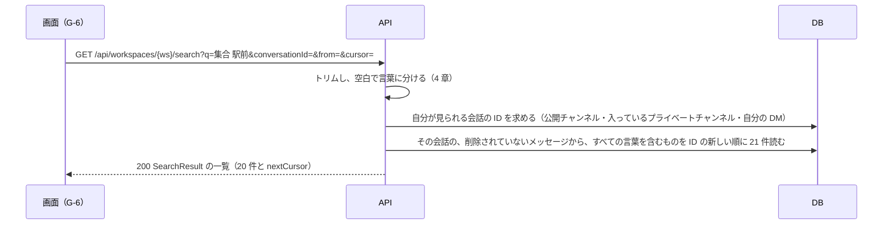

# 機能定義書 FN-13 メッセージ検索：チャットアプリ（RaiseChat）

| 項目 | 内容 |
| --- | --- |
| 文書番号 | RC-FD-13 |
| 版数 | 0.2 |
| 作成日 | 2026-11-10 |
| 最終更新日 | 2026-11-16 |
| 作成者 | （氏名） |
| 上位文書 | [機能定義書](function-definition.md)（RC-FD） |
| 状態 | 承認待ち |

## 改訂履歴

| 版数 | 日付 | 内容 | 作成者 |
| --- | --- | --- | --- |
| 0.1 | 2026-11-10 | 初版 | （氏名） |
| 0.2 | 2026-11-16 | 検索を作るとき（開発計画書 1-16）に決めたことを入れた。G-6 の本文は Markdown の飾りにせず書いたままの文字で出す（5 章の 5。行が押せるボタンのため）、「会話」と「送った人」の絞り込みの候補（SR-5）、SearchResult の会話の形（6 章）、1〜2 文字の言葉の性能を測った結果（5 章の 4） | （氏名） |

本書は機能定義書の一部である。承認は[機能定義書](function-definition.md)で一括して行う。API・リアルタイムの通知・メッセージの共通の決まりは機能定義書 3 章〜5 章のとおり。

---

## 1. 概要

| 項目 | 内容 |
| --- | --- |
| 目的 | 前のメッセージを文字で探し、そのメッセージの位置を開けるようにする |
| 使う画面 | G-5〜G-9・G-11 のヘッダーの検索欄、G-6 検索結果画面 |
| 関係する機能 | FN-07（結果からメッセージの位置を開く。MS-14）、FN-08（スレッドの返信も探す）、FN-06・FN-12（探すのは見られる会話だけ） |
| 前提 | 探すのは、いま開いているワークスペースの中で、自分が見られる会話のメッセージだけ（要件定義書 3.1、N-14）。検索の文字は 1〜100 文字（データ要件定義書 8 章） |

## 2. 機能要件

| ID | 内容 |
| --- | --- |
| SR-1 | ヘッダーの検索欄に文字を入れて Enter を押すと、G-6 を開いて、一致するメッセージを新しい順に 20 件出す。下までスクロールすると次の 20 件を読み込む |
| SR-2 | 探す範囲は、そのワークスペースの、公開チャンネル（参加していないものも含む）・自分が入っているプライベートチャンネル・自分の DM の、メッセージとスレッドの返信である。「削除されました」のメッセージは出さない |
| SR-3 | 英字の大文字・小文字を区別しない部分一致で探す。空白（半角・全角）で区切った言葉は、すべてを含むメッセージだけを出す（AND） |
| SR-4 | 結果の 1 行には、会話の名前（チャンネルは「#名前」、DM は相手の表示名）、送った人のアバター・表示名、日時、本文（3 行まで。一致した言葉を目立たせる）を出す。スレッドの返信には「スレッドの返信」の印を出す |
| SR-5 | G-6 の上で、「会話」（自分が見られる会話から 1 つ。チャンネルは G-8 と同じ一覧（公開チャンネルと自分が入っているプライベートチャンネル）、DM はサイドバーに出ているもの）と「送った人」（ワークスペースのメンバーから 1 人。名前を入れると候補を出す。ユーザー ID を入れて Enter キーでも絞り込め、抜けた人も探せる）で絞り込める。絞り込みを変えると、結果を読み直す |
| SR-6 | 結果を押すと、G-5 でそのメッセージの位置を開く（FN-07 MS-14）。スレッドの返信なら、スレッドのパネルも開く（FN-08 の 5 章の 6） |
| SR-7 | 検索欄が空のまま Enter を押したときは M-43 を出す。1 件もないときは M-44 を出す |
| SR-8 | 結果はリアルタイムでは変えない。検索の後に送られたメッセージは、もう一度検索すると出る |

## 3. 処理の流れ

## 4. 入力の確認

| 項目 | 型 | 必須 | 条件 | 守られないとき |
| --- | --- | --- | --- | --- |
| 検索の文字（q） | 文字列 | ○ | トリム後 1〜100 文字。空白で区切った言葉は 10 個まで（11 個目からは使わない） | 0 文字は M-43（API は 400 QUERY_REQUIRED）。101 文字目以降は入力できない（API は 400 BAD_REQUEST） |
| 会話（conversationId） | 数値 | | 自分が見られる、同じワークスペースの会話 | 見られなければ 404 CONVERSATION_NOT_FOUND |
| 送った人（from） | 文字列 | | ユーザー ID。いまのメンバーでなくてもよい（抜けた人のメッセージも探せる） | いない人なら結果は 0 件 |

## 5. 業務ルール

| No | ルール |
| --- | --- |
| 1 | 本文は Markdown 記法の記号を含んだままで探す（「**集合**」は「集合」で見つかる） |
| 2 | 「%」「_」など、データベースの検索で特別な意味を持つ文字は、ただの文字として探す |
| 3 | 見られる会話の求め方は、メッセージの一覧（FN-07）と同じ決まりを使い、検索だけ別の決まりにしない（見られないメッセージが混ざらないようにするため） |
| 4 | 1 万件以上のメッセージがあっても要件定義書 N-5（2 秒以内）を満たすよう、日本語の部分一致に使える索引を本文に付ける。索引の種類はデータ設計書・技術スタック定義書で決める。要件定義書 11.1 の件数で測った結果はデータ設計書 8.3 のとおり（いちばん遅い「見つからない 2 文字」でも約 0.4 秒） |
| 5 | 結果の本文は、Markdown 記法を飾りにせず書いたままの文字で 3 行まで出す（結果の行は押せるボタンで、本文の中にメンションのボタンやリンクを入れられないため。G-7 と同じ）。一致した言葉の目立たせ方は画面で行う |

## 6. API（案）

| メソッド | URL | 入力 | 出力（成功） | 主なエラー |
| --- | --- | --- | --- | --- |
| GET | /api/workspaces/{ws}/search?q=&conversationId=&from=&cursor= | 4 章 | 200 SearchResult の一覧（20 件ずつ） | 400 QUERY_REQUIRED、404 WORKSPACE_NOT_FOUND・CONVERSATION_NOT_FOUND |

SearchResult：`{"message": MessageView, "conversation": {"id","type","name","dmPartner"}}`（conversation は FN-14 のメンションの一覧と同じ形）。

リアルタイムの通知：なし（SR-8）。

## 7. 使うデータ

| テーブル | 操作 | 内容 |
| --- | --- | --- |
| messages | R | 本文を探す |
| conversations・conversation_members・workspace_members | R | 見られる会話を求める |
| users・attachments・reactions | R | 結果の MessageView |

## 8. 権限

| 操作 | ワークスペースのメンバー | メンバーでない人 |
| --- | --- | --- |
| 検索する | できる（見られる会話のメッセージだけ） | できない（404） |

## 9. エラーとメッセージ

| 場面 | HTTP | code | メッセージ |
| --- | --- | --- | --- |
| 検索の文字が空 | 400 | QUERY_REQUIRED | M-43 |
| 結果が 0 件 | 200 | — | M-44 |
| 見られない会話で絞り込んだ | 404 | CONVERSATION_NOT_FOUND | M-27 |
| 画面を通さずに送られた、条件に合わない入力 | 400 | BAD_REQUEST | 入力が正しくありません。 |
| 検索に失敗 | 500 | INTERNAL_ERROR | M-48 |

## 10. テストの観点

- TC-13-1：参加していない公開チャンネル・入っているプライベートチャンネル・自分の DM・スレッドの返信のメッセージが見つかる
- TC-13-2：入っていないプライベートチャンネル・ほかの人の DM・ほかのワークスペースのメッセージは、同じ言葉でも見つからない。API でそれらの会話を conversationId に指定すると 404
- TC-13-3：「Tokyo」で「tokyo」が見つかる。「集合 駅前」で両方を含むものだけ。「100%」の「%」がただの文字として探される
- TC-13-4：「削除されました」のメッセージ・削除したメッセージは出ない
- TC-13-5：会話・送った人で絞り込める。抜けた人のメッセージも送った人で絞り込める
- TC-13-6：結果を押すと、そのメッセージの位置が開いて目立つ。スレッドの返信ならパネルも開く
- TC-13-7：空で Enter は M-43、0 件は M-44。101 文字目は入力できない
- TC-13-8：21 件以上あると、下までスクロールで次の 20 件が出る
- TC-13-9：要件定義書 11.1 の件数で、最初の 20 件が 2 秒以内に出る（N-5）
