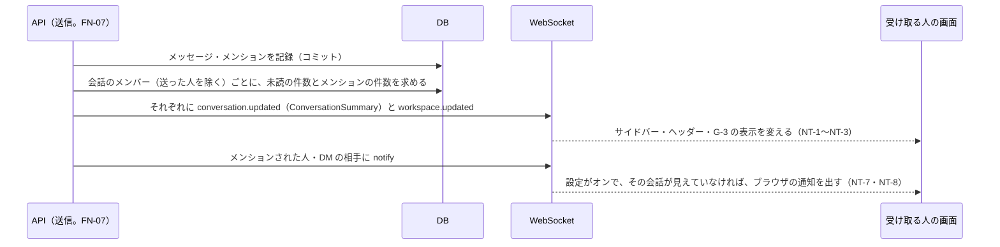
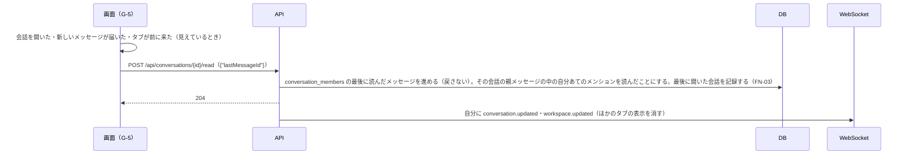

# 機能定義書 FN-14 通知：チャットアプリ（RaiseChat）

| 項目 | 内容 |
| --- | --- |
| 文書番号 | RC-FD-14 |
| 版数 | 0.1 |
| 作成日 | 2026-11-10 |
| 最終更新日 | 2026-11-10 |
| 作成者 | （氏名） |
| 上位文書 | [機能定義書](function-definition.md)（RC-FD） |
| 状態 | 承認待ち |

## 改訂履歴

| 版数 | 日付 | 内容 | 作成者 |
| --- | --- | --- | --- |
| 0.1 | 2026-11-10 | 初版 | （氏名） |

本書は機能定義書の一部である。承認は[機能定義書](function-definition.md)で一括して行う。API・リアルタイムの通知・メッセージの共通の決まりは機能定義書 3 章〜5 章のとおり。

---

## 1. 概要

| 項目 | 内容 |
| --- | --- |
| 目的 | 未読のメッセージと自分あてのメンションを知らせ、見落とさないようにする。メンションと DM は、ブラウザの通知でも知らせる |
| 使う画面 | G-3 ワークスペースの一覧画面、G-5 チャット画面（サイドバー・ヘッダーのメンション）、G-7 メンション一覧画面、G-10 プロフィールの設定画面（ブラウザの通知の設定） |
| 関係する機能 | FN-07・FN-08（メッセージが届くと未読になる）、FN-11 メンション、FN-12 DM、FN-03（最後に開いた会話を、既読と一緒に記録する） |
| 前提 | 未読は、会話のメンバーにだけ出す。スレッドの返信は未読に数えない（データ要件定義書 5.3）。ブラウザの通知は、アプリを開いている間だけで、設定は初めオフ・ブラウザごとに覚える（データ要件定義書 9 章）。iOS ではブラウザの通知を検収の対象にしない（要件定義書 R-12） |

## 2. 機能要件

| ID | 内容 |
| --- | --- |
| NT-1 | サイドバーで、未読がある会話の名前を太字にする。DM には未読の件数も出す（100 件以上は「99+」） |
| NT-2 | 読んでいないメンション（スレッドの返信の中のものを含む）がある会話には、その件数を丸の中の数字で出す。ヘッダーの「メンション」には、そのワークスペースの読んでいないメンションの合計を出す |
| NT-3 | G-3 のワークスペースの一覧で、未読がある会話を含むワークスペースを太字にし、読んでいないメンションの合計を出す |
| NT-4 | 会話を開いて、その画面が見えている（ブラウザのタブが前にある）ときは、その会話を最新のメッセージまで読んだことにし、太字・件数を消す。開いている間に届いたメッセージも、見えていればすぐ読んだことにする。親メッセージの中のメンションは会話を開いたときに、スレッドの返信の中のメンションはそのスレッドを開いたときに読んだことにする |
| NT-5 | ヘッダー（またはサイドバー）の「メンション」で G-7 を開く。そのワークスペースで自分あてのメンションを新しい順に 20 件ずつ、会話の名前・送った人・日時・本文とともに出し、読んでいないものには印を付ける。押すと G-5 でそのメッセージの位置を開き（FN-07 MS-14）、読んだことにする。1 件もないときは M-45 を出す |
| NT-6 | 未読・メンションの表示は、開き直さずにすぐ変える（要件定義書 N-4）。別のブラウザ・タブで読んだときも、すぐ消す |
| NT-7 | G-10 で「ブラウザの通知」をオンにすると、メンションされたときと DM が届いたときに、ブラウザの通知（OS の通知欄に出るもの）を出す。通知には、送った人の表示名・会話の名前（「#チャンネル名」か「DM」）・本文の初めの 50 文字を出す。本文がなく添付だけのときは「画像・動画を送りました」と出す |
| NT-8 | ブラウザの通知を出すのは、アプリをどこかのタブで開いているときだけ。その会話を開いていて画面が見えているときは出さない。通知を押すと、アプリのタブを前に出し、そのメッセージの位置を開く |
| NT-9 | G-10 で「ブラウザの通知」をオンにしたとき、ブラウザがまだ許可していなければ許可を求める。許可されなかったとき・前に拒否していたときは M-46 を出してオフのままにする。設定はブラウザごとに覚え、初めはオフ |
| NT-10 | 自分が送ったメッセージは、未読・メンション・ブラウザの通知のどれにも数えない |
| NT-11 | 見られなくなった会話（抜けたチャンネル・ワークスペース、削除されたもの）の未読・メンションは、どこにも数えず、G-7 にも出さない |

## 3. 処理の流れ

### 3.1 メッセージが届いたとき

### 3.2 読んだことにする

スレッドを開いたときは POST /api/messages/{親の ID}/thread-read で、そのスレッドの返信の中の自分あてのメンションを読んだことにする。

## 4. 入力の確認

| 項目 | 型 | 必須 | 条件 | 守られないとき |
| --- | --- | --- | --- | --- |
| 最後に読んだメッセージ（lastMessageId） | 数値 | ○ | その会話の親メッセージの ID | 400 BAD_REQUEST |

ブラウザの通知の設定はブラウザに覚えるだけで、API には送らない。

## 5. 業務ルール

| No | ルール |
| --- | --- |
| 1 | 未読の件数は、その会話の親メッセージのうち、ID が最後に読んだメッセージより大きく、自分以外が送ったものの数（100 以上は 100 として返し、画面は「99+」と出す） |
| 2 | メンションの件数は、自分あての読んでいないメンションのうち、いま見られる会話のものの数（NT-11）。会話を見られるかは FN-07 と同じ決まりで求める |
| 3 | 最後に読んだメッセージは進めるだけで、戻さない（古い位置を送られても変えない） |
| 4 | 公開チャンネルに参加していない人には未読を出さない。ただし、その人へのメンションは数える（FN-11 の 5 章の 2） |
| 5 | ブラウザの通知は、通知の tag にメッセージの ID を入れ、同じブラウザで複数のタブを開いていても 1 つだけ出す |
| 6 | ブラウザの通知の本文は、Markdown 記法の記号を取り除き、改行を空白にしてから、初めの 50 文字にする |
| 7 | DM の中のメンションは、メンションとして数え、ブラウザの通知は 1 つだけ出す（kind は DM） |
| 8 | つなぎ直したとき（機能定義書 4.4）は、サイドバーの API で件数を取り直す。届かなかった notify はブラウザの通知にしない（古い通知をまとめて出さないため） |

## 6. API（案）

| メソッド | URL | 入力 | 出力（成功） | 主なエラー |
| --- | --- | --- | --- | --- |
| POST | /api/conversations/{id}/read | `{"lastMessageId"}` | 204 | 400、404 CONVERSATION_NOT_FOUND |
| POST | /api/messages/{親の ID}/thread-read | なし | 204 | 404 MESSAGE_NOT_FOUND |
| GET | /api/workspaces/{ws}/mentions?cursor= | なし | 200 MentionItem の一覧（20 件ずつ） | 404 WORKSPACE_NOT_FOUND |

- MentionItem：`{"message": MessageView, "conversation": {"id","type","name","dmPartner"}, "read": false}`
- サイドバーの未読・メンションの件数は、FN-06 の GET /api/workspaces/{ws}/conversations の ConversationSummary に入れて返す。G-3 の印は FN-03 の GET /api/workspaces の WorkspaceSummary に入れて返す

リアルタイムの通知：

| 場面 | 通知 | 送る相手 |
| --- | --- | --- |
| メッセージ・返信が届いた（FN-07・FN-08） | conversation.updated・workspace.updated | 件数が変わった会話のメンバー |
| メンションされた・DM が届いた（FN-11・FN-12） | notify | メンションされた人・DM の相手 |
| 読んだことにした | conversation.updated・workspace.updated | 本人（ほかのタブのため） |
| メッセージの削除・編集で件数が減った（FN-07・FN-11） | conversation.updated・workspace.updated | 件数が変わった人 |

## 7. 使うデータ

| テーブル | 操作 | 内容 |
| --- | --- | --- |
| conversation_members | R U | 最後に読んだメッセージの読み書き |
| workspace_members | U | 最後に開いた会話の記録（FN-03） |
| mentions | R U | 件数、一覧、読んだことにする |
| messages | R | 未読の件数 |
| ブラウザ（localStorage） | R U | ブラウザの通知の設定 |

## 8. 権限

| 操作 | 本人 | ほかの人 |
| --- | --- | --- |
| 自分の未読・メンションを見る・読んだことにする | できる（見られる会話だけ） | できない |
| 自分のブラウザの通知の設定 | できる | — |

## 9. エラーとメッセージ

| 場面 | HTTP | code | メッセージ |
| --- | --- | --- | --- |
| メンションがない | 200 | — | M-45 |
| ブラウザが通知を許可していない | — | — | M-46。オフのまま |
| 見られない会話を読んだことにしようとした | 404 | CONVERSATION_NOT_FOUND | 出さない |
| 読んだことにするのに失敗 | 500 | INTERNAL_ERROR | 出さない（次に開いたときにもう一度送る） |
| メンションの一覧の読み込みに失敗 | 500 | INTERNAL_ERROR | M-48 |

## 10. テストの観点

- TC-14-1：別の人が送ると、サイドバーのその会話が 1 秒以内に太字になる。DM は件数が出る。100 件以上で「99+」
- TC-14-2：スレッドの返信は未読にならない。返信の中のメンションはメンションの件数に入る
- TC-14-3：会話を開くと太字・件数が消え、別のブラウザで開いていた自分の画面からもすぐ消える
- TC-14-4：タブを後ろにしている間に届いたメッセージは未読のまま。タブを前にすると読んだことになる
- TC-14-5：G-3 で、未読のあるワークスペースが太字になり、メンションの合計が出る
- TC-14-6：G-7 にメンションが新しい順に出て、読んでいないものに印が付く。押すとメッセージの位置が開き、印と件数が消える。0 件は M-45
- TC-14-7：プライベートチャンネルから抜けた後、そのチャンネルのメンションが G-7 にも件数にも出ない
- TC-14-8：ブラウザの通知をオンにすると許可を求められる。拒否すると M-46 でオフのまま
- TC-14-9：オンのとき、メンション・DM で OS の通知が出て、表示名・会話の名前・本文の初めの 50 文字（記号を除く）が出る。押すとそのメッセージが開く。その会話を開いて見ているときは出ない。タブを 2 つ開いていても通知は 1 つ
- TC-14-10：自分のメッセージでは未読・通知が出ない
- TC-14-11：オフのとき・アプリを閉じているときは通知が出ない。設定は別のブラウザでは初めのオフ
