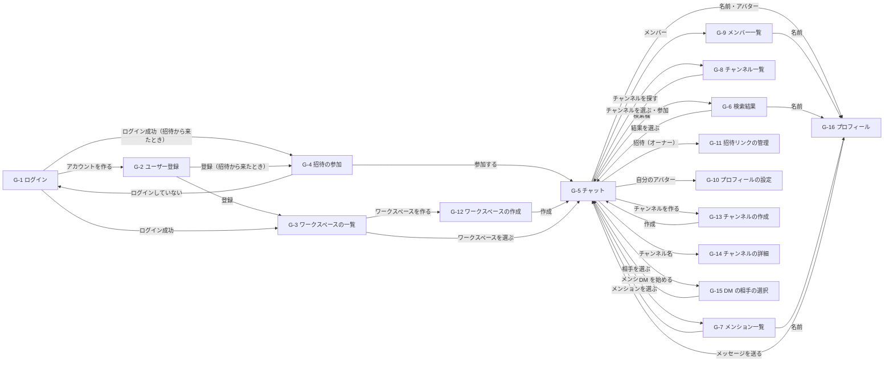

# 画面一覧：チャットアプリ（RaiseChat）

| 項目 | 内容 |
| --- | --- |
| 文書番号 | RC-REQ-SCR |
| 版数 | 0.1 |
| 作成日 | 2026-11-10 |
| 最終更新日 | 2026-11-10 |
| 作成者 | （氏名） |
| 上位文書 | [要件定義書](requirements.md)（RC-REQ） |
| 状態 | 承認待ち |

## 改訂履歴

| 版数 | 日付 | 内容 | 作成者 |
| --- | --- | --- | --- |
| 0.1 | 2026-11-10 | 初版 | （氏名） |

本書は要件定義書の一部である。承認は[要件定義書](requirements.md)で一括して行い、変更は要件定義書 16 章の手続きで行う。

本書では、どんな画面があり、どうつながるかを定める。画面ごとの細かい見た目・動き（大きさ、色、操作ごとの結果など）は画面設計書で定める。

---

## 1. 画面一覧

URL の {ws} はワークスペースの ID、{channel} はチャンネルの ID、{dm} は DM の ID、{message} はメッセージの ID である。

| 画面 ID | 画面名 | URL | 内容 | 主な機能 |
| --- | --- | --- | --- | --- |
| G-1 | ログイン画面 | /login | ユーザー ID とパスワードでログインする | FN-01 |
| G-2 | ユーザー登録画面 | /signup | アカウントを作る | FN-01 |
| G-3 | ワークスペースの一覧画面 | / | 自分が入っているワークスペースの一覧（未読・メンションの印つき）と「ワークスペースを作る」。選ぶと G-5 | FN-03、FN-14 |
| G-4 | 招待の参加画面 | /invite/{招待の文字列} | 招待されたワークスペースの名前と「参加する」。ログインしていなければ、G-1・G-2 に移り、ログイン・登録の後にこの画面に戻る。期限切れ・取り消し済みのときはその旨を出す | FN-04 |
| G-5 | チャット画面 | /w/{ws}/c/{channel}、/w/{ws}/d/{dm} | 左にサイドバー（ワークスペース名・チャンネルの一覧・DM の一覧・未読とメンションの印）、中央に会話のメッセージの一覧と入力欄、右にスレッドのパネル（開いたときだけ）。ヘッダーに検索欄 | FN-06〜FN-12、FN-14 |
| G-6 | 検索結果画面 | /w/{ws}/search?q={検索した文字} | 見つかったメッセージの一覧と、会話・送った人の絞り込み。選ぶと G-5 でそのメッセージの位置を開く | FN-13 |
| G-7 | メンション一覧画面 | /w/{ws}/mentions | 自分あてのメンションを新しい順に出す。選ぶと G-5 でそのメッセージの位置を開く | FN-14、FN-11 |
| G-8 | チャンネル一覧画面 | /w/{ws}/channels | ワークスペースの公開チャンネルと、自分が入っているプライベートチャンネルの一覧。名前で絞り込み、公開チャンネルに参加する | FN-06 |
| G-9 | メンバー一覧画面 | /w/{ws}/members | ワークスペースのメンバーの一覧（オーナーの印つき）。名前を押すと G-16。オーナーには各メンバーに「キック」を出す | FN-05 |
| G-10 | プロフィールの設定画面 | /settings/profile | アバター・表示名・ステータスを変える | FN-02 |
| G-11 | 招待リンクの管理画面 | /w/{ws}/invites | オーナーだけが開ける。招待リンクを作る・コピーする・期限を見る・取り消す | FN-04 |
| G-12 | ワークスペースの作成ダイアログ | （G-3 の上に重ねる） | ワークスペースの名前を入れて作る | FN-03 |
| G-13 | チャンネルの作成ダイアログ | （G-5・G-8 の上に重ねる） | チャンネルの名前・説明・公開かプライベートかを入れて作る | FN-06 |
| G-14 | チャンネルの詳細ダイアログ | （G-5 の上に重ねる） | チャンネルの名前・説明・メンバーの一覧。プライベートチャンネルではメンバーを招待する。退出する。オーナーには「チャンネルを削除」を出す | FN-06 |
| G-15 | DM の相手の選択ダイアログ | （G-5 の上に重ねる） | ワークスペースのメンバーを名前で探して選び、DM を開く。すでに DM があればそれを開く | FN-12 |
| G-16 | プロフィールのダイアログ | （G-5・G-6・G-7・G-9 の上に重ねる） | ユーザーのアバター・表示名・@ユーザー ID・ステータスと「メッセージを送る」（DM を開く） | FN-02、FN-12 |
| G-17 | 画像の拡大ダイアログ | （G-5・G-6・G-7 の上に重ねる） | 添付の画像を大きく出す。同じメッセージのほかの画像に左右で移る | FN-09 |
| G-18 | 確認ダイアログ | （G-5・G-9・G-11・G-14 の上に重ねる） | メッセージの削除、チャンネルの削除、キック、招待リンクの取り消しの前に確認する（スレッドの返信の削除を含む） | FN-04〜FN-08 |

G-3・G-10 にはアプリ名とログアウトだけの簡単なヘッダーを、G-5〜G-9・G-11 にはワークスペース用のヘッダー（ワークスペース名・検索欄・メンション・自分のアバター・ログアウト）を出す。自分のアバターを押すと、G-10 とワークスペースの一覧（G-3）に移れる。

## 2. 画面遷移



- 画像を押すと G-17 を重ねて出す。メッセージの削除・チャンネルの削除・キック・招待リンクの取り消しを押すと G-18 を重ねて出す
- ログイン済みの状態で G-1・G-2 の URL を開いた場合は、G-3 を表示する
- G-3 で入っているワークスペースが 1 つもないときは、「ワークスペースを作る」と、招待リンクをもらって参加する方法の案内を出す
- G-5 の URL に会話を指定せずに開いた場合（/w/{ws}）は、そのワークスペースで最後に開いた会話を、初めてなら general を出す
- 見られない会話の URL（入っていないプライベートチャンネル、削除されたチャンネル、ほかの人の DM）を開いた場合は、その旨を出して general を出す。入っていないワークスペースの URL を開いた場合は、その旨を出して G-3 を出す
- キックされた人がそのワークスペースの画面を開いていた場合は、その旨を出して G-3 に移す。開いていたチャンネルが削除された場合・チャンネルから外れた場合は、その旨を出して general に移す
- 横幅が狭い画面（スマートフォン）では、G-5 のサイドバー・メッセージの一覧・スレッドのパネルを 1 つずつ出し、戻るボタンで切り替える（要件定義書 N-29）

## 3. チャット画面（G-5）のイメージ

```
┌─────────────────────────────────────────────────────────────────────────────────┐
│ RaiseChat  ▸ 仲間うち      [🔍 メッセージを検索            ]   @ メンション 2  (た) ログアウト │
├────────────────────┬──────────────────────────────────┬─────────────────────────┤
│ 仲間うち         ▾ │ # general                    👥 12 │ スレッド  # general   ✕ │
│                    │ 全体への連絡はここに               │                         │
│ @ メンション     2 │──────────────────────────────────│ (は) はなこ  10:02       │
│ 🔍 チャンネルを探す │ ───────── 11月10日（月） ─────────│   土曜の集合は駅前で    │
│                    │ (は) はなこ  10:02                 │   いいですか？          │
│ チャンネル       ＋ │   土曜の集合は駅前でいいですか？   │ ─── 2 件の返信 ───      │
│  # general         │   [👍 3] [🎉 1] [＋]               │ (た) たろう  10:05      │
│  # 旅行の計画   5  │   💬 2 件の返信  最終 10:07        │   了解です！            │
│ *# 雑談*           │                                    │ (じ) じろう  10:07      │
│  🔒 運営       ②  │ (た) たろう  10:15                 │   @hana 少し遅れます    │
│                    │   写真です                         │                         │
│ ダイレクトメッセージ ＋│   ┌──────────┐ ┌──────────┐    │                         │
│ *(は) はなこ    1* │   │  画像 1  │ │ ▶ 動画   │    │                         │
│  (じ) じろう       │   └──────────┘ └──────────┘    │                         │
│                    │                                    │ ┌─────────────────────┐ │
│                    │ ┌────────────────────────────────┐ │ │ 返信する…           │ │
│                    │ │ # general へのメッセージ…      │ │ └─────────────────────┘ │
│                    │ │ 📎  B  I  S  </>      [送信]   │ │                         │
│                    │ └────────────────────────────────┘ │                         │
└────────────────────┴──────────────────────────────────┴─────────────────────────┘
```

| 部品 | 内容 |
| --- | --- |
| ヘッダー | 左にアプリ名とワークスペース名、中央にメッセージの検索欄（FN-13、G-6 に移る）、右にメンション（件数つき、G-7 に移る）・自分のアバター・ログアウト |
| サイドバー | ワークスペース名（押すとメンバー一覧 G-9、オーナーには招待リンクの管理 G-11 も出す）、「メンション」「チャンネルを探す」（G-8）、自分が入っているチャンネルの一覧（＋で G-13）、DM の一覧（＋で G-15）。🔒 はプライベートチャンネル |
| 未読・メンションの印 | 未読がある会話は太字（図では * で囲む）、メンションされた件数を丸の中の数字で出す（FN-14） |
| 会話の見出し | チャンネル名と説明、メンバーの人数。押すとチャンネルの詳細（G-14）。DM では相手の名前とステータス |
| メッセージ | 送った人のアバター・表示名・時刻、本文（Markdown 記法を飾りにする）、添付、リアクション、スレッドの返信の件数と最後の返信の時刻。日付が変わるところに区切りの線を出す。編集したメッセージは時刻の後ろに「（編集済み）」と出す。続けて同じ人が送ったときはアバターと名前を省く |
| メッセージの操作 | メッセージに重ねる（スマートフォンでは長押し）と、リアクションを付ける・スレッドで返信する・（自分のメッセージなら）編集・削除のボタンを出す |
| リアクション | 絵文字と件数。押すと自分のリアクションを付ける・外す。重ねると付けた人の表示名を出す。「＋」で絵文字を選ぶ（FN-10） |
| 添付 | 画像は縮小して並べ、押すと G-17。動画は再生ボタンつきで出し、画面の中で再生する（FN-09） |
| 入力欄 | 本文、📎（画像・動画を選ぶ。ドラッグ＆ドロップ・貼り付けでも添付できる）、Markdown の飾りのボタン、送信。「@」を入れるとメンションの候補を出す（FN-11）。Enter で送信、Shift＋Enter で改行（要件定義書 N-31） |
| スレッドのパネル | 親メッセージ、返信の一覧、返信の入力欄（FN-08）。「✕」で閉じる |
| 接続の状態 | WebSocket が切れている間は、メッセージの一覧の上に「接続が切れました。再接続しています…」と出す（要件定義書 N-9） |
